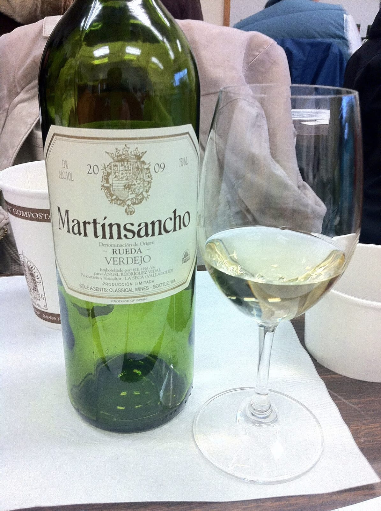
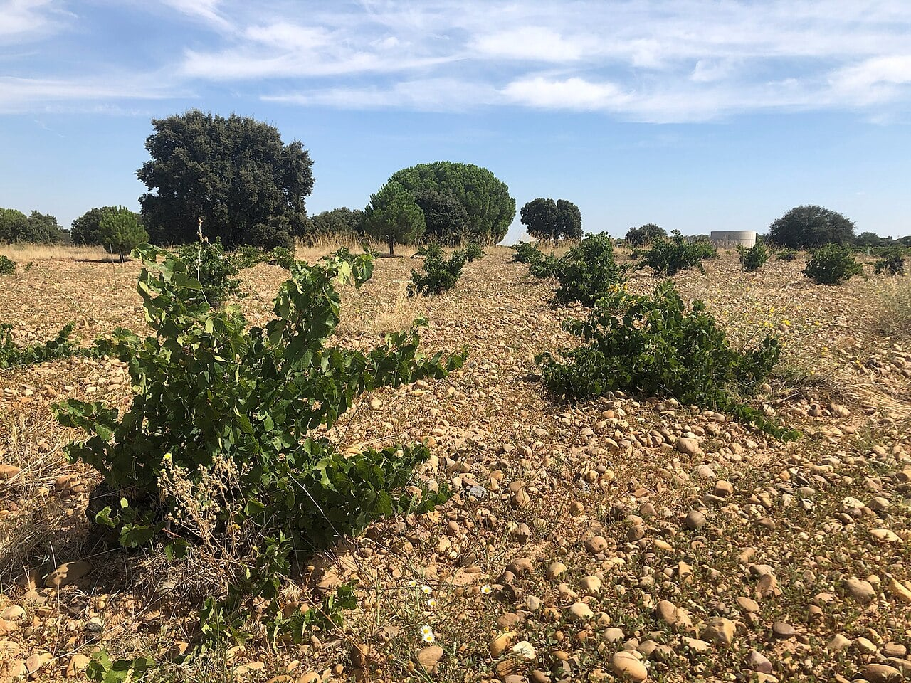

# 弗德乔

西班牙卢埃达产区的白葡萄，带茴香、柑橘、白花与草本香气，酸度清爽；常与长相思、维欧尼混酿，是西班牙现代白葡萄酒的核心品种。

弗德乔是西班牙卢埃达的白葡萄，带茴香、柑橘与草本香气，酸度清爽；常与长相思、维欧尼混酿。读它时，先看产区与是否酒泥陈年。

图：Verdejo：Rueda Verdejo（Wikimedia Commons）。图片：Agne27，CC BY-SA 3.0，via Wikimedia Commons（[原图页面](https://commons.wikimedia.org/wiki/File:Rueda_Verdejo.JPG)）。

## 定义与命名

弗德乔是西班牙[卢埃达](ref:rueda)的白葡萄，带茴香、柑橘、白花与草本香气，酸度清爽；常与长相思、维欧尼混酿，是西班牙现代白葡萄酒的核心品种。它的名字在西班牙语中写作 Verdejo，中文也译“弗德乔”。

Verdejo 的名称可能与“verde”（绿色）有关，指果实或酒的颜色；它不是“Verdejo”与“弗德乔”两个品种。与葡萄牙的 Verdelho 名字相近，但两者不同：Verdelho 在马德拉与杜罗，Verdejo 在卢埃达。

在卢埃达，Verdejo 常与 Viura、Sauvignon Blanc、Viognier 混酿；法规允许不同比例，酒标写“Verdejo”通常表示主导品种。读标签时，Rueda 与 Verdejo 要分开看。

卢埃达的夜采与低温发酵是保留茴香的关键：白天温度高，夜间采收可以保住酸度；不锈钢罐控温发酵避免香气损失。部分酒庄用酒泥搅拌增加质地，但会削弱茴香的锐度，风格取舍很清楚。

## 起源与传播

弗德乔原产西班牙中部，可能与北非或地中海品种有关；在卢埃达，它至少从 18 世纪起种植，20 世纪中期，当地酒农用它酿日常白葡萄酒。

1970–80 年代，卢埃达的白葡萄酒因清爽酸度与茴香香气受到注意；Marqués de Riscal、Palacio de Bornos 等酒庄推动 Verdejo 现代化，把它从本地酒变成西班牙白葡萄酒的代表。

传播到西班牙其他产区与少量新世界种植，但卢埃达仍是核心；在澳大利亚与美国有实验性版本，风格更熟、更少茴香。

卢埃达在 20 世纪中期以白葡萄酒合作社为主，Verdejo 常与 Viura 混酿；1970 年代以后，冷发酵与不锈钢罐让它的茴香与柑橘更清晰，酒庄开始单独装瓶。

## 植物学与栽培

果粒中等、皮薄，早中熟，酸度高；成熟时带青苹果、柑橘、茴香、白花与草本。皮薄让它易感灰霉，需要通风与早采；在卢埃达，大陆性气候与昼夜温差让酸度得以保留。

弗德乔树势中等，产量较高；高产会让香气淡、酒体水。酒农通过控产、夜间采收与低温发酵保留茴香与柑橘；部分酒款用酒泥搅拌增加质地。

采收通常在 9 月，早采保留高酸与草本，晚采糖分更高、更适合混酿或陈年。

弗德乔的皮薄、早中熟，容易感灰霉；卢埃达的大陆性气候与昼夜温差让酸度保留。夜间采收与低温发酵是保留茴香的关键，酒泥搅拌则增加质地。

## 风格与味觉

弗德乔呈浅黄，香气带青苹果、柠檬、葡萄柚、茴香、白花与青草；入口酸度高、酒体轻到中等，收口清爽，常带轻微苦韵。与[长相思](ref:sauvignon)比，它更少青椒、更多茴香；与[维欧尼](ref:viognier)比，它更轻、更酸。

酒泥陈年版本带奶油、坚果与更圆的酒体；橡木桶版本更饱满，但会遮盖茴香。混酿中，Verdejo 提供酸度与草本，Viura 给花香，Sauvignon 给青草，Viognier 给酒体。

判断典型性，先看茴香与酸度：如果只有青草与柑橘，可能是长相思或混酿；如果酒体很圆、香气很熟，可能经过橡木或晚采。

弗德乔的茴香与青草来自品种，不是添加；高酸让它在温暖产区也能保持清爽。与长相思比，它更少青椒、更多茴香；与维欧尼比，它更轻、更酸。

弗德乔的苦韵来自果皮与种子，适量时增加层次，过量则显得粗糙；酒泥搅拌与早采可以平衡苦味。老藤版本香气更浓、酸度更稳，年轻藤版本更轻、更简单。

## 主要产区与代表酒款

卢埃达是核心，Rueda Verdejo 与 Rueda 混酿都常见；Castilla y León 的其他产区也有种植。代表生产者包括 Marqués de Riscal、Palacio de Bornos 与 Ossian，前者更偏商业清爽，后两者更强调老藤与酒泥质地。

卢埃达的 Rueda Verdejo 通常以弗德乔为主，Rueda 混酿可能加入 Viura、Sauvignon 或 Viognier；Ossian 的老藤版本更饱满，Palacio de Bornos 的更清爽。

卢埃达的土壤以石灰岩、砂土与黏土为主，排水好、酸度稳；海拔较高的地块成熟更晚，茴香与柑橘更清晰。Castilla y León 的其他产区也有种植，但风格更暖、更熟。

## 怎么喝与配餐

温度 8–10°C，用中等口径白酒杯；不要过度冰镇，低温会压住茴香。配餐适合海鲜、沙拉、蔬菜、鸡肉与轻奶酪；茴香香气与茴香菜、番茄、橄榄油很搭。

开瓶后冷藏，2–3 天；酒泥陈年版本可放 3–4 天。它不适合长期陈年，最好在 1–3 年内喝。

弗德乔配海鲜、沙拉、蔬菜、鸡肉与轻奶酪；茴香香气与茴香菜、番茄、橄榄油很搭。温度 8–10°C，不要过度冰镇；开瓶后冷藏 2–3 天。

弗德乔的茴香与柑橘适合配海鲜、沙拉、蔬菜与鸡肉；酒泥版本可以配奶油酱汁与轻奶酪。不要配重辣菜，高酸会与辣味冲突。

## 选购与常见误区

先看产区与品种：Rueda Verdejo 表示以弗德乔为主，Rueda 可能是混酿；再看是否酒泥陈年或橡木桶，风格差别大。价格高可能来自老藤或酒泥，不代表更香。

常见误读：把 Verdejo 与 Verdelho 混为一谈；以为卢埃达只有一种白葡萄；以为茴香香气来自添加。茴香是品种与成熟度的结果。

Verdejo 与 Verdelho 不是同一品种：前者在卢埃达，后者在马德拉与杜罗。买之前看产区与品种名，不要只看“ verde ”的词根。

买弗德乔时，先分 Rueda Verdejo 与 Rueda 混酿：前者品种更纯、茴香更清楚，后者更圆、更复杂；再看年份，弗德乔不适合长期存放，越新越清爽。

## 参见

- [卢埃达](ref:rueda)：弗德乔的核心产区。
- [长相思](ref:sauvignon)：常与弗德乔混酿。
- [维欧尼](ref:viognier)：增加酒体的混酿品种。
- [白葡萄酒](ref:white)：白葡萄的发酵与风格。
- [风土（terroir）](ref:terroir)：大陆性气候与昼夜温差。

**关键事实。**

| 项目 | 内容 |
| --- | --- |
| 一句话定位 | 西班牙卢埃达产区的白葡萄，带茴香、柑橘、白花与草本香气，酸度清爽；常与长相思、维欧尼混酿，是西班牙现代白葡萄酒的核心品种 |
| 物种 | Vitis vinifera |
| 代表产区 | 卢埃达 |

**来源与边界。** 本页关于「弗德乔」的关键事实，主要由以下来源交叉核对：Julius Kühn-Institut（品种名称、同义词、起源与全球分布）、OIV（葡萄品种与栽培框架）、USDA ARS（植物分类、种质与栽培信息）等 4 条来源。价格、批次与状态会变，涉及这些字段时以页面所列来源的最新版本为准。正文为项目自写，来源只作核验，不复制原文。

## 相关图像

图：卢埃达马丁桑乔（Martinsancho）葡萄园，石砾地上的老藤。图片：Carlosmartinmm34，CC BY-SA 4.0，via Wikimedia Commons（[原图页面](https://commons.wikimedia.org/wiki/File:Martinsancho_Vineyard.jpg)）。关联图像：弗德乔。
