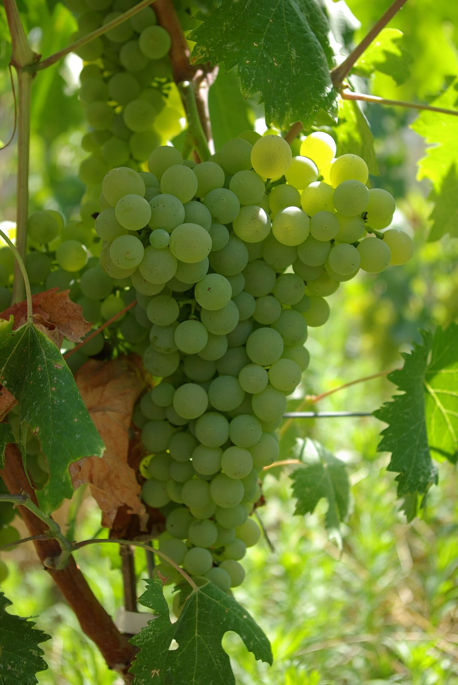

# 维蒙蒂诺

地中海沿岸的白葡萄，在撒丁岛、利古里亚、托斯卡纳与法国普罗旺斯（称 Rolle）种植；带柑橘、白花、海盐与草药，酸度中高，适合海鲜。

图：Vermentino：Rolle (Vermentino)（Wikimedia Commons）。图片：Magnetto，CC BY-SA 3.0，via Wikimedia Commons（[原图页面](https://commons.wikimedia.org/wiki/File:Rolle_(Vermentino).jpg)）。

## 定义与命名

维蒙蒂诺（Vermentino）属于 Vitis vinifera 浅色果皮品种，在不同海岸地区有一串彼此纠缠的名字：法国普罗旺斯与朗格多克一带称 Rolle，科西嘉叫 Vermentinu，意大利利古里亚的 Pigato 与皮埃蒙特的 Favorita 经 DNA 分型确认与它为同一品种；至于法国东部尼斯附近的 Rollo 是否等同，目前研究尚未定论。旧资料里还能见到 Agostenga、Brustiano、Carbes、Malvoisie de Corse 等一串同义词，酒标读到这些名字时，需要回到品种登记与产地法规对照，而不能只按音译判断。

在品种索引里，维蒙蒂诺既是一个酒标上常见的名称，也是一组可以横向比较的栽培与酿造选择。判断一款酒属于哪个层级，要看它写的是品种名、产区名还是混酿名：Vermentino di Gallura 是法定产区，Pigato 是利古里亚的地方品种名，Rolle 是法语区称呼，三者指向同一葡萄，但法规允许的混酿比例、最低酒精度与允许地块并不相同。

## 起源与传播

关于它的摇篮，长期存在三种假说：经贸易路线从西班牙传入、起源于意大利西北部，或更早经希腊来自地中海东部。VIVC 品种目录将原产地记为意大利；近年的 DNA 研究也更偏向意大利北部至利古里亚方向。文献线索可以追溯到 14 世纪：利古里亚文本中曾以 Arratelau 之名记载这种葡萄，早于后来跨海的贸易往来。基因与文献目前只能给出方向，亲本关系与具体传播路线仍有空白，同名异品、异名同品的情况在地中海沿岸并不少见。

它沿西地中海的贸易与移民路线扩散：撒丁岛北部 Gallura 半岛、利古里亚沿海梯田、托斯卡纳海岸、科西嘉与普罗旺斯构成今天的主要版图。全球种植面积超过 11,500 公顷，其中意大利约 5,000 公顷、法国约 3,500 公顷。在普罗旺斯，Rolle 已占普罗旺斯丘白葡萄用量的一半以上，逐步取代了过去常用的白玉霓类品种。

## 植物学与栽培

叶片深绿、五裂，果穗呈锥形，成熟果粒带琥珀黄色；果粒中等、果皮偏薄，属于中晚熟品种。植株耐旱，偏好向阳坡地与反射强烈的海岸环境，花岗岩与石灰岩排水快的土壤能限制产量、浓缩风味。海风同时带来降温与病害压力：花期与成熟期的强风会加厚果皮，也可能造成落果与串型松散。

栽培上真正影响风格的是产量控制与叶果平衡。留叶不足，糖分与成熟度跟不上；叶幕过厚，遮阴会压低酸度与香气纯度。沿海梯田多采用居由式修剪与篱架引缚，疏叶、疏果与采收日期都围绕保留酸度这一目标安排。维蒙蒂诺不像一些芳香品种那样依赖浓郁果香，它的清晰度很大程度来自低产、排水与海风带来的水分胁迫。

## 风格与味觉

典型维蒙蒂诺呈浅麦秆黄、带青绿色调；香气以白色花、柠檬、葡萄柚、桃皮与晒干草药为主，鼻端常带一抹燧石与海盐感。入口酸度明快、略带苦杏仁尾韵，矿物质感随产区不同而强弱有别。大多数酒在不锈钢罐发酵，以保留清新与盐感；Gallura 与托斯卡纳博尔盖里的部分酒庄会用酒泥搅拌、短时间橡木或果皮接触，做出更宽的质地与更饱满的果香。

它的风格跨度比酒标印象更大：年轻干白主打柑橘与草本，适合早饮；少数晚收酒浓缩菠萝、蜂蜜与梨干，可以放数年。同一块地的葡萄，低温浸渍带来花香与颜色，较暖发酵则更多果香与质地；品种提供骨架，发酵温度、桶陈与酒泥接触是把酒推向不同方向的工艺变量。与 [chardonnay](ref:chardonnay) 这类国际品种相比，维蒙蒂诺通常更少依赖橡木甜感，骨架更偏酸与矿物。

## 主要产区与代表酒款

撒丁岛东北部的 Gallura 是它最受认可的产区：Vermentino di Gallura 在 1975 年获得 DOC 资格，1996 年 9 月升格为 DOCG，也是撒丁岛唯一的 DOCG。法规要求酒中至少 95% 为维蒙蒂诺，普通款最低酒精度 12%，Superiore 款要求达到 13%。产区表层为花岗岩砂质土，葡萄园最高海拔约 500 米，密斯托拉风调节昼夜温度。全岛范围还有 Vermentino di Sardegna DOC（1988 年设立，维蒙蒂诺比例至少 85%）与 Isola dei Nuraghi IGT 等层级。

代表生产者集中在 Arzachena、Olbia 一带：Capichera 由 Ragnedda 家族的 Fabrizio 与 Mario 经营，1981 年第一款贴 Capichera 标的维蒙蒂诺上市，旗舰 Vign'angena 与晚收款是 Gallura 风格的参照；Argiolas 位于 Serdiana，Pala、Piero Mancini、Vigne Surrau 也在产区内占有位置。利古里亚的 Colli di Luni 以 Pigato 为名，五渔村一带它与 Bosco、Albarola 混种，并参与酿造 Sciacchetrà 风干甜酒；托斯卡纳博尔盖里的 Poggio al Tesoro Solosole 是较丰满的沿海风格。科西嘉 Patrimonio AOC（1968 年设立）只允许维蒙蒂诺作为白葡萄品种。

## 怎么喝与配餐

清淡型维蒙蒂诺适合 8–10°C 饮用，经过酒泥或橡木、酒体更宽的款可以放到 10–12°C；温度过低会关闭白花与矿物香，过高则放大酒精与苦感。杯型用中等肚径的通用杯即可，不必追求窄口专用杯。开瓶后先倒一小杯放置十分钟左右，再判断香气展开程度。

配餐围绕海鲜与轻乳类：烤或煎的海鱼、贝类、虾蟹、香草沙拉、山羊奶酪都能与它的酸度和盐感接上。海岸菜式里的柠檬、迷迭香、刺山柑与酒中的草药气息呼应；浓重奶油酱或红肉会压住它的清晰度，不是理想搭配。作为开胃酒或搭配餐前小食，它的高酸也能起到清口作用。

## 选购与常见误区

买酒时先分清法规层级：Gallura DOCG 的地块与比例要求最严，Vermentino di Sardegna DOC 覆盖全岛，IGT 与地区餐酒的来源更杂。酒标上出现 Pigato、Favorita、Rolle 不等于另一个品种，但对应产区的法规与典型风格有差别；读到同义词时，先确认产地再下风味判断。

常见误读是把维蒙蒂诺当成单一固定风味标签。温暖低地的果实更成熟、酒精感更重，高海拔与海岸地块酸度更紧、草本与矿物更明显；酒庄是否做酒泥、是否用桶，也会改变质地。选购时看生产者、地块层级与年份比只看品种名更有效；陈年潜力不必高估，多数干白适合上市后两三年内饮用，少数晚收与老藤款可以放更久。

## 延伸阅读与另见

理解这个品种最直接的方式，是在同一年份里比较 Gallura 干白、利古里亚 Pigato 与普罗旺斯 Rolle 混酿，记录三者在酸度、苦感与矿物上的差别。它与 [white-wine](ref:white) 一类的酿造方式、[terroir](ref:terroir) 层面的海岸风土、[fermentation](ref:fermentation) 工艺以及 [oak-ageing](ref:oak) 选择都相互关联。

- 相关条目：[white-wine](ref:white)、[terroir](ref:terroir)、[fermentation](ref:fermentation)、[chardonnay](ref:chardonnay)、[oak-ageing](ref:oak)。

## 相关图像

图：风土（terroir）。图片：Friedrich Petersdorff，CC BY-SA 2.0 de，via Wikimedia Commons（[原图页面](https://commons.wikimedia.org/wiki/File:080110_zell_mosel.JPG)）。关联图像：维蒙蒂诺。
