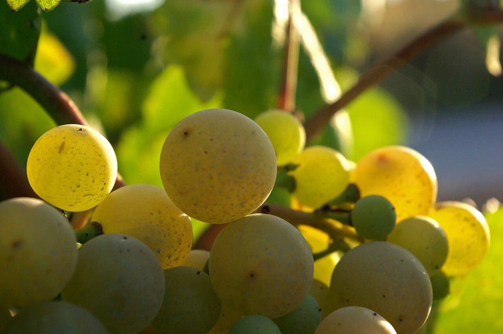
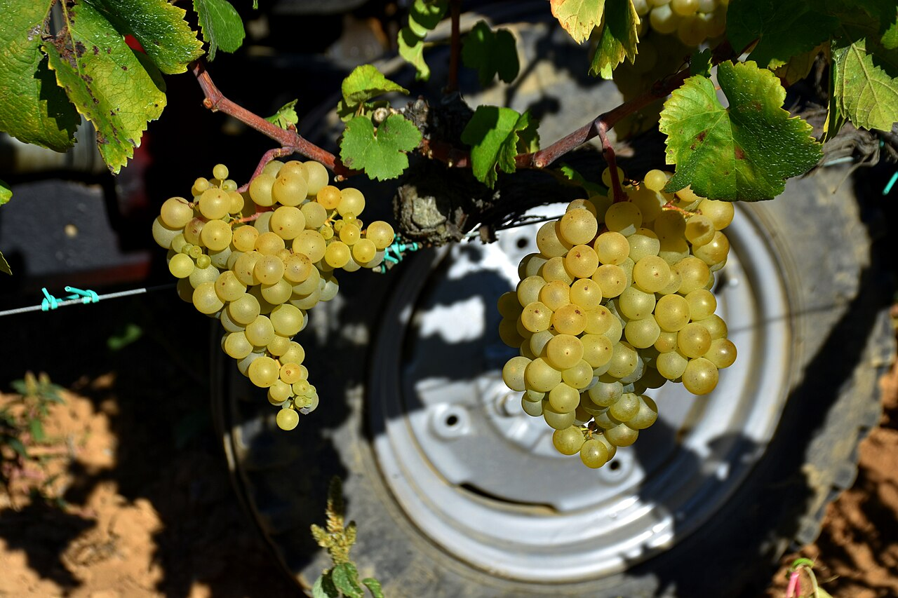

# 沙雷洛

沙雷洛是西班牙加泰罗尼亚佩内德斯的本土白葡萄，也是卡瓦起泡酒经典三元组合之一；酸度高、骨架清晰，带青苹果、柑橘、白花、茴香与矿物咸鲜，既能支撑长龄卡瓦，也越来越多地酿成有结构的静止白葡萄酒。

图：Xarel·lo：Xarel lo Cava grapes（Wikimedia Commons）。图片：batega，CC BY 2.0，via Wikimedia Commons（[原图页面](https://commons.wikimedia.org/wiki/File:Xarel_lo_Cava_grapes.jpg)）。

## 定义与命名

加泰罗尼亚语写法带间隔号 Xarel·lo，其他语言常写作 Xarel-lo 或 Xarello；地方别名包括 Alella 一带的 Pansa Blanca、佩内德斯的 Cartoixà，以及马略卡的 Premsal Blanc（Moll）等。名称词源被认为来自意大利语 chiarello，意为“淡红葡萄酒”，可能指果皮偶尔带的粉红调，而不是酒的颜色。

它与马卡贝奥（Macabeo/Viura）常被混酿、有时被混淆；DNA 谱显示二者可能有亲缘关系，但并不是同一品种。作为 Vitis vinifera 白葡萄，沙雷洛果串紧凑、果粒中等、皮偏厚，萌芽与成熟期中等，商业种植以选定克隆为主，酒标一般不标注克隆与砧木（[macabeo](ref:macabeo)）。

## 起源与传播

沙雷洛最可能的起源地是佩内德斯，1785 年在 Sitges 的文献中首次以这一名称被记载，是加泰罗尼亚认定的本土品种。它几乎只在加泰罗尼亚集中种植：西班牙境内约 99% 的沙雷洛位于加泰罗尼亚，授权种植区覆盖佩内德斯、Alella、Conca de Barberà、Costers del Segre、Tarragona 以及马略卡的 Binissalem 一带。

在漫长的本地种植史中，它一直是佩内德斯静止白与卡瓦基酒的基础品种；20 世纪卡瓦工业化阶段，它主要作为调配成分提供骨架。1998 年，Segura Viudas 推出 Creu de Lavit 单一品种沙雷洛，较早把这一品种从调配原料推向单品酒方向；此后佩内德斯一批酒庄开始做橡木发酵、酒泥陈酿的静止沙雷洛，它才从“卡瓦的骨架”变成独立的白葡萄酒风格。

海外只有零星试验性种植，法国、美国与澳大利亚的少量地块尚未形成规模；品种的主要风格与声誉仍然绑定在加泰罗尼亚本土地块上。

## 植物学与栽培

果串中等紧凑，果粒中等、皮厚，多酚与抗氧化物质含量较高，果汁糖酸平衡、潜在酒精度不低。萌芽与成熟期中等，适应多数土壤，在石灰质、排水良好的地块表现最好，同时相对耐旱，能承受地中海夏季的干燥。

栽培上的弱点集中在坐果与病害：容易出现 coulure（坐果不良），对白粉病和霜霉病都较敏感，潮湿的花期与叶幕过密会加重落果与真菌压力。光照过强时果皮酚类物质偏重，可能带来苦涩感，因此叶幕管理要在防晒、通风与保留成熟光照之间平衡；疏果控制产量后，果粒的风味浓缩度与陈年能力才出得来。

## 风格与味觉

典型沙雷洛呈浅禾秆黄，香气以青苹果、梨、葡萄柚、柠檬、白花、茴香、杏仁与矿物咸鲜为主；口感干型、中等酒体，酸度明亮、骨架清晰，口感圆润而有咀嚼感。它不是清香型轻白葡萄，结构与余味长度是识别要点，低产地块的酒可以陈年数年。

用于卡瓦时，沙雷洛为基酒补充酒体、结构与新鲜感，并延长起泡酒的寿命；长龄卡瓦的调配比例里，它负责平衡马卡贝奥的果香与帕雷亚达的清新（[parellada](ref:parellada)）。瓶内二次发酵与长时间带泥陈酿后，香气转向烤面包、杏仁、蜂蜜与坚果，质地更绵密（[sparkling-wine](ref:sparkling)）。

静止酒方向，不锈钢罐低温发酵保留青果与花香；橡木桶发酵或酒泥接触（含搅拌酒泥）增加圆润度、坚果与黄油气息。部分低产老藤地块做桶陈白葡萄酒，陈年中逐渐出现蜜饯、干草与香料；判断潜力看酸度是否完整、酚类是否成熟，而不是颜色深浅（[white-wine](ref:white)）。

## 主要产区与代表酒款

佩内德斯是核心产区，Sant Sadurní d'Anoia 一带是卡瓦的摇篮；Alella、Conca de Barberà 与 Costers del Segre 也有本土种植。按卡瓦监管机构的统计，沙雷洛在卡瓦产区约有 9,825 公顷，高于帕雷亚达的 7,385 公顷，是卡瓦体系内种植第二多的白葡萄。

代表生产者包括：Recaredo 以超长带泥陈酿的长龄卡瓦著称，沙雷洛在其调配中占重要比例；Gramona、Raventós i Blanc、Juvé & Camps 与 Sumarroca 是佩内德斯起泡酒的长期参照；Segura Viudas 自 1998 年起做单品沙雷洛；静止酒方向，J. Fortuny Fàbregas 的 Blanc de Mayte 来自 1954 年栽种、海拔 216 米的单一园，产量低于每公顷 4,500 公斤，经至少 8 个月酒泥陈酿；Vallformosa 等酒庄也有单品静止沙雷洛面世。

市场定位上，沙雷洛单品酒价格带从入门餐酒到高海拔老藤单一园都有；同一名下，卡瓦基酒与精品静止白在浓度、桶味与陈年潜力上差距明显，生产者与地块比品种名更能预测杯中风格。

## 怎么喝与配餐

起泡沙雷洛按传统法起泡酒侍酒，约 8–10°C；静止白可略高一度到十度出头，温度过高会让酸度显得单薄、酒精浮上来。杯型用中等杯口白葡萄酒杯即可，年轻酒不需要醒酒；长龄卡瓦可以提前片刻开瓶，让烤面包与坚果气息展开。

配餐围绕海鲜、白肉与地中海菜式：烤鳕鱼、鳟鱼、虾贝、烤鱼、海鲜饭、绿叶沙拉与柠檬油醋汁都能接上它的高酸与矿物感；伊比利亚火腿、软质与半硬质奶酪也搭配得当。单宁不重，不必配浓重红肉，酱汁过甜或过肥腻会压住它的咸鲜骨架。

## 选购与常见误区

误区一：把沙雷洛等同于卡瓦原料。它在卡瓦调配中承担骨架，但精品静止沙雷洛是另一类酒，桶陈与酒泥带来的复杂度不在起泡酒表达里；看酒标时先分清是起泡还是静止。误区二：把它与马卡贝奥混为一谈。二者常搭档、可能有亲缘，但沙雷洛皮更厚、酚类更重、骨架更强，马卡贝奥则以果香与柔和口感见长。

误区三：认为高酸白葡萄不能陈年。低产、成熟酚类与完整酸度的沙雷洛恰恰有多年瓶陈潜力；判断时看地块产量与酿造方式，而不是品种的普遍印象。选购留意年份与装瓶时间，经过长期库存或受热的酒会失去青果花香，矿物咸鲜也会变得发闷。

## 延伸阅读与另见

对照练习：把一款佩内德斯长龄卡瓦与一款同产区静止单品沙雷洛同场比较，记录香气从烤面包坚果转向青果茴香的差别；再对比不锈钢发酵与桶陈酒款，看清酒泥与橡木在这条品种线上的作用。

沙雷洛的面积、克隆与亲本研究仍随品种调查更新，正式引用以卡瓦监管机构资料、VIVC 登记与加泰罗尼亚官方品种目录为准。

- 相关条目：[macabeo](ref:macabeo)、[parellada](ref:parellada)、[sparkling-wine](ref:sparkling)、[white-wine](ref:white)、[fermentation](ref:fermentation)。

## 相关图像

图：Parellada：Temps de verema Parellada la més tardana. - Flickr - Angela Llop（Wikimedia Commons）。图片：Angela Llop from Spain，CC BY-SA 2.0，via Wikimedia Commons（[原图页面](https://commons.wikimedia.org/wiki/File:Temps_de_verema_Parellada_la_m%C3%A9s_tardana._-_Flickr_-_Angela_Llop.jpg)）。关联图像：沙雷洛。
