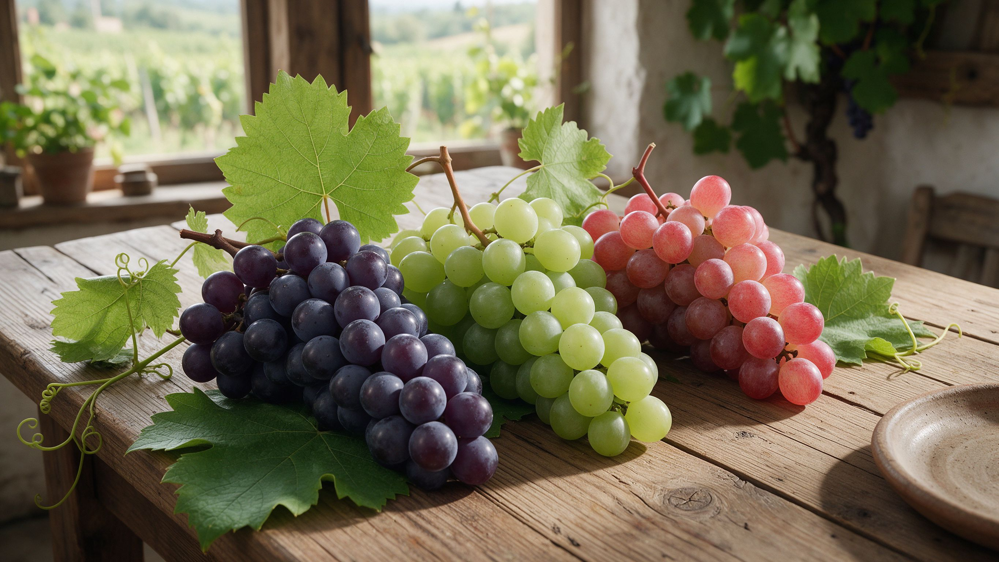

# 希诺马罗

希诺马罗（Xinomavro，亦拼 Xynomavro）是希腊北部马其顿地区最有分量的红葡萄品种，名称由希腊语 xino（酸）与 mavro（黑）组合而成，意为“酸黑”。它高酸、高单宁、酚类丰富，年轻时紧闭涩口，需要数年瓶陈才展开红色果、番茄、橄榄与干草本的层次，优质酒可陈放十年到三十年，常被拿来与皮埃蒙特的内比奥罗相比较（ref:nebbiolo）。

读这个品种要先分清两条风土线：一是 Naoussa 丘陵与山麓的结构化红酒，力量集中、单宁硬朗；二是 Amyndeon 高海拔高原上更冷凉、更清爽的表达，并向外延伸到起泡酒、桃红与 blanc de noir。同名品种在不同 PDO 的法规、混酿与成熟节奏差别很大，酒标名称只是入口。

图："希诺马罗"栏目示意图。项目自产编辑插图，用于葡萄品种语境，不是对象实拍。

## 定义与命名

希诺马罗学名为 Vitis vinifera，是希腊本土红品种。希腊语原名 Ξινόμαυρο，英语常见拼法 Xinomavro 与 Xynomavro。历史俗名包括 Mavro Naoussis、Niaoustiano、Mavro Goumenissas、Mavro Xino、Popolka、Xinomavro Kozanis，当地曾把 Naoussa 的黑葡萄叫作 Popolka；这些名字指向的都是同一品种，部分俗称也被邻近地区借用。

最容易混淆的是伯罗奔尼撒 Nemea 的 Agiorgitiko：那是柔软、果香开放的红品种，与希诺马罗的高酸、紧单宁与长陈年方向完全不同。希诺马罗果粒中等、近球形，果皮薄到中等、墨蓝青色，发芽与成熟偏晚，需要向阳坡地与足够积温；酒液颜色中等偏浅，却不代表酒体轻。按产区法规，Naoussa 与 Amyndeon 的 PDO 酒款须用 100% 希诺马罗，Goumenissa、Rapsani 等产区则与其他品种混酿，酒标上的 PDO 名称可用来核对品种比例。

## 起源与传播

希诺马罗原生并主要栽培于希腊北部马其顿的山地区域，向南延伸到中部希腊与色萨利边缘；在邻国北马其顿有少量种植。考古资料把马其顿的酿酒历史追溯到数千年前，但品种本身的亲本组合尚无确定性的基因结论。它在 Naoussa、Amyndeon、Goumenissa 一带的传统山地葡萄园中长期留存，根瘤蚜时期前后都有老藤片段保存至今。

面积方面，2010 年全球栽培面积为 1,971 公顷，全部在希腊境内；到 2013 年增长到 2,239 公顷，中国甘肃等地出现了最初的试种地块。除希腊本土外，海外商业种植规模很小，市场上的主力酒款仍来自马其顿的几个 PDO 与 PGI 产区。

## 植物学与栽培

植株长势旺、产量偏高，适合短梢修剪；果粒中等、近球形，果皮薄到中等、呈墨蓝青色，果肉软、果汁无色。它对霜霉病、白粉病较敏感，潮湿年份还需防范灰霉；大风天气下果梗容易折断，因此园地选择要兼顾通风与避风。品种偏好钙质土壤，对钾素需求友好，发芽与成熟节奏偏晚，需要向阳坡地与足够积温完成成熟。

栽培上的核心仍是叶果平衡与控产：叶片过密造成遮阴会降低酸度、加重病害，产量过高则香气稀薄、单宁松散。Naoussa 法定产区规定用于产区酒的产量不得超过每公顷 10,000 公斤；山地坡地、老藤与低产是获得集中结构的前提。不同地块的海拔、土壤与朝向会明显改变酸度亮度、单宁粗细与成熟节奏，这也是同一品种在 Naoussa 与 Amyndeon 呈现不同轮廓的原因（ref:terroir）。

## 风格与味觉

典型希诺马罗红酒呈红宝石色，颜色中等偏浅，并不像很多国际品种那样深黑；香气以紫罗兰、红樱桃、黑果、番茄、橄榄果肉与橄榄酱为标志，伴随干草本、蘑菇与烟草气息。入口酸度高、单宁有力，骨架紧致、余味长；年轻时单宁干涩、果味收敛，陈年后逐渐出现皮革、干无花果、核桃、李子干与 balsamic 式的甜酸气息。

它的酿造路线分化明显：传统派保留较多整串与较长浸渍，追求结构与陈年潜力；现代派更早采收、控制萃取，做出更轻盈、果香更开放的版本。除干红外，品种还可酿桃红、blanc de noir、起泡酒，从干型到半甜、甜型都有尝试。橡木使用从大桶到小桶不等，新桶比例决定香草与烘烤次级香气的强弱；品种本身的酸与单宁是骨架，工艺变量更多是在调节萃取与节奏（ref:oak）。

## 主要产区与代表酒款

四个与希诺马罗直接相关的 PDO 中，Naoussa 与 Amyndeon 用 100% 希诺马罗；Goumenissa 与 Negoska 混酿，Rapsani 与 Krasato、Stavroto 混酿。Naoussa PDO 设立于 1971 年，位于 Imathia 地区 Vermio 山东麓，酒款结构厚重；产区法规还区分陈酿级别：普通款经法国橡木桶陈酿一年，Reserve 桶陈一年再瓶陈两年，Grande Reserve 桶陈两年、瓶陈至少两年。Amyndeon 位于 Florina 高海拔高原，海拔约 620–710 米，气候更冷凉，酸度更亮，也是起泡桃红与 blanc de noir 的来源。PGI 层面还有 Velvendos、Siatista、Grevena、Pella、Vertiskos 坡地、Halkidiki、Epanomi 与阿索斯山周边等产区。

代表生产者方面，Ktima Kir-Yianni 由 Yiannis Boutaris 于 1997 年创立于 Naoussa 的 Yianakohori，Vermio 山东麓，葡萄园约 85 公顷，分布在 Naoussa 与 Amyndeon；单一品种酒款包括 Ramnista、Naoussa Cuvée Villages、Yianakohori Hills 与单一园 Diaporos，Amyndeon 一侧有来自 40–60 年生老藤的 Kali Riza 与 Charmat 法起泡桃红 Akakies，产品出口约 54 个国家。Alpha Estate 同样创立于 1997 年，坐落 Amyndeon 高原，自有葡萄园约 220 公顷。此外，Boutari 家族企业 1879 年始于 Naoussa，Vaeni Naoussa 是当地 cooperative 背景的生产者，也都以希诺马罗为核心品种。

## 怎么喝与配餐

结构扎实的希诺马罗建议在 16–18 °C 饮用，年轻、单宁厚重的年份开瓶后先醒 30 分钟到一小时，让单宁柔化、香气散开；不要低温冰镇，否则酸与草本气息会被收紧。杯子用中等偏大肚径的红酒杯，方便聚拢番茄、橄榄与干草本的复合香气。

配餐上，它适合烤羊肉、炖野味、番茄慢炖的红肉与肉酱、蘑菇、陈年奶酪和橄榄为主的前菜；高酸能切割油脂，单宁与咸鲜的橄榄、腌渍食材相接。希腊本地菜如 moussaka、番茄酱汁炖菜、烤羊排都能搭配；桃红与起泡版本则配海鲜、白肉与冷盘。香气清淡的海鲜或甜味酱汁会与它的单宁和酸度冲突，不宜搭配。

## 选购与常见误区

最常见的类比是“希腊的内比奥罗”：两者都有浅色酒液、高酸高单宁与长陈年潜力，但香气谱系与风土并不相同，这个类比只能作为入口线索。第二个误区是看颜色浅就以为酒体轻；希诺马罗的力量在酸度与单宁结构，不在厚重色素。第三个误区是把所有希诺马罗当成一种风格：Naoussa 偏集中硬朗，Amyndeon 偏清爽高酸，起泡与桃红又是完全不同的产品类型。

看酒标时先分清 PDO 还是 PGI、单一品种还是混酿、陈酿级别与年份。年份对这个品种影响明显：冷凉年份酸度更亮、单宁更紧，温暖年份果味更成熟、酒精度更高；优质 PDO 酒款具备十年以上瓶陈空间，普通年轻款建议三五年内饮用。储存上平放、避光、远离温度波动；海外渠道以专业进口商为主，购买时留意储存条件。

相关条目：[内比奥罗](ref:nebbiolo)、[红葡萄酒](ref:red)、[风土（terroir）](ref:terroir)。

## 延伸阅读与另见

- 相关条目：[nebbiolo](ref:nebbiolo)、[red-wine](ref:red)、[terroir](ref:terroir)、[oak-ageing](ref:oak)、[vintage](ref:vintage)。
- 想比较 Naoussa 与 Amyndeon 的风土差别，可同一年份各选一款 100% 希诺马罗，对比酸度亮度、单宁粗细与橄榄番茄香气的浓度。
