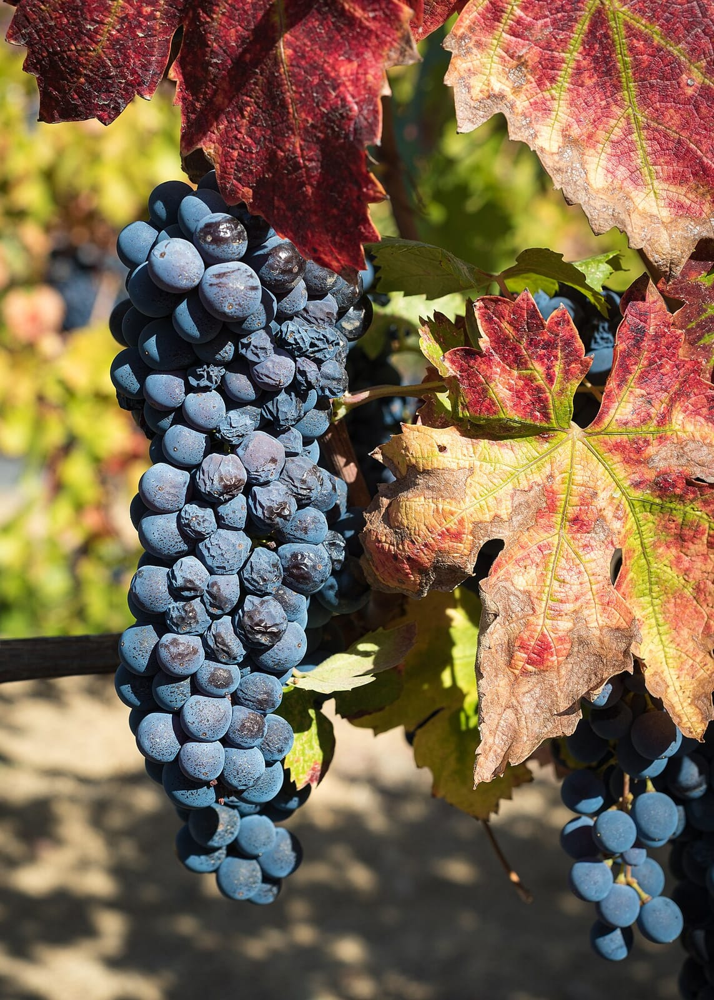

# 仙粉黛

仙粉黛（Zinfandel）是加州最具辨识度的红葡萄，也是少数在旧世界与新世界都占据重要位置的品种。它在意大利普利亚被称为普里米蒂沃（Primitivo），在克罗地亚达尔马提亚则保留着 Tribidrag 与 Crljenak Kaštelanski 两个古老名字。浓郁的黑莓果酱、黑胡椒与高酒精度是它最常见的面貌，但真正优秀的老藤仙粉黛也能给出香料、干草与矿物般的细节。要理解这个品种，最好把它放回移民史、海运与加州淘金热的脉络中，而不是只读酒标上的“old vine”(ref:wine)。

图：仙粉黛。图片：Frank Schulenburg，CC BY-SA 4.0，via Wikimedia Commons（[原图页面](https://commons.wikimedia.org/wiki/File:Ripe_Zinfandel_grapes_in_Dry_Creek_Valley-8958.jpg)）。

## 定义与别名

仙粉黛属于欧洲葡萄 Vitis vinifera，是红葡萄品种。它的英文名 Zinfandel 在加州通用，意大利官方名称是 Primitivo，克罗地亚的 Tribidrag 与 Crljenak Kaštelanski 则指向同一基因型。英文资料里常见的 Primativo 通常是 Primitivo 的误拼，而不是另一个独立品种。需要区分的是“品种”与“酒款”：White Zinfandel 是用仙粉黛酿成的浅色桃红葡萄酒，并非白葡萄品种；而“old vine”是酒标用语，不是植物学分类(ref:red-wine)。

## 亲本与起源

仙粉黛的亲本至今没有完全确定，但它的地理来源已经清楚。20 世纪 90 年代，加州大学戴维斯分校的 Carole Meredith 与克罗地亚学者合作，把加州的仙粉黛与达尔马提亚海岸的 Crljenak Kaštelanski 匹配起来，从而确认它原产于克罗地亚。达尔马提亚的 Plavac Mali 则是仙粉黛与当地品种 Dobričić 的后代，这也解释了为什么三者常被混淆。仙粉黛在 1820 年代经欧洲苗圃进入美国东岸，19 世纪中叶随淘金热在加州迅速扩散。禁酒令时期，家庭自酿与宗教用酒的豁免让部分老藤免于被拔除，这些地块后来成为老藤仙粉黛的重要来源。

## 植物学特征

仙粉黛的果穗较大，果粒中等偏大，果皮中等厚，颜色深。它最显著的植物学特点是同一串葡萄上成熟度不一致：有的果粒已经皱缩变甜，有的仍然坚硬发酸，果农形象地称之为“母鸡带小鸡”。这种不均来自品种本身的生长习性，也使采收决策变得困难。果粒糖分上升快，酸度下降也快，因此在炎热地块很容易出现酒精过高、酸度不足的葡萄。果皮颜色深、色素丰富，但单宁并不算特别厚重；果穗较紧，遇到秋季降雨时容易感染灰霉病与酸腐病。

## 栽培特性

仙粉黛长势旺、产量高，对土壤的适应范围较广，在贫瘠坡地与河谷冲积土上都能结果。它发芽较早，春霜是主要风险；成熟期中等，比赤霞珠略早或相近。由于坐果后糖分积累迅速，酒农必须在“果味成熟”和“酸度流失”之间找平衡点。老藤、干式种植与头状修剪（head training）是加州传统做法：产量低、果粒小、皮果比高，酒的风味更集中，单宁也更细。若负载过高，酒会显得稀薄、果酱味重而缺少骨架；若在炎热地区延迟采收，则容易出现葡萄干化与苦味。

## 产区分布

美国是仙粉黛最重要的现代产区(ref:usa)。加州的门多西诺、索诺马（Dry Creek Valley、Russian River、Alexander Valley）、纳帕、洛迪、阿马多尔县与帕索罗布尔斯都有规模种植。索诺马的 Dry Creek Valley 以香料感与结构见长，洛迪以老藤与较高性价比著称，阿马多尔的丘陵地带则常给出更紧致的酸度与矿物感。意大利普利亚是普里米蒂沃的核心(ref:italy)，曼杜里亚（Manduria）与焦亚德尔科莱（Gioia del Colle）是最有代表性的法定产区；当地温暖干燥的气候让果实更早成熟，酒风偏向黑李子、无花果干与甘草。克罗地亚达尔马提亚近年有恢复种植，澳大利亚、南非与南美也有少量实验性栽培。

## 法定规则

在美国，品种标注通常要求酒液中至少 75% 来自所标注的品种，地理标注则由 AVA（美国葡萄种植区）体系管理；“old vine”“ancient vine”没有统一的联邦定义，因此更多是营销语言而非法规等级。意大利的普里米蒂沃·迪·曼杜里亚（Primitivo di Manduria）是 DOC，其甜型 Dolce Naturale 于 2011 年升为 DOCG，是普利亚首个 DOCG；焦亚德尔科莱也有独立的 DOC 规范。各产区对品种比例、最低酒精度与陈年要求不同，具体参数以最新产区规范为准。由于仙粉黛与普里米蒂沃是同一基因型，跨国产区名称不能互相替代，酒标必须遵守销售市场的法规。

## 酿造

仙粉黛的糖分高，发酵完成后的酒精度常在 14% 至 16% 之间，部分老藤或晚采酒款更高(ref:alcohol-by-volume)。高酒精会带来甜润的口感与灼热感，因此酒庄有时进行酸化、提前采收或选用较凉的夜间采摘来保持平衡。传统加州做法包括整串发酵、野生酵母、开放式发酵槽与压帽，之后进入美国橡木桶陈年，赋予香草、椰子与甜香料气息。老藤地块常是“田间混酿”（field blend），混有 Petit Sirah、Carignan、Alicante Bouschet 等品种，这些品种补充颜色、单宁与酸度。White Zinfandel 则通过短暂浸渍或放血法（saignée）取得浅色果汁，1970 年代后在加州流行，通常带有残留糖分。

## 感官风格

年轻仙粉黛以黑莓、覆盆子果酱、黑樱桃、黑胡椒、干百里香与无花果干为主，酒体饱满，单宁中至高，酸度中等。高酒精常让收尾显得甜美，但优质酒款会用酸度与单宁把果味托住，避免腻感。普里米蒂沃通常更偏黑李子、无花果干、甘草与烟草，单宁更明显，酸度略低。经过橡木陈年的仙粉黛会出现香草、可可、摩卡与烘烤香料；瓶陈后则转向皮革、烟草、松露与干果。老藤仙粉黛的陈年潜力常被低估，结构良好的酒款可以陈放十年以上。

## 代表生产者与年份

加州代表酒庄包括 Ridge（Lytton Springs 与 Geyserville 是老藤田间混酿的标杆）、Ravenswood、Turley、Bedrock、Seghesio 与 Robert Biale。Ridge 强调地块与低干预，Turley 以老藤、低产与浓烈风格闻名，Bedrock 则专注于历史老藤地块。普利亚的代表生产者包括 Feudi di San Marzano 与 Leone de Castris，前者偏向现代果味，后者保留了更传统的氧化与陈年风格。年份差异主要来自夏季高温与采收期降雨：炎热年份酒精更高、果味更熟，凉爽年份酸度更好、单宁更紧；具体年份表现仍取决于地块与采收决策。

## 常见误区

第一，把 White Zinfandel 当成白葡萄品种。它是用红葡萄短暂浸渍酿成的桃红葡萄酒。第二，认为仙粉黛与普里米蒂沃是两种不同葡萄。两者是同一基因型，但克隆、产地与法规不同。第三，以为“old vine”有法定含义。美国没有统一标准，老藤更多是酒庄自述。第四，把高酒精一律视为缺陷。在果味、酸度与单宁平衡时，高酒精是风格的一部分。第五，认为仙粉黛原产美国。它的起源在克罗地亚达尔马提亚。第六，以为仙粉黛只能做果酱味浓酒。凉爽地块、老藤与克制酿造可以给出更细致、带香料与矿物感的版本。

## 延伸阅读

- [葡萄酒](ref:wine)：从发酵、分类到陈年的总体框架。
- [红葡萄酒](ref:red-wine)：仙粉黛所属的酒类。
- [美国](ref:usa)：仙粉黛最重要的现代产区。
- [意大利](ref:italy)：普里米蒂沃的产地与法规背景。
- [酒精度](ref:alcohol-by-volume)：理解仙粉黛高酒精风格的关键指标。

## 相关图像

图：' 09 - ITALY - Vineyard and signs Emilia Romagna wine - Mollino。图片：Topural 1，CC BY-SA 2.0，via Wikimedia Commons（[原图页面](https://commons.wikimedia.org/w/index.php?curid=35825496)）。关联图像：仙粉黛。
