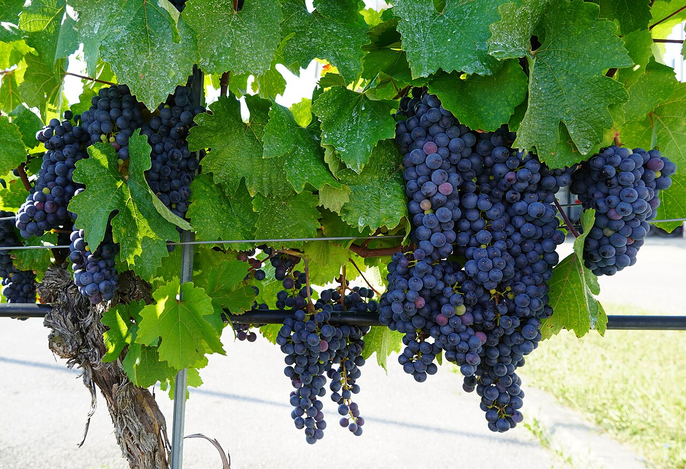

# 茨威格

茨威格是奥地利种植面积最大的红葡萄，1922 年由 Fritz Zweigelt 在克洛斯特新堡杂交育成，亲本为蓝弗兰克与圣劳伦特；早熟、丰产、耐寒，酒色深、单宁柔和，带黑樱桃、紫罗兰与香料气息，风格从轻快年轻酒到橡木陈酿的珍藏款都有。

图：Zweigelt：Rebsorte Zweigelt, Versuchsgut Agneshof der HBLA und dem Bundesamt für Wein- und Obstbau, Klosterneuburg 01（Wikimedia Commons）。图片：Naturpuur，CC BY-SA 4.0，via Wikimedia Commons（[原图页面](https://commons.wikimedia.org/wiki/File:Rebsorte_Zweigelt,_Versuchsgut_Agneshof_der_HBLA_und_dem_Bundesamt_f%C3%BCr_Wein-_und_Obstbau,_Klosterneuburg_01.jpg)）。

## 定义与命名

茨威格（Blauer Zweigelt）是人工杂交育成的 Vitis vinifera 红葡萄，亲本为圣劳伦特（St. Laurent）与蓝弗兰克（Blaufränkisch）；它从圣劳伦特继承了鲜亮的樱桃香与丝滑优雅，从蓝弗兰克得到香料感与良好酸度，两边亲本的深紫 Crimson 色泽也传给了后代。酒标上常见的 Rotburger 是它最初的名字，1972 年品种登记中正式名称为 Zweigeltrebe Blau，1978 年定为 Blauer Zweigelt。

名称历史上曾与德国盖森海姆同期育成的 Rotberger 品种混淆，直到 1970 年代才厘清；今天 Blauer Zweigelt、Zweigelt 与 Rotburger 指的都是同一个奥地利品种。作为杂交品种，它没有古老地方实生苗的多组地方克隆，商业种植以官方登记克隆为主，树龄、地块与酿造方式对风格的影响比克隆标签更直接（[blaufrankisch](ref:blaufrankisch)）。

## 起源与传播

杂交在 1922 年于下奥地利州克洛斯特新堡的联邦葡萄栽培研究机构完成，育种者是葡萄栽培教授 Friedrich “Fritz” Zweigelt；杂交登记编号为 Klosterneuburg 71。1950 年以后品种才开始规模化种植，1950 年代 Lenz Moser 推广的高篱架栽培体系帮助它适应现代葡萄园管理，此后种植面积持续上升。

1995 年，茨威格被欧盟认定为维也纳、下奥地利、布尔根兰与施泰尔马克的推荐品种；20 世纪 90 年代奥地利重返本土红品种路线后，它进一步巩固了地位。按奥地利官方机构统计，全国茨威格种植面积超过 6,200 公顷，约占红葡萄种植面积的 46%、全国葡萄园总面积（约 45,500 公顷）的 13%；奥地利葡萄酒行业手册给出的数字约 5,940 公顷，是该国第一大红葡萄品种。

传播出奥地利后，它在德国南部、匈牙利、捷克、斯洛伐克有少量种植，加拿大、澳大利亚与新西兰也有试验性地块；海外规模不大，风格参照仍以奥地利产区为准。

## 植物学与栽培

果粒中等、皮厚，果串紧凑，新梢长势强健，抗病性较好，萌芽与成熟期偏早。早熟使它能在奥地利较凉的产区完成成熟，避开秋季湿冷，但也意味着花期与幼果期要留意春霜；丰产是它的优点，放任产量则颜色、果香与结构都会被稀释。

栽培上的平衡关键是控制产量与叶幕：疏果压低单产，保留足够叶面积供成熟，同时避免过密遮阴带来的酸度下降与病害压力。不同地块表现分化明显：湖边温暖地块果味更成熟、酒体更宽，坡地与黏土地块酸度更挺、香气更细；同一品种在低产老藤与高产新园之间可以是两种酒（[terroir](ref:terroir)）。

## 风格与味觉

典型茨威格呈深宝石红到紫红，香气以黑樱桃、酸樱桃、覆盆子、李子、紫罗兰、黑胡椒与 licorice 为主；口感干型，轻到中等酒体，单宁柔和不粗，酸度明亮，余味带果香与香料。入门款圆润多汁，珍藏款则有更深的黑色果味、更扎实的单宁与橡木带来的香草、巧克力气息。

酿造风格分三层：轻快型在不锈钢罐短发酵、快速装瓶，追求新鲜樱桃与草本，适合当年饮用；经典型浸渍 10–15 天提取颜色与中等结构，罐或大桶陈酿 6–12 个月，可放 3–5 年；珍藏型长时间萃取、小橡木桶陈酿 12–18 个月，顶级地块有 8–12 年陈年潜力。酒精度通常在 11.5–13.5% 之间（[oak-ageing](ref:oak)）。

茨威格也是优秀的混酿搭档：与两个亲本、赤霞珠、梅洛混酿时，它贡献果香、色泽与圆润度，平衡骨架与单宁。多数酒款在发布后几年内饮用，新鲜果味是核心；优质珍藏瓶在陈年后出现干果、皮革与瓶中香料，结构依然和谐。

## 主要产区与代表酒款

奥地利每个产区都有种植，最受认可的来自布尔根兰，尤其是新锡德尔湖（Neusiedlersee）东岸一带：湖泊调节气温、日照充足、降水适中，昼夜温差由湖面缓冲，出产果味成熟、香气集中的茨威格。Mittelburgenland、Carnuntum、Leithaberg 以及下奥地利、维也纳郊区也有代表性地块。

代表生产者包括布尔根兰的 Moric、Prieler 与 Weninger，以及 Thermenregion 的 Stadlmann；这些酒庄分别在老藤低产、湖边地块与橡木珍藏方向上建立参照。市场上茨威格从 heuriger 酒馆式轻快酒到单一园珍藏款价格带很宽，同一名下，不锈钢年轻款与 barrique 珍藏在浓度、单宁与陈年潜力上差距明显，生产者与地块比品种名更能预测杯中风格（[red-wine](ref:red)）。

## 怎么喝与配餐

轻快与未过桶的茨威格略凉饮用，约 13°C；饱满或橡木陈酿款在 15–18°C 之间侍酒，温度过低会压住香料与橡木香。杯型用中等偏大的圆肚红杯聚拢香气；年轻酒不需要醒酒，结构强的珍藏款可提前 30–60 分钟 decant，柔化单宁、展开果香。

配餐是茨威格的强项：奥地利传统的烤猪肘、烤香肠配芥末、烤鸭油封、烤鸡与烧烤肉类都接得住它的酸度与果香；蘑菇、烤蔬菜、通心粉沙拉与中等硬度奶酪也搭配得当。单宁不重，不必配极重的红肉或浓酱，辛辣菜式可以选果味更成熟的年份。

## 选购与常见误区

误区一：把茨威格当成蓝弗兰克的克隆或变种。它是独立杂交品种，亲本之一是蓝弗兰克，风格上却更柔和、果香更靠前，不能按蓝弗兰克的高酸高单宁期待去买。误区二：以为深颜色等于重酒体。茨威格颜色深但单宁通常柔和，多数款型是轻到中等酒体，颜色主要来自厚皮与深色素，不等于结构厚重。

误区三：认为茨威格只能年轻时喝。轻快款确实适饮窗口短，但低产地块、长浸渍与桶陈的珍藏款有多年瓶陈潜力；判断时看酿造等级与地块，而不是品种的普遍印象。选购留意年份、装瓶时间与储存条件，经过长期库存或受热的酒会失去樱桃花香，单宁也显得发涩。

## 延伸阅读与另见

对照练习：把一款 Neusiedlersee 经典款与一款 Carnuntum 或 Leithaberg 珍藏款同场比较，记录果味成熟度、单宁粗细与橡木气息的差别；再对比不锈钢年轻款与 barrique 款，看清酿造方式在这条品种线上推到了哪里。

茨威格的面积、克隆与海外种植仍随品种调查更新，正式引用以奥地利官方农业机构、VIVC 登记与各 DAC 产区资料为准。

- 相关条目：[blaufrankisch](ref:blaufrankisch)、[st-laurent](ref:st-laurent)、[red-wine](ref:red)、[terroir](ref:terroir)、[oak-ageing](ref:oak)。
