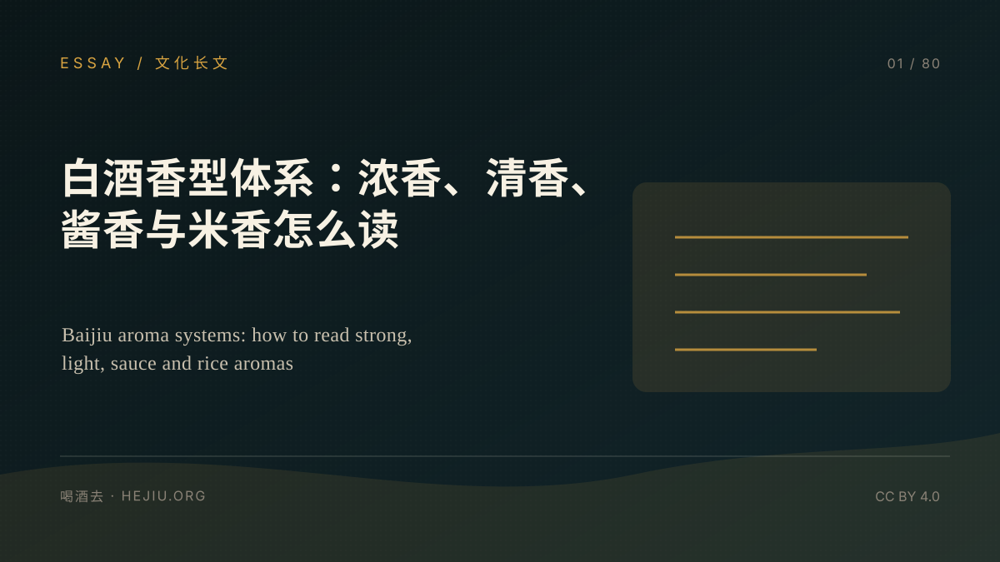

# Baijiu aroma systems: how to read strong, light, sauce and rice aromas

On a baijiu shelf, “strong aroma”, “light aroma” and “sauce aroma” are among the most frequent words. They look like grades, but they are closer to a classification language describing aromatic styles and craft traditions. Understanding that language helps a drinker know what is in the bottle and avoids mistaking an aroma type for a guarantee of quality.

Figure: thematic illustration for Baijiu aroma systems: how to read strong, light, sauce and rice aromas. Image: AI-assisted illustration generated with Doubao Seedream 5.0 (project-owned); not a photograph of the subject.

## Where the question comes from

Baijiu is usually made from grains such as sorghum, wheat, rice and maize, and the methods of making qu, fermenting, distilling and storing differ from region to region. Wines from different places smell noticeably different, so the trade needed a vocabulary that could be used for communication, comparison and teaching. Out of that need came the idea of an “aroma type”. It began as a way of organising production experience and industry judging, and later entered standards, textbooks, labels and marketing.

The problem arrived with the success. Once an aroma type became a selling point, consumers began compressing complex craft differences into a single word. Some treat sauce aroma as automatically superior, some treat light aroma as cheap, and others assume the aroma type is a legal grade of quality. All of these readings skip the middle step: an aroma type first describes how a style is made.

## The system and its principles

An aroma type is not the smell of a single compound. It is the result of raw materials, the type of qu, the fermentation vessel, the fermentation method, the distillation process and the storage conditions acting together. Among the common types: strong aroma often uses mud-pit solid-state fermentation, continued mash recycling and mixed steaming and boiling, with the microbial community in the pit contributing to aroma; light aroma emphasises a cool, clean fermentation environment, often in earthen or ceramic jars, and aims at a clean, crisp aroma; sauce aroma is associated with high-temperature qu making, high-temperature stacking and multiple rounds of fermentation and distillation, giving a layered aroma; rice aroma uses rice as its main raw material, with small qu for saccharification and fermentation, and tends towards a clean sweetness. These summaries are only entry points; the actual process still depends on the region, the distillery and the product standard.

In flavour chemistry, differences between aroma types are often described through the proportions and thresholds of esters, alcohols, aldehydes and phenols. Discussion of strong aroma often centres on esters such as ethyl hexanoate, light aroma on esters such as ethyl acetate, and rice aroma on compounds such as beta-phenylethanol. But “a particular compound is high” does not mean “a particular aroma type is good”. Aroma is perceived as a whole and is also affected by alcohol content, temperature, glass shape and the drinker's own sense of smell.

## Key categories and parameters

Common baijiu aroma types include strong, light, sauce and rice aroma, alongside feng, te, chi, sesame, laobaigan, fuyu and mixed aroma, among others. Different sources do not count them in exactly the same way, so it is unwise to state a fixed total. Judging the aroma type of a particular bottle normally means combining the label, the execution standard, the region and the process description, not just an advertising phrase.

Observable parameters include the temperature and type of qu, the fermentation vessel (mud pit, stone pit, earthen jar and so on), the fermentation cycle, the number of distillation rounds and the cuts taken, the storage vessel and duration, and the finished alcohol content along with physical and chemical measures such as total acid and total esters. The specific limits belong to the standard text and should follow the officially published standard. When reading a label, the aroma type, raw materials, alcohol content, execution standard and production date usually carry more information than a “vintage story”.

[Baijiu](ref:baijiu) is the broad category, and [strong aroma](ref:strong) is one common branch within it; to understand the distillation step, start with [distillation](ref:distillation). For terminology, see [baijiu industry terminology](ref:gbt15109), which belongs to a system of trade terms and is not a quality promise for any particular product. The perception and description of aroma is also covered on the [aroma](ref:aroma) page.

## Cases

Sichuan's strong-aroma regions are often discussed in terms of mud pits, continued mash recycling and mixed steaming and boiling, with the climate and microbial environment of [Sichuan](ref:sichuan) treated as an important background for style. Guizhou's sauce-aroma regions are often described through high-temperature qu making, stacked fermentation and multiple rounds of distillation, with the river-valley climate and seasonal rhythm of [Guizhou](ref:guizhou) shaping the scheduling of qu making and fermentation. The rice-aroma tradition in southern China links rice, small qu and a relatively simple process.

Set side by side, these cases show that an aroma type is more like a process route than a league table from high to low. Within one aroma type, different regions, distilleries and batches can differ markedly; across aroma types, the comparison is more like comparing two aesthetics than comparing two scores.

## Common misunderstandings

First, treating an aroma type as a quality grade. It describes style and craft tradition, not quality directly. Second, treating the number of aroma types as fixed. Industry classification changes with research, standards and the market; consult official and industry material. Third, assuming sauce aroma must be better than light aroma, or that strong aroma is necessarily more “traditional”. These are matters of personal preference and occasion, not conclusions proved by a single measure. Fourth, equating aroma type with added flavourings. Properly made aroma comes from fermentation, distillation and storage; added flavouring and improper labelling are a separate problem to be judged from the label and regulatory information. Fifth, assuming every baijiu must declare an aroma type. Labelling requirements vary by product category and standard, so with an unfamiliar bottle, read the execution standard and ingredient list first.

## Controversies and limits

The aroma system has three main areas of dispute. The first is scientific boundary: flavour chemistry can measure differences in compounds, but it is hard to quantify “style” completely, and cross-type or mixed-aroma products blur the lines further. The second is history and the market: industry judging, local brands and consumer memory together made certain aroma types famous, and fame is not universal relevance. The third is standards and labels: different standards set different requirements for terms, measures and declarations, and the specific clauses should follow the official text.

This essay therefore offers a framework for understanding, not an absolute rule about what a given aroma type “must” be. Questions of quality, vintage, grade and execution standard for a specific product belong to the label and the official standard. If you use aroma type as a buying guide, consider it together with region, process, alcohol content and your own taste.

## How to use it

When choosing, first ask what experience you want: rich and mellow, or clean and crisp; roasted and aged, or rice-sweet. Use aroma type as a first filter, then narrow by region, alcohol content and price. In tasting, compare two wines of the same aroma type at the same temperature and in the same glass, noting aroma, entry, finish and the smell of the empty glass, rather than only recording “I liked it” or “I did not”.

For food, strong and sauce aromas are often suggested with richer dishes, while light and rice aromas suit lighter or umami-forward food; these are rules of thumb and should give way to actual taste. For storage, avoid direct sunlight and sharp temperature swings, and drink soon after opening. Finally, any claim about “vintage”, “aged” or “special supply” should be checked against the label and verifiable production information.

## Further reading

- [Baijiu](ref:baijiu): an overview of the category.
- [Strong aroma](ref:strong): one common aroma type.
- [Baijiu industry terminology](ref:gbt15109): background on terms and classification.
- [Sichuan](ref:sichuan) and [Guizhou](ref:guizhou): two frequently discussed regions.
- [Distillation](ref:distillation): from fermented mash to spirit.
