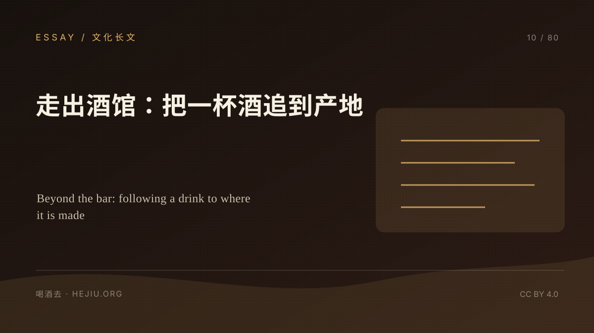

# Beyond the bar: following a drink to where it is made

At a bar, a drink is a finished product: right temperature, right glass, right price. At the place of production it is taken apart: malt, water, yeast, stills, casks, fermentation tanks, harvest dates and the judgements of the people working there. The value of a production visit is not that you have “seen it”, but that flavour turns from an adjective into a process you can question.

Figure: thematic illustration for Beyond the bar: following a drink to where it is made. Image: AI-assisted illustration generated with Doubao Seedream 5.0 (project-owned); not a photograph of the subject.

## From a drink to a route

Drink tourism usually takes three forms: brewery visits, distillery visits and wine-estate visits. All three follow a “talk—see the equipment—taste—buy” pattern, but with different emphases. A brewery shows mashing and fermentation, a distillery shows distillation and ageing, and a wine estate shows growing, harvesting and pressing. Comparing the three reveals the different paths by which raw material becomes drink.

When planning, decide first which stage you want to understand: for agriculture, go to a wine estate; for equipment and craft, a brewery; for time and casks, a distillery. If you simply want a few drinks at the weekend, a bar suits better than a production site; visits involve travel, booking and standing, and are a different activity from drinking.

## Brewery visits: fermentation you can see

The basic beer process is: milling the malt, mashing, boiling with hops, cooling, fermentation, maturation and packaging. On a visit you usually see the mash tun, the boil kettle, fermentation vessels and the packaging line; the guide explains how water temperature, time and hop additions affect aroma and bitterness. Where a brewery uses unusual raw materials or methods, a visit is the easiest place to understand the difference. For the basic families of [beer](ref:beer), see the linked style page.

Take [Schlenkerla](ref:schlenkerla) in Bamberg: its official page records that the building was first documented in 1405 as the “Haus zum blauen Löwen”, that it is now run by the sixth generation of the Trum family, and that the smoked beer is still drawn from oak casks in the traditional way. That information anchors “smoky flavour” in specific craft and family management rather than in adjectives.

Three questions are worth asking on a visit: where does the malt come from? What temperature range is fermentation held at? How long does the finished beer mature on site? If the talk is only about “a family secret” and never about process, the visit is leaning towards brand storytelling. Both are worth seeing, but you should know what you are looking at.

## Distillery visits: pot stills and ageing

Distillation separates and concentrates the alcohol and aromatic compounds in a fermented liquid. A Scotch whisky visit usually covers malting, mashing, fermentation, pot distillation and oak-cask ageing; for the general principles of distillation, see [distillation](ref:distillation). The easiest thing to observe on a visit is the shape and number of the stills: pot stills usually work in pairs, with the first distillation and the second carried out in different vessels.

The ageing stage shows most clearly that time is also an ingredient. The wood, the level of charring, the storage environment and the length of maturation all change colour and aroma. Distillery visits often end in the warehouse: rows of casks say more about cost and patience than any advertising line. To understand this kind of drink systematically, read [whisky](ref:whisky).

One caution: claims about “vintage”, “cask type” and “limited release” in a tour should be checked against the distillery's or bottler's official information. Label rules for tourist editions and standard releases may differ, so read the label and bottling details before buying.

## Wine-estate visits: plots, harvest and pressing

A wine-estate visit starts with the plot, not the cellar. Grape ripeness, slope, aspect and soil determine the harvest date and the quality of the raw material; after harvest come pressing, fermentation and ageing. What visitors usually see are presses, fermentation tanks, oak barrels and the bottling line, but what really determines style is the plot and the vintage.

This kind of visit is usually tied to the idea of [terroir](ref:terroir). Guides will say “this plot drains well” or “these old vines crop low”; such statements need to be read together with the vintage and the winemaking, and cannot stand alone as a guarantee of quality. Comparing different plots or vintages from the same estate tells you more than comparing different estates.

Wine visits also follow the agricultural seasons: harvest is the busiest time and winter the quietest. To see pressing and fermentation, choose the harvest season; for quiet tasting, avoid the harvest peak. Specific opening hours and booking rules are set by the estate's official channels.

## Tasting, guiding and safety

All three kinds of visit include tasting, but tasting is not “drinking several glasses”. A well-run tasting usually includes a standard glass, controlled temperature, a spit bucket and water, and an order arranged by style. If a tour offers only small glasses of strong spirits without a spit bucket and a transport plan, participants should judge the risk for themselves.

Safety rules matter too. Breweries and wine estates often have stairs, wet floors, steam pipes and forklift traffic; before visiting, check whether children are allowed, whether closed shoes are required and whether step-free routes exist. Do not drive after tasting; that is the most basic boundary.

## Buying and supporting local production

Buying at the place of production has the advantage of complete information: you can ask about batch, vintage, cask and storage conditions, and avoid high temperatures and light during transport. The disadvantage is that you must consider carrying and checking-in limits, especially for liquids and rules on alcohol content.

Supporting local production does not mean buying without question. More effective support is to choose standard releases within your means rather than only souvenir editions, to ask the producer specific questions, and to respect their pricing and capacity. Where a producer also runs a bar or restaurant, sitting down for a drink usually explains its daily life better than buying a bottle.

## Boundaries

This essay describes a framework for visits and does not guarantee any producer's opening hours, ticket price, tour language or tasting arrangements. Rules on visits, tasting age and drink-driving differ between places, so check local law and official pages before travelling.

Stories of origin are easily packaged as “heritage”, “secret recipe” and “limited edition”; those words are not proof of quality by themselves. Judge by verifiable process, vintage and label information rather than by the tone of the advertising. No third-party images are used on this essay, and no specific route coordinates are given; for navigation to a place, use a live map service.

**At a glance:** Beyond the bar lies the place of production. Visits to breweries, distilleries and wine estates break flavour down into raw materials, equipment, time and human choices. This essay explains what each kind of visit shows, what to ask, and which claims not to trust. 

For Beyond the bar, begin with the subject it covers. Then look at the sources it draws on, and finally ask what it adds to the general account. The answers point to different choices, not to a single score.

[Schlenkerla](ref:schlenkerla) and [Beer](ref:beer) answer different questions about Beyond the bar: topic and evidence. Read them as a pair, not as alternatives.
