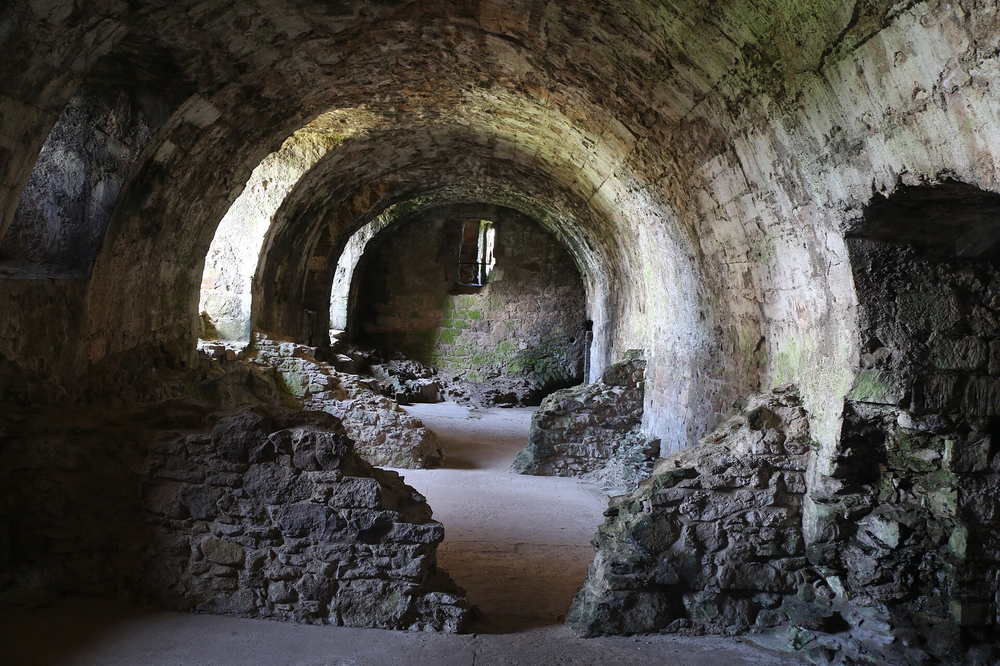

# Cellars and storage: temperature, humidity, light and time

“Cellar” sounds like a room with a kind of magic: put the bottles in, and time does the rest. Reality is plainer. The aim of storage is not to make a drink “get older” but to let it change slowly under controlled conditions, without being ruined early by temperature, light, oxygen or vibration. Understanding those variables matters more than owning an underground cellar.

Figure: Related photograph of Cellars and storage: temperature, humidity, light and time. Image: Deepsphotography, CC BY-SA 3.0, via Wikimedia Commons ([source page](https://commons.wikimedia.org/wiki/File:The_Cellars_in_Direlton_Castle.JPG)).

## Where the question comes from

Home storage runs into three kinds of problem. The first is space: bottles end up in a kitchen cupboard, a fridge or on a balcony, where temperature and light are unstable. The second is time: a bottle is bought and forgotten until its best drinking window has passed. The third is the closure: cork, screwcap and crown cap seal differently and suit different bottle positions. So the common questions become: do I need a wine fridge, can wine go in the fridge, and is older always better?

## The system and its principles

Storage turns on four groups of variables: temperature, humidity, light and vibration, plus odour in the environment and oxygen in the bottle. The key to temperature is not a single “best number” but stability; repeated warm-cool cycles change the volume of the liquid, stress the closure and speed up chemical reactions. Humidity mainly affects cork: too dry may let the cork shrink and increase the risk of oxygen entry, while too wet may damage labels and packaging. Light, especially ultraviolet, accelerates the ageing of wine and beer, and beer can develop so-called lightstruck off-flavours. Vibration disturbs sediment and is unfriendly to long-term storage.

Oxygen in the bottle is the other half of the story. Oxidation in wine is continuous: a little can soften tannin and develop aroma, while too much strips freshness; cork allows a tiny exchange of oxygen, and the permeability of a screwcap depends on its liner. Beer prizes freshness, and hop aroma fades with time; spirits are relatively stable in bottle, but light, temperature and headspace still affect long-term performance.

## Key categories and parameters

By drink type, wine, beer and spirits follow different logic. Wine needs an assessment of vintage, alcohol, acidity, sugar, tannin and body to judge ageing potential; most beer is best fresh, with only a minority of strong, dark or specially treated beers suited to keeping; spirits do not continue to “distil” in bottle, but change slowly under light and temperature.

By closure, cork, screwcap and crown cap differ in sealing and permeability. Wine under cork is often laid down so the liquid keeps the cork moist; screwcaps and crown caps have no such humidity requirement and can be stored upright. Bottle shape, glass colour and labels also affect light protection. Recommended ranges for temperature and humidity vary between producers and industry guidance, so this page does not turn them into fixed figures; follow product instructions and reliable guidance.

## Cases

Wine storage is the most romanticised. Short-term keeping can use a dark cupboard with relatively stable temperature; long-term keeping needs a more stable environment, and a wine fridge, a cellar or professional storage are common options. A wine fridge controls temperature, but humidity, vibration and odour management vary by model; an underground space is temperature-stable but may be damp or odorous. Tasting the same wine after several months in a fridge and in a wine fridge often makes the difference obvious.

Beer makes the point more directly: keep a case of fresh beer in a warm, bright place and another in a cool, dark place, and after a few weeks the aroma may differ noticeably. Spirits are often overlooked: high-alcohol drinks are often stored upright to reduce long contact between liquid and cork, and a large headspace after opening can let aroma fade. Put together, these cases show that “storage” is not one rule for all drinks.

## Common misunderstandings

First, the fridge is suitable for long-term storage. It is cold but dry, vibrates, carries odours and fluctuates as the door opens; it is fine for short-term chilling, not for long ageing. Second, all drinks improve with age. Most beer and much sake are for fresh drinking, and only some wines have ageing potential. Third, bottles must always be laid flat. Laying down mainly serves cork moisture; screwcaps and crown caps do not need the same position. Fourth, a wooden box or rack equals a cellar. The container provides no stable temperature or humidity; the environment is what matters. Fifth, an older vintage on the label is better. The vintage is the harvest year, not a guarantee of quality or readiness.

## Controversies and limits

There are genuine disputes in storage. One is cork versus screwcap: cork has tradition and breathability but carries the risk of cork taint, while screwcaps seal reliably but their permeability and long-term ageing behaviour depend on the liner. Another is home versus professional storage: a home cannot fully reproduce a professional cellar, and stability and darkness matter more than perfection. A third is transport: heat and vibration on a long journey may affect a wine more than home storage. A fourth is the “drinking window”: it varies by drink, vintage, batch and personal preference, and producer advice is only a guide.

This page therefore gives no universal temperature or humidity figures and no promise about how long any drink will keep at home. For a specific product's ageing potential and storage advice, consult the producer; for food safety and labelling requirements, follow local law.

## How to use it

Home storage can start with four steps. First, choose a dark place with relatively stable temperature and no strong odours, away from the stove, balcony and top of the fridge. Second, separate by drink type: lay wine down or adjust position by closure, refrigerate beer and drink it soon, keep spirits upright and dark. Third, keep an inventory of name, vintage, purchase date and planned drinking date so nothing is forgotten. Fourth, check periodically: look at the liquid level, the closure and whether labels are damp, and smell for off-notes before serving.

Plan the drinking order too: drink the most freshness-sensitive bottles first, then those that can keep a little; try the same batch in stages and record the changes. If you suspect cork taint or oxidation, see the term pages for [cork taint](ref:cork) and [oxidation](ref:oxidation). To understand the difference between barrel ageing and bottle ageing, see [oak ageing](ref:oak). Finally, storage serves drinking; there is no need to postpone the glass in pursuit of perfect conditions.

**At a glance:** A cellar is not a magic room that ages wine. Storage aims to let a drink change at a controlled pace. This article covers wine, beer and spirits, the differences between closures, common myths and practical home storage. 

## Further reading

- [Wine](ref:wine): an overview of the category.
- [Wine storage](ref:storage): a more detailed practical guide.
- [Oxidation](ref:oxidation): the core process in wine and beer ageing.
- [Cork taint](ref:cork): the off-flavour risk linked to cork.
- [Oak ageing](ref:oak): barrel ageing versus bottle ageing.
- [Vintage](ref:vintage): what the year on a label means.
- [Beer](ref:beer): freshness and the effect of light on beer.
