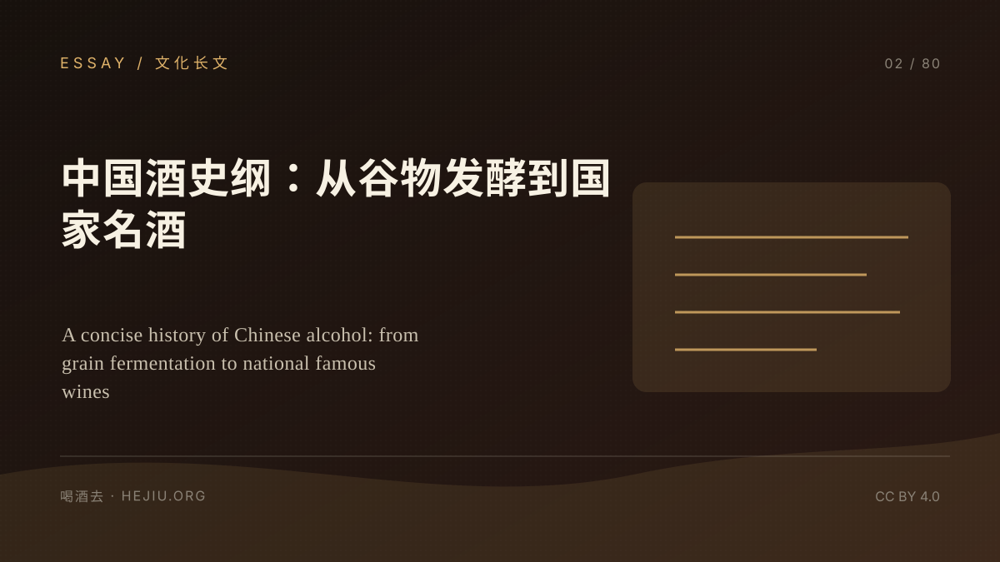

# A concise history of Chinese alcohol: from grain fermentation to national famous wines

The history of Chinese alcohol is easily written as a straight line: an early origin, steady progress in the middle, and finally entry into modern industry. The reality is more crooked. Archaeological material can prove that fermented drinks existed early, but cannot say directly what kind of drink they were; agricultural manuals record qu-making and brewing in detail, but cover only particular regions; poems and urban notes supply scenes, but often carry literary embellishment. Only by keeping these kinds of material apart can a history of alcohol be written without exaggeration.

This article follows several key turns in chronological order: early grain fermentation, Tang and Song taverns and alcohol policy, Yuan-Ming distilled spirits, and modern industrialisation together with the national wine-evaluation system. Each section marks the type of evidence, and the final section sets out the questions that remain disputed.

Figure: thematic illustration for A concise history of Chinese alcohol: from grain fermentation to national famous wines. Image: AI-assisted illustration generated with Doubao Seedream 5.0 (project-owned); not a photograph of the subject.

## Early period: fermented drinks and grain wine

The early evidence most often cited today comes from the Jiahu site in Wuyang, Henan. Analysing residues in pottery, researchers concluded that a beverage had been fermented there from rice, honey, fruit and other ingredients around 9000 years ago. The study supports the judgement that fermentation techniques were already known in the Neolithic, but it does not amount to any particular drink in today's sense; ingredients, process and manner of consumption all require interdisciplinary inference.

Once writing appears, the link between alcohol and sacrifice and ritual becomes clear. Shang and Zhou bronzes include wine vessels such as the jue, gu, zun and you; oracle-bone and bronze inscriptions preserve the character for wine; and the Book of Songs contains lines such as making spring wine to promote long life. The drink here was mainly a fermented grain wine, in which qu converted starch to sugar before fermentation; its alcohol strength was low and its keeping time limited. It belongs to the same craft lineage as today's [yellow wine](ref:yellow-wine), but the two cannot simply be equated.

In the early period, production was mostly tied to households, lineages and sacrifice, while the state intervened through ritual and prohibition. Alcohol was both an offering and a medium of banqueting and gift-giving; its social meaning exceeded that of a mere beverage from the outset.

## Han and Tang: alcohol policy, taverns and poetry

In the Han dynasty there were explicit debates about a state monopoly on alcohol and policies known as wine taxation. The state adjusted repeatedly between fiscal need and popular consumption. During the Wei, Jin and Northern and Southern dynasties, experience in qu-making and brewing was written into agricultural manuals; volume 7 of the Northern Wei [Qimin Yaoshu](ref:qimin-yaoshu) gathers qu types such as shenqu and benqu together with the brewing methods that went with them, and is one of the earliest systematic texts to survive.

In the Tang dynasty urban commerce expanded, and taverns, wine banners and licensed wine households became part of city life. Poems by Li Bai, Bai Juyi and others wrote wine into partings, solitary drinking and gatherings; these are literary texts, not drinking statistics, but they show the place of alcohol in social life. The mainstream in Tang was still low-strength grain wine, and scholarship has not reached agreement on whether distilled spirits were already widespread.

Song alcohol policy was more detailed. Officials managed production and sales through wine households, wine taxes and monopoly; cities developed a hierarchy of principal taverns and foot taverns, the former able to brew and wholesale while the latter sold at retail. Dongjing Meng Hua Lu records that before Mid-Autumn in Bianjing "all the taverns sold new wine" and townspeople competed to drink it; [Qingming Shanghe Tu](ref:qingming) paints taverns, wine banners and urban transport along one street. Documents and images corroborate each other, which is more reliable than relying on a single source.

## Yuan and Ming: distilled spirits and regional famous wines

On the origin of distilled spirits, a common account holds that the technique entered from outside during the Yuan dynasty and gradually spread. Li Shizhen wrote in the Ming Bencao Gangmu that "shaojiu is not an ancient method; its method was first created in the Yuan", a sentence widely quoted afterwards. But archaeological and textual research also suggests that distillation may have appeared earlier, or appeared separately in different regions; treating a "Yuan origin" as settled is not safe.

What can be said with more confidence is this: after the Song and Yuan, distilled spirits gradually entered the map of Chinese alcohol; in the Ming and Qing, sorghum and other raw materials were combined with different qu types to form the prototypes of the aroma categories familiar today. Regional famous wines accumulated reputations at this time, and products from Shaoxing yellow wine, Shanxi Fenjiu and Luzhou in Sichuan reached wider markets. Famous wines did not appear overnight; they were formed jointly by water quality, grain, qu types, fermentation pits and long-term business.

## Modern era: industrialisation and the national famous-wine system

In the late 19th century, a modern-style distilling and wine industry appeared in China. The Changyu Winery was founded in 1892, introducing vine planting and grape-wine production; in 1903 a foreign-owned brewery appeared in Qingdao, and beer entered coastal cities. These enterprises brought new equipment, standards and brand awareness, but traditional workshops remained the majority.

In 1952 the first national wine evaluation was held in Beijing. From 103 samples it selected eight Chinese famous wines, including four types of [baijiu](ref:baijiu), Shaoxing Jiafan wine and three Changyu products. National evaluations continued in 1963, 1979, 1984 and 1989. The evaluation system brought regional famous wines into a national framework and also drove standardisation of sensory vocabulary, testing indicators and sample management; but it also carried an element of administrative designation and industry recommendation, and cannot simply be equated with modern blind tasting.

## Timeline

- About 9000 years ago: chemical evidence of a fermented beverage at the Jiahu site.
- Shang and Zhou: bronze wine vessels, and wine in oracle-bone and bronze inscriptions; alcohol closely tied to sacrifice and ritual.
- Northern Wei: about 533—544, the Qimin Yaoshu was completed, its volume 7 systematically recording qu-making and brewing.
- Northern Song: 960—1127, taverns flourished in Bianjing, with a hierarchy of principal and foot taverns.
- 1892: the Changyu Winery was founded.
- 1903: a foreign-owned brewery appeared in Qingdao.
- 1952: the first national wine evaluation selected eight famous wines.
- 1989: the fifth national wine evaluation; national evaluations were discontinued afterwards.

## Controversies and notes on method

First, origin narratives are easily inflated by national sentiment. The Jiahu research matters, but headlines such as "China's earliest alcohol" omit arguments about ingredients, process and definition. Second, the origin of distilled spirits has no single answer. The Yuan account, the earlier account and the multi-centre account each have evidence, and they should be presented side by side rather than choosing whichever is most pleasing. Third, "Yidi made wine" and "Dukang made wine" are legends, not verifiable historical events; they can explain cultural memory but cannot serve as dating evidence. Fourth, poems are not alcohol statistics. Li Bai's "three hundred cups" is rhetoric; Song dynasty wine-tax figures are fiscal material. Fifth, famous-wine evaluations are historical institutions, not eternal rankings; lists change, and markets change too.

## Conclusion

The main line of Chinese alcohol history is not "from lower to higher" but a process in which fermentation technology, alcohol policy, urban commerce, literary imagination and industrial standards layer upon one another. Early grain wine stands in a lineage relationship with today's yellow wine; distilled spirits later changed the strength of drinks and the occasions of consumption; and modern industry and the national evaluation system reshaped brands and markets. Reading this line, it is best to keep hold of the boundaries of evidence at the same time: what is archaeological data, what is textual record, and what is later interpretation.

## Related entries

- [Yellow wine](ref:yellow-wine): the craft lineage of fermented grain drinks.
- [Baijiu](ref:baijiu): definitions, aroma categories and craft of distilled spirits.
- [China](ref:china): national appellation and regulatory framework.
- [Qimin Yaoshu](ref:qimin-yaoshu): the Northern Wei agricultural manual on qu-making and brewing.
- [Jiujing](ref:jiujing): the Song dynasty monograph on qu-making and brewing.
- [1952 national wine evaluation](ref:evaluation-1952): the starting point of the eight famous wines and the evaluation system.
- [Qingming Shanghe Tu](ref:qingming): visual material on Bianjing taverns and urban commerce.
