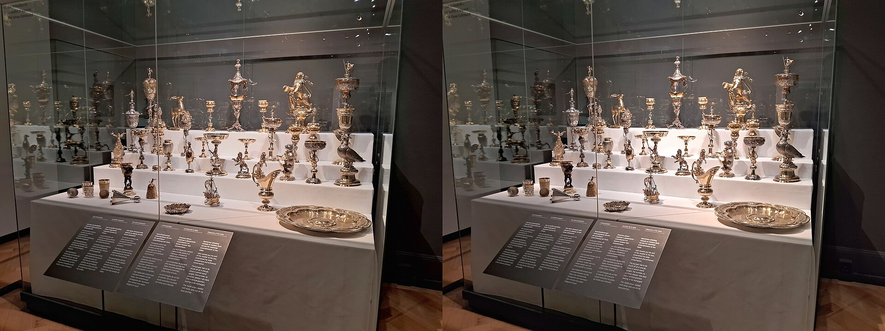

# A history of drinking vessels: how the cup changed the drink

The same wine tastes different from a pottery bowl, a bronze jue, a porcelain cup or a thin crystal glass. Form changes more than the feel in the hand: the rim affects aroma, the wall affects temperature, capacity decides how much is taken at once, and the set of vessels determines the order of a rite. The history of drinking vessels is therefore not only a history of craft but a history of drinking.

This article does not list names by dynasty. It asks a more specific question: which feature of a vessel changed which aspect of drinking? The answers fall into four variables: capacity, rim, material and combination. The six periods are simply those variables unfolded under different technical conditions.

Figure: Related photograph of A history of drinking vessels: how the cup changed the drink. Image: VasuVR, CC BY 4.0, via Wikimedia Commons ([source page](https://commons.wikimedia.org/wiki/File:SW45-B-18-Bern_History_Museum_Humorous_drinking_vessels_3D.jpg)).

## Argument

A drinking vessel is the hardware of a drinking practice. It precedes language and prescribes gesture: a small cup encourages sipping, a large one encourages draining; a closed rim gathers aroma, an open one disperses it; metal conducts heat quickly, ceramic holds it, glass is neutral; a matching set makes order visible. Changes in vessels often follow changes in wine type, technology or ritual rather than changes in taste alone.

But form is not passive. Once fixed, it trains the body: the user of a jue learns to lift it with both hands, the user of an ear cup learns to pass it, the user of a stemmed glass learns to swirl and smell. The history of vessels is thus a history in which object, wine and gesture shape one another.

## Evidence one: Neolithic pottery and eggshell ware

Early fermented drinks needed containers: jars, urns, spouted pitchers and covered vessels. The Dawenkou culture's gui has a spout, a handle and three legs, convenient for pouring and heating, showing that “pouring wine” was already a consideration. Pottery breathes and holds heat, suiting fermentation and storage, and the differentiation of forms began with containers rather than cups.

The Longshan culture's eggshell black pottery stem cup is another marker. Some walls are only 0.5 to 1 millimetre thick, and the body is light with a tall stem, suited to holding. It shows that a vessel made specifically for drinking had appeared in the late Neolithic, and that drinking was separating from the shared container. Wine was not yet a commodity, but it already had dedicated vessels.

## Evidence two: Shang and Zhou bronzes and ritual

Shang and Zhou bronzes pushed wine vessels to the centre of ritual. Bronze jue appear at Erlitou, among the earliest known Chinese bronze wine vessels. The jue has three legs, a spout and a tail, used for warming and offering; the gu is a slender drinking vessel; the zun, you and hu hold wine; the gong serves large banquets. The tomb of Fu Hao at Yinxu, around 1200 BCE, yielded many bronze wine vessels, including jue, gu, jia, zun, you and hu, whose number and combination point to high rank.

Number and combination were often tied to status, forming a system of graded sets. The order discussed in [wine and ritual](ref:wine-and-ritual) was realised through these objects: who used a jue, who used a gu, and in which vessel the wine was served were all regulated. Bronze inscriptions also record why an object was made, making the vessel a historical text. In archaeology, a combination says more about its owner than a single piece, because number and placement are themselves relations.

## Evidence three: Han lacquer ear cups and Tang gold and silver

Han lacquer was light and corrosion-resistant, and the ear cup became a common drinking vessel. An oval body with two ears makes it easy to hold with both hands and pass along. The lacquer ear cups from Mawangdui Tomb 1 are well preserved in form, decoration and inscription, offering material evidence for Han banquets. The literary record of floating cups along a winding stream brings the feather cup into literature: at the Lanting gathering in 353 CE, cups floated downstream and whoever they stopped before drank. The vessel was not only a container but part of the rules of a game.

Tang gold and silver work matured, and wine jugs and cups acquired lobed and flower-shaped forms, alongside new types such as the ewer. In 1970 the Hejiacun hoard in Xi'an yielded more than a thousand Tang gold and silver objects, including a silver ewer with a dancing horse holding a cup in its mouth, showing how closely vessels were tied to performance and ritual. Gold and silver served the elite, while porcelain covered a wider market.

Song kilns flourished, and the ewer was paired with a warming bowl: wine was warmed before pouring, while the meiping held wine and cups and stands served tea and wine. In the [Song city](ref:history-of-taverns) tavern, vessels were part of the business: warming, pouring and changing cups all had rules. The differentiation of forms shows that drinking scenes had multiplied, with separate sets for home, tavern and banquet.

## Evidence four: Ming and Qing porcelain and modern glass

Ming and Qing Jingdezhen official and popular kilns produced large quantities of wine vessels, and blue-and-white, polychrome and famille rose cups and ewers became common. The Yongle press-hand cup, the Chenghua chicken cup and the Kangxi twelve flower cups represent the taste of different periods. At the same time, tin and copper vessels were widely used among ordinary people, and warming pots spread. With yellow wine and spirits coexisting, vessels differentiated further: yellow wine in larger bowls or cups, spirits in small cups.

Glass is transparent, odourless and easy to clean, and spread after the nineteenth century. Wine tasting developed stemmed and tulip-shaped glasses with narrowed rims to gather aroma; whisky has nosing and tumbler glasses; beer has different shapes to control foam and aroma. Modern tasting glasses break aroma, temperature and measure into controllable variables, a different function from ancient ritual vessels but a related logic.

## Counterexamples and limits

First, the Jian bowl is not a wine vessel. Song Jian ware, known for black glaze and hare's-fur or oil-spot effects, served tea whisking and tea contests, and cannot be treated as a wine vessel merely because it looks like a bowl. Second, the practical use of the jue is disputed. Three legs can warm wine and the spout can pour, but the spout is narrow, and scholars disagree on whether it was a daily drinking cup; it may have been mainly a ritual and sacrificial vessel.

Third, ancient and modern names do not correspond. Shang, bei, zhan and zhong refer to different things in different periods, and one modern word cannot cover all ancient names. Fourth, grave goods are not everyday objects. Pottery wine vessels from tombs may be reduced or simplified and cannot be taken directly as tableware. Fifth, the aroma advantage of glass is modern tasting discourse, not an absolute truth; temperature, pour and individual smell matter as much.

## Division of labour with other entries

This article discusses how vessels change drinking by material and form, and does not repeat the cataloguing of individual pieces. [Wine and ritual](ref:wine-and-ritual) covers the rank significance of vessels in ritual, and this article takes only the point that combination determines order. [The history of taverns](ref:history-of-taverns) covers warming and pouring in commercial space, and this article deals with the vessels themselves.

[Yellow wine](ref:yellow-wine) and [baijiu](ref:baijiu) cover the process and serving of those drinks, and this article covers the matching of cup shape to wine type. [China](ref:china) provides the geography of kilns and production regions. Pictorial material belongs to the painting entries and is not developed here. Museum object entries cover date, size and provenance, and this article does not replace them.

## See also

- [Yellow wine](ref:yellow-wine): warming traditions and cup choice.
- [Baijiu](ref:baijiu): the rhythm of small-cup tasting.
- [China](ref:china): the geography of vessel production and kilns.
- [Wine and ritual](ref:wine-and-ritual): how vessels realise ritual order.
- [The history of taverns](ref:history-of-taverns): warming and vessels in the wine shop.

Begin with the subject it covers, move on to the sources it draws on, and finish with what it adds to the general account. That order keeps the reading of A history of drinking vessels practical.