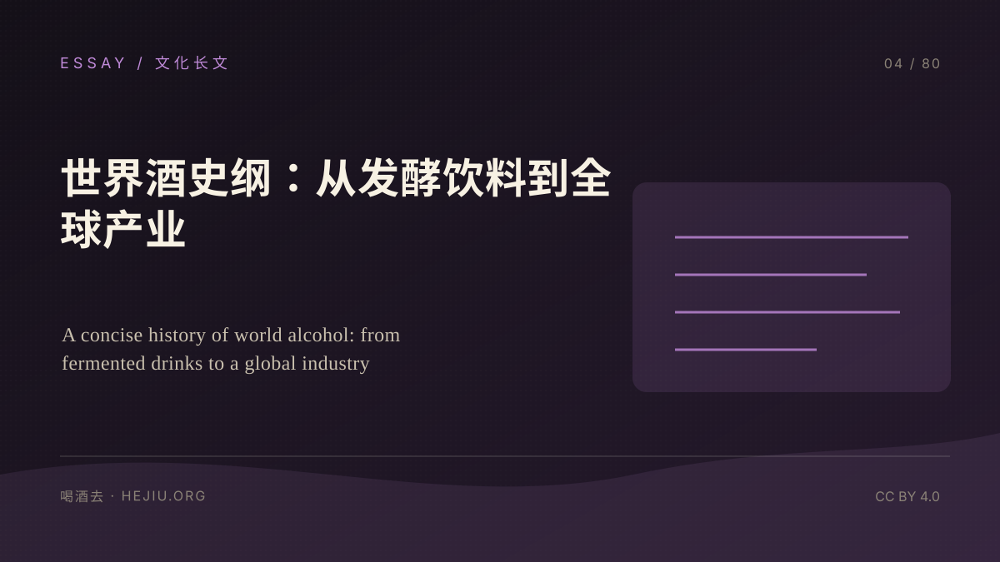

# A concise history of world alcohol: from fermented drinks to a global industry

The history of world alcohol is often written as three separate lines — wine, beer and spirits — that finally merge into a global market. In fact the three lines influenced one another very early: distillation changed both wine and grain drinks, colonial trade carried sugar cane and rum into Europe, and the Industrial Revolution turned beer from a local workshop product into a national brand. This article takes only a few verifiable turning points, to show how today's drinks world took shape.

Figure: thematic illustration for A concise history of world alcohol: from fermented drinks to a global industry. Image: AI-assisted illustration generated with Doubao Seedream 5.0 (project-owned); not a photograph of the subject.

## Wine: from the Caucasus to appellation systems

Evidence for early wine is widely distributed. At Neolithic sites in the Caucasus, researchers identified components associated with wine through pottery residues and chemical analysis, dating back about 8000 years. Such research can prove that wine existed early, but the specific process, manner of drinking and social setting still have to be judged against the archaeological context.

The Roman Empire expanded vine planting and the wine trade; medieval monasteries preserved and improved winemaking techniques and also left records of plot division. The key modern turning point for wine came in the nineteenth century: the 1855 Bordeaux classification placed certain estates on a list that has continued to influence the market; disease and war at the end of the nineteenth century changed the structure of wine regions and also drove grafting, regulation and scientific research. In the twentieth century France gradually built an appellation system, with AOC/AOP binding place, rules and name together.

The definition and craft of [wine](ref:wine) are not mysterious; what is difficult is the appellation system and market stratification. A single glass may carry variety, vintage, plot, regulation and brand at once, and these layers cannot be summed up with the word "good".

## Beer: cities, taxes and industry

The history of beer is closer to that of an everyday drink than wine is. Ancient Mesopotamia and Egypt left records connected with beer; in medieval Europe beer became part of urban life, with both monasteries and town brewhouses taking part in production. The Bavarian Reinheitsgebot of 1516 laid down that beer could use only water, malt and hops; the rule was quoted repeatedly afterwards, but its scope and interpretation differed at different times.

The Industrial Revolution of the nineteenth century changed beer: steam engines, refrigeration, glass bottles, pasteurisation and rail transport allowed beer to be produced on a large scale and shipped further. In the twentieth century big brands and national standards further concentrated the market; after the 1970s the craft movement re-emphasised local flavour and small-batch production. The "types" of [beer](ref:beer) are therefore both a craft classification and a market and cultural one.

## Distilled spirits: from medicine and alchemy to consumption

Distillation developed gradually in the medieval Mediterranean and Europe, at first connected with medicine, alchemy and preservation. Distilling wine to make brandy, distilling a fermented grain liquid to make whisky, and distilling sugar-cane molasses to make rum were all results of the technique diverging according to local materials and demand. A record connected with whisky appears in Scottish fiscal accounts in 1494; over the following centuries whisky developed different production and taxation traditions in Scotland and Ireland.

The legal definition of [whisky](ref:whisky) emphasises raw materials, place of distillation and ageing time; these requirements are not ancient but the result of taxation, trade and industrial competition in the nineteenth and twentieth centuries. The global spread of spirits is also closely tied to colonial trade: Caribbean sugar, rum and the Atlantic trade form one chain, and the glass cannot be viewed on its own.

## The twentieth century: standards, brands and globalisation

In the twentieth century two sets of forces ran in parallel in the drinks world. One was standardisation: international organisations and legislation wrote definitions, labels, geographical indications and production methods into texts. The International Organisation of Vine and Wine (OIV) was founded in 1924, and the European Union updated its spirits regulation in 2019; these texts determine what may be called "wine", "whisky" or a "geographical indication product".

The other was brands and markets. Large companies built global brands through advertising, distribution and mergers, while local producers sought a premium through geographical indications and craft narratives. The 1976 Paris blind tasting brought California wine into international view, and afterwards cross-region comparisons, international competitions and New World brands multiplied. The two forces are not contradictory: standardisation lets consumers compare, while brand and origin narratives make comparison complicated again.

## Timeline

- About 8000 years ago: archaeological and chemical evidence of early wine in the Caucasus.
- Around 3000 BCE: records connected with beer in Mesopotamia and Egypt.
- 1494: a record connected with whisky appears in Scottish fiscal accounts.
- 1516: Bavaria issues the beer Reinheitsgebot.
- 1855: the Bordeaux classification is established.
- 1924: the International Organisation of Vine and Wine is founded.
- 1935: the predecessor of the body managing the French appellation system is established.
- 1976: the Paris blind tasting, in which California wines led both the red and white groups.
- 2019: the European Union updates its rules on spirit definitions and labelling.

## Controversies and notes on method

First, origins are not a single point. Wine, beer and distilled spirits may each have appeared separately in several regions, and calling one archaeological find "the world's first" suppresses other evidence. Second, dates and definitions must be read together. Residues from Jiahu or the Caucasus can prove fermentation or components associated with wine, but cannot be equated directly with today's commodity categories. Third, the 1976 Judgment of Paris was one blind tasting, not a long-term quality ranking; samples, storage and serving order all affect results. Fourth, standardisation and local character are not inherently opposed. Geographical indications protect places but may also freeze rules and limit innovation. Fifth, writing on drinks history often treats legend, advertising and literature as historical sources; this article tries to keep archaeological data, legal texts and later narratives apart.

## Conclusion

The main line of world alcohol history is technical divergence plus institutional layering: fermentation split into wine, beer and grain drinks according to different raw materials, and distillation then built spirits on that foundation; nineteenth-century industrialisation and twentieth-century standards, brands and globalisation rearranged the geography of production and consumption. To understand this line one need not memorise dates, but must know what question each kind of evidence can answer.

## Related entries

- [Wine](ref:wine): definitions, craft and classification.
- [Beer](ref:beer): ingredients, fermentation and styles.
- [Whisky](ref:whisky): the law and craft of grain spirits.
- [France](ref:france): the appellation system and major regions.
- [1976 Judgment of Paris](ref:judgment-paris): the point at which California wine entered international view.
- [International Organisation of Vine and Wine](ref:oiv): the international framework for wine standards.

Read [Wine](ref:wine) for the topic side of A concise history of world alcohol, and [Whisky](ref:whisky) for the evidence side. Together they locate it on a map.
