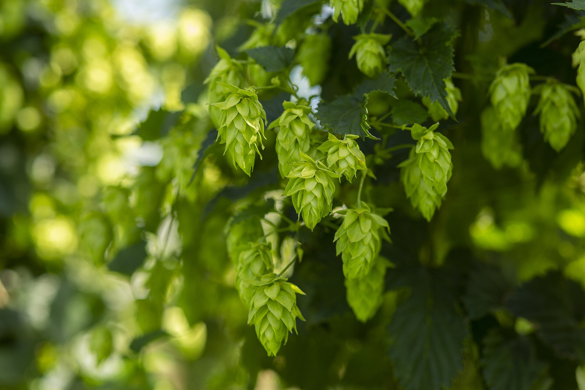

# Hops and bitterness: what IBU can and cannot tell you

In craft-beer conversation, IBU has become almost a synonym for “how bitter is it?”. A label says 40, 60 or 80, and drinkers judge the beer's character from the number. IBU is a useful measure, but it measures the concentration of a particular chemical, not all the bitterness your tongue perceives. Understanding that distinction puts hops, bitterness and flavour in their proper places.

Figure: Related photograph of Hops and bitterness: what IBU can and cannot tell you. Image: ScienceEditorBB, CC BY-SA 4.0, via Wikimedia Commons ([source page](https://commons.wikimedia.org/wiki/File:Humulus_lupulus_(Hops).jpg)).

## Where the question comes from

Beer bitterness comes mainly from hops. The female flowers of Humulus lupulus contain lupulin glands rich in resins such as alpha acids. During the boil these isomerise into iso-alpha acids, which give the characteristic bitterness. Hops also provide aroma and some keeping quality. The problem is that consumers reduce bitterness to a number, equate “more hops” with “more bitter”, and then equate “more bitter” with “better”. These shortcuts blur the tasting.

## The system and its principles

Alpha acids in hops convert into iso-alpha acids when heated, and iso-alpha acids are the main source of bitterness. A longer boil generally gives more complete isomerisation and a larger bitterness contribution. Hops added late in the boil or at whirlpool contribute more aroma than bitterness. Dry hopping, adding hops during fermentation or maturation, mainly increases aroma and contributes little directly to IBU. Hop varieties also shape style: some are valued for bitterness, some for aroma, and some serve both purposes.

IBU stands for International Bitterness Units and is usually expressed as the mass concentration of iso-alpha acids in milligrams per litre, commonly called ppm. Measurement methods include spectrophotometry and chromatography, and different methods, laboratories and sample preparations can produce different results. IBU is therefore a comparable analytical measure, but not a complete map of sensory bitterness.

## Key categories and parameters

To understand bitterness, look at four things together: hop variety, the stage of addition, the intensity and duration of the boil, and the other components of the finished beer. Variety determines the texture of the bitterness and the direction of the aroma; the addition stage determines the ratio of bitterness to aroma; boiling conditions affect isomerisation; malt sweetness, alcohol, carbonation and pH all affect how bitterness is perceived.

Hop products come in several forms, including whole cones, pellets, extracts and CO2 extracts. Their utilisation and aroma behaviour differ, and the details follow the supplier's technical information. At the style level, pilsner-style lagers are often characterised by a clean, crisp bitterness; IPA-style beers often emphasise aroma through late additions and dry hopping; stouts and porters may combine the bitterness of roasted malt with hop bitterness. No specific IBU ranges are given here because style guidelines and producer data change, and variation within a style is large.

## Cases

Take pilsner-style lager: traditional versions emphasise clarity, a clean bitterness and a soft hop aroma, with bitterness serving the overall refreshment rather than overpowering the malt. In IPA-style beers, hop aroma moves to the foreground: generous late additions and dry hopping bring citrus, tropical fruit or pine-like notes, with bitterness acting as the frame. Stouts and porters draw bitterness from more than one source, as the roast and astringency of dark malt join hop bitterness in shaping the finish.

Set side by side, these three show that “bitter” is not one dimension: some bitterness is clean and sharp, some is heavy and long, some arrives together with sweetness and aroma. IBU tells you the concentration of iso-alpha acids; it cannot tell you the texture, duration or balance of the bitterness. For systematic practice, see [beer tasting intro](ref:beer-tasting-intro) and compare different beers within the same style.

## Common misunderstandings

First, higher IBU means more bitter. IBU correlates with sensory bitterness, but perception also depends on malt sweetness, carbonation, temperature, glassware and individual sensitivity. Second, more hops means more bitter. Late additions and dry hopping mainly add aroma and contribute far less bitterness than early boil additions. Third, bitterness is a defect. It is part of a beer's structure, and whether it suits you depends on style and occasion. Fourth, IBU is an absolute, universal number. Different analytical methods and laboratories can differ, so compare data from the same source. Fifth, low IBU means no flavour. Aroma, malt and fermentation flavours also make up the experience.

## Controversies and limits

Some disputes come from measurement: there is more than one IBU method, and sample handling and instrument conditions affect results; producer figures may also be calculated rather than measured. Others come from style: ranges in style guidelines are descriptive tools, not legal standards, and classifications differ between countries and organisations. Others come from agriculture: alpha-acid content varies with variety, year, origin and processing, so the same recipe can produce different bitterness between batches.

This page therefore does not treat any IBU figure as a quality criterion, nor bitterness as the only measure of a style. A specific product's IBU, hop varieties and addition schedule should follow the producer's published information; style definitions and classifications should follow the organisation that publishes them.

## How to use it

When buying, decide first whether you want bitterness-led or aroma-led beer. If the label gives an IBU, compare it with other beers of the same style, not across styles. In tasting, look at colour and foam first, then smell, then take a small sip to follow where the bitterness appears, how long it lasts and how it finishes; perception may change as the beer warms, and carbonation affects mouthfeel. If a beer tastes too bitter, try a lower-IBU version of the same style, or a variety with softer bitterness.

For food, bitterness can cut fat and balance sweetness, making it a good match for fried food, grilled meat or rich cheese; but high bitterness can also amplify salty and bitter ingredients. For storage, beer is a fresh product: hop aroma fades with time, and light can trigger off-flavours; check the producer's date and storage guidance. IBU is a tool, not a verdict; the real judgement still happens in the glass.

Put [Beer](ref:beer)'s topic next to [Malting](ref:malting)'s evidence; the difference marks the boundary.

**Key facts.**

| Item | Detail |
| --- | --- |
| In one line | Hops bring bitterness, aroma and keeping quality, and IBU is a measure of iso-alpha-acid concentration. This article explains how bitterness arises, how IBU is measured, and why “higher IBU means more bitter” is unreliab… |
| Topics | beer、hops、bitterness、brewing |
| Period | modern era |

## Further reading

- [Beer](ref:beer): an overview of the category.
- [IBU](ref:ibu): the definition and use of the bitterness unit.
- [Malting](ref:malting): how malt shapes the base of a beer.
- [Lagering](ref:lagering): cool maturation and clean styles.
- [Beer tasting intro](ref:beer-tasting-intro): a path from nose to palate.
