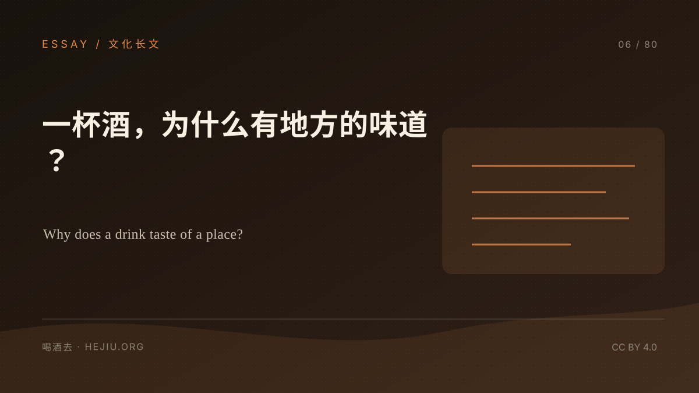

# Why does a drink taste of a place?

“A taste of place” is not a mysterious substance. It usually comes from the combined action of climate, soil, raw-material variety, microbial environment and human craft. Taking these factors apart explains why the same region can produce different styles, and avoids turning “terroir” into a quality ranking.

Figure: thematic illustration for Why does a drink taste of a place?. Image: AI-assisted illustration generated with Doubao Seedream 5.0 (project-owned); not a photograph of the subject.

## Local flavour is not mysticism

When we say a drink “tastes of the place”, the usual evidence is aroma, acidity, sweetness, alcohol content and texture. Behind these perceptible differences are describable conditions: where the grapes or grain ripened, what water was used, what containers it passed through, how long it was aged. Claims that cannot be tied to such conditions are usually just adjectives.

Conversely, identical conditions do not guarantee identical results. The same plot and the same variety still produce different wines in different vintages, and two distilleries in the same region may differ widely because their craft choices differ. A taste of place is the result of “conditions plus choices”, not a property automatically generated by a set of coordinates.

## Climate: heat, rain and temperature range

Climate sets the pace of ripening. Where there is enough heat and a long growing season, sugar accumulates more fully; where the day–night temperature range is large, acidity usually survives better; rainfall and humidity affect disease pressure and harvest scheduling. For wine these differences directly shape alcohol, acidity and aroma types; for grain-based drinks they affect starch content and fermentation stability.

Climate also affects the ageing environment. Temperature and humidity swings in a warehouse change evaporation rates and the evolution of flavours in oak. A coastal warehouse and an inland one, even with the same cask type, can produce different changes. Such differences belong to “environmental conditions”, not to brand storytelling.

## Soil and terrain

Soil affects crops through drainage, water retention and nutrient supply. Well-drained slopes usually encourage deeper roots and more concentrated fruit; water-retentive soils may have an advantage in dry years. Aspect determines the angle of sunlight and the speed of ripening, and altitude brings a temperature gradient. Put these conditions together and you have the idea of a “plot”.

Terrain also affects human work. Steep slopes are hard to work by machine, so harvesting and transport cost more; small plots can be managed more finely but yield less. These economic and labour conditions eventually enter the price and style of the drink. What is called a taste of place is often at the same time a result of geography and of work.

## Varieties and microbes

Raw-material variety provides the skeleton of flavour. Grape varieties set the base of fruit aroma and tannin; barley varieties affect malt and mashing; different treatments of sorghum and rice change the fermentation paths of baijiu and yellow wine. The same variety performs differently in different environments, which is why “variety × origin” is such a common framework of discussion.

Microbes are a less visible layer. Natural yeasts on the grape skin, a winery's chosen yeasts, the qu of baijiu and the starter of yellow wine all change fermentation products. Traditional craft emphasises “environmental microbes” and modern craft emphasises “pure-culture fermentation”; both can make good drink, but the stability and complexity of flavour differ. In discussions of local flavour, microbes are often the hardest layer to replicate and the easiest to mystify.

## Craft and human choices

Craft is a series of decisions that turn raw material into drink: fermentation temperature, container material, still shape, level of cask charring, ageing time, whether to filter. Each decision changes the final style. Take distillation: pot stills and continuous stills give different structures, and even among pot stills the height and shape affect reflux and aroma.

Human choices also include commercial judgement: how much to make, at what price, for which market. One producer may make both an everyday release and a premium one with different materials and methods. When comparing “regional styles”, therefore, first confirm which kind of product you are comparing; that is more reliable than comparing region names directly.

## Wine

The origin of [wine](ref:wine) affects ripeness, acidity, sugar and flavour. Soil drainage, aspect, day–night temperature range and rainfall all change the grapes; vinification and ageing then add further choices on top of the place. A geographical indication states an area and its rules, not a quality ranking.

Wine has the strongest origin narrative, and the easiest one to oversimplify. A place name on the label usually corresponds to a set of growing and winemaking rules, but within one region the villages, plots and estates may differ greatly. Reading the label with “region” as a scope rather than a conclusion avoids many misreadings. For a systematic account of label rules, see [how to read a wine label](ref:read-a-label).

## Whisky and baijiu

The taste of place in [whisky](ref:whisky) comes from water, malt, yeast, still shape, oak casks and warehouse climate; [baijiu](ref:baijiu) is tied to fermentation pits, qu, water quality and local climate. Different distilleries within the same region can also differ widely.

Scotch whisky region names are protected, and association rules and regulations set clear requirements on production location, materials and process; that makes “region” verifiable information rather than a marketing word. Baijiu aroma types and craft terms are defined in the national standard, and GB/T 15109-2021 regulates production terminology; understanding those terms helps more in judging what a drink actually is than memorising aroma-type names.

## Yellow wine

The rice, water, qu and ageing environment of [yellow wine](ref:yellow-wine) together determine flavour. Geographical indication protection usually points to a producing area and a craft tradition, not to one fixed taste. Differences in Shaoxing yellow wine come from the raw material and starter as much as from the ageing vessels and warehouse conditions.

The “time” dimension is especially visible in yellow wine: the difference between new and aged wine is not only a number of years but also the degree of oxidation, aromatic complexity and roundness of texture. When discussing the origin of yellow wine, comparison is hard to sustain unless vintage and ageing method are stated.

## Geographical indications are not quality rankings

The role of a geographical indication is to define the area, raw materials and craft scope, and to protect the name from misuse. It lets consumers confirm that “this bottle comes from a certain place and was made under a certain set of rules”, but it cannot guarantee that it tastes better than a product without such protection. Quality also depends on the specific producer, vintage, batch and storage conditions.

So a sensible reading of a geographical indication is: first confirm what it protects, then judge whether the drink suits your taste and budget. Treating a geographical indication as a “quality grade” is a common misreading; treating the absence of one as “inferior” has no basis either.

## Boundaries

Terroir is a clue to understanding origin, not a guarantee of quality. Making “a taste of place” the only cause ignores craft and human choices. This essay does not evaluate specific brands or provide regional rankings; for standards and regulations, the issuing body's current text is authoritative.
