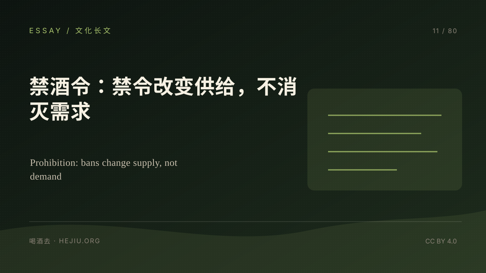

# Prohibition: bans change supply, not demand

“Prohibition” sounds like a clear order: no drinking. Yet almost every prohibition actually enforced in history quickly became a complex system of control: who may produce, who may transport, who may possess, which uses are exempt, and who enforces. The result was not that alcohol disappeared, but that supply, price and risk were redistributed.

This article takes American national prohibition from 1920 to 1933 as the main line, compares other countries, and returns to Chinese history of bans and monopolies.

Figure: thematic illustration for Prohibition: bans change supply, not demand. Image: AI-assisted illustration generated with Doubao Seedream 5.0 (project-owned); not a photograph of the subject.

## America: from movement to constitutional amendment

The 19th-century American temperance movement was driven by religious groups, women's organisations and reformers; the [Anti-Saloon League](ref:anti-saloon) was among the most effective organisers. It treated the saloon as a source of poverty, domestic violence and corruption, and pushed for local prohibition and a constitutional amendment.

In 1919 the 18th Amendment obtained enough state ratifications; in January 1920 national prohibition took effect. The accompanying Volstead Act defined intoxicating drink as anything above 0.5% alcohol and regulated production, sale, transport and possession. Religious wine and medicinal alcohol were exempted, planting the seeds of later loopholes.

## Enforcement: exemptions, moonshine and the underground economy

Prohibition did not mean no alcohol at all. Medicinal alcohol could be bought by prescription, religious wine could be allocated, and home fermentation of fruit wine was permitted within limits. Weak enforcement resources, blurred boundaries and local resistance made evasion widespread.

Moonshine and smuggled liquor entered the market, industrial alcohol was illegally converted for drinking and caused poisoning and death. Speakeasies appeared in apartments, basements and back rooms, creating a new social space with passwords and codes.

## Consequences: black market, crime and revenue

The most direct consequence was that supply moved from the legal market to the black market. Prices rose, quality escaped control, tax revenue was lost, and organised crime expanded through smuggling and underground distribution. Uneven enforcement also distributed risk by class: the wealthy could buy regulated stock, while the poor were more exposed to bad moonshine.

In 1933 the 21st Amendment repealed the 18th, ending prohibition. It was the first time in American constitutional history that one amendment repealed another. Its legacy includes more complex licensing systems, federal-state division of powers, and the formation of alcohol control as a field of public policy.

## Other countries: war, health and religion

Russia imposed restrictions on the state alcohol monopoly during the First World War in 1914 and adjusted repeatedly in the Soviet period; Finland had prohibition from 1919 to 1932 and repealed it because of smuggling and crime; Iceland prohibited alcohol from 1915, with a ban on beer lasting until 1989. Motives differed: wartime mobilisation, public health, religious ethics or nationalism.

The common point is that prohibition can reduce consumption in the short term but is hard to sustain, and often brings black markets and enforcement costs. By contrast, “control rather than prohibition” policies such as high taxation, limited hours, state monopoly and advertising restrictions are usually more sustainable.

## Chinese bans and monopolies

China treated alcohol as a fiscal object very early. In the Han period there were debates over the state wine monopoly, and the Hanshu records the state's choice between wine revenue and popular consumption. Later dynasties adjusted repeatedly among bans, taxes, licensed households and official brewing; prohibitions were often linked to grain shortages, famine or war.

Unlike American moral reform, Chinese alcohol policy was more often fiscal and grain policy. The object of prohibition was frequently private brewing and waste rather than drinking itself. This explains why ban and monopoly alternated: the state needed wine tax and also needed to limit grain use in shortages.

## Conclusion: bans change supply, not demand

The lesson of prohibition history is not that prohibition always fails, but that a ban must consider substitute supply and enforcement costs. When demand persists, prohibiting legal supply pushes the market underground and brings problems of quality, revenue and public order.

Prohibition is best read by starting with the subject it covers, moving to the sources it draws on, and ending with what it adds to the general account.

Prohibition is not mainly a story about whether people still wanted alcohol. It is a story about how supply was reorganised after legal channels closed: illicit distillation, medicinal exemptions, cross-border smuggling and organised crime filled the gap, while enforcement costs rose. The American case shows that a ban can change supply and prices without eliminating demand. Reading it only as moral failure or policy success misses the market and enforcement structure. Enforcement also changed tax structures, medical exemptions and cross-border policing, and those institutional consequences are more useful to compare than a simple question of whether people still drank.

## Decision table: a Prohibition timeline

| Date | Policy or event | Consequence for supply |
| --- | --- | --- |
| 1919 | the 18th Amendment is ratified by enough states | manufacture, sale and transport of intoxicating liquor are banned |
| 1920 | the Volstead Act takes effect | a 0.5% alcohol threshold, with medical and religious exemptions |
| 1920s | moonshine, smuggling and speakeasies expand | prices rise, quality becomes uncontrolled, organised crime grows |
| 1933 | the 21st Amendment repeals the 18th | Prohibition ends; licensing and control frameworks remain |

This table follows the main line only; motives and enforcement differed by country, so US experience should not be applied everywhere.

## Frequently asked questions

### Why did Prohibition fail?

Not because demand disappeared, but because enforcement was costly, substitute supply was strong and exemptions were wide. When legal channels closed, moonshine, medicinal alcohol, sacramental wine and cross-border smuggling filled the gap; uneven enforcement pushed the risks onto those most likely to encounter bad liquor.

### Was there really no alcohol at all?

No. Medicinal alcohol could be bought by prescription, sacramental wine could be allocated, home fermentation of fruit was allowed in limited cases, and moonshine and smuggling never stopped. Prohibition changed the channel and price of supply, not the demand to drink.

### What did it leave behind?

A more complex licensing system, federal-state division of power, and alcohol control as a public-policy field. The US case also suggests that if the goal is harm reduction, taxation, restricted hours, state monopolies and advertising limits are often more sustainable than a total ban.

> **Next:** Read the background on [Prohibition-era America](ref:anti-saloon), then [the history of taverns](ref:taverns) for the relationship between speakeasies and public space; continue with [pubs and the city](ref:public-house).

## Related entries

- [American prohibition](ref:us-prohibition): the timeline and system, 1920 to 1933.
- [Anti-Saloon League](ref:anti-saloon): organisation and mobilisation.
- [United States](ref:usa): the territory of the prohibition laws.
- [China](ref:china): bans, taxes and monopolies across dynasties.
- [History of taverns](ref:taverns): how prohibition changed tavern space.
- [Taverns and the city](ref:public-house): bars and urban life.

**Short definition:** Taking America’s national prohibition of 1920 to 1933 as the main case, with Russian, Finnish, Icelandic and Chinese experience alongside, this article explains enforcement, loopholes and consequences, and why prohibition rarely means no alcohol. 

Put [US Prohibition: The Experiment's topic next to Repeal of 1920 to 1933](ref:us-prohibition) and [United States](ref:usa)'s evidence; the difference marks the boundary.

A frequent error is to treat Prohibition as a news item. Establish what it is, then what the article argues. Neither answer settles the question alone.

The entry on Prohibition draws on U.S. National Archives, Encyclopaedia Britannica, By Ban Gu (Han); Zhonghua Book Company punctuated edition.

The US case also produced lasting effects: the 21st Amendment repealed federal prohibition in 1933, but states kept local option laws, and the criminal networks it created shaped organised crime for decades. The Russian and Finnish cases show that restriction can shift consumption to spirits and home production rather than eliminate it. Chinese and Icelandic examples add the point that enforcement capacity and public legitimacy matter as much as the legal text.

**Key facts.**

| Item | Detail |
| --- | --- |
| In one line | Taking America’s national prohibition of 1920 to 1933 as the main case, with Russian, Finnish, Icelandic and Chinese experience alongside, this article explains enforcement, loopholes and consequences, and why prohibitio… |
| Topics | prohibition、alcohol policy、legal history |
| Period | 19th to 20th century |

**Sources and limits.** The key claims about Prohibition: bans change supply, not demand are checked against the following sources: U.S. National Archives (Used to check the text, adoption and ratification dates of the 18th Amendment; Used to check the date and procedure by which the 21st Amendment repealed prohibition), Encyclopaedia Britannica (Used to check the standard account of the movement, enforcement and consequences), By Ban Gu (Han); Zhonghua Book Company punctuated edition (Used to check records of the Han state wine monopoly). Prices, batches and status change; the body is project-written and does not reproduce source text.
