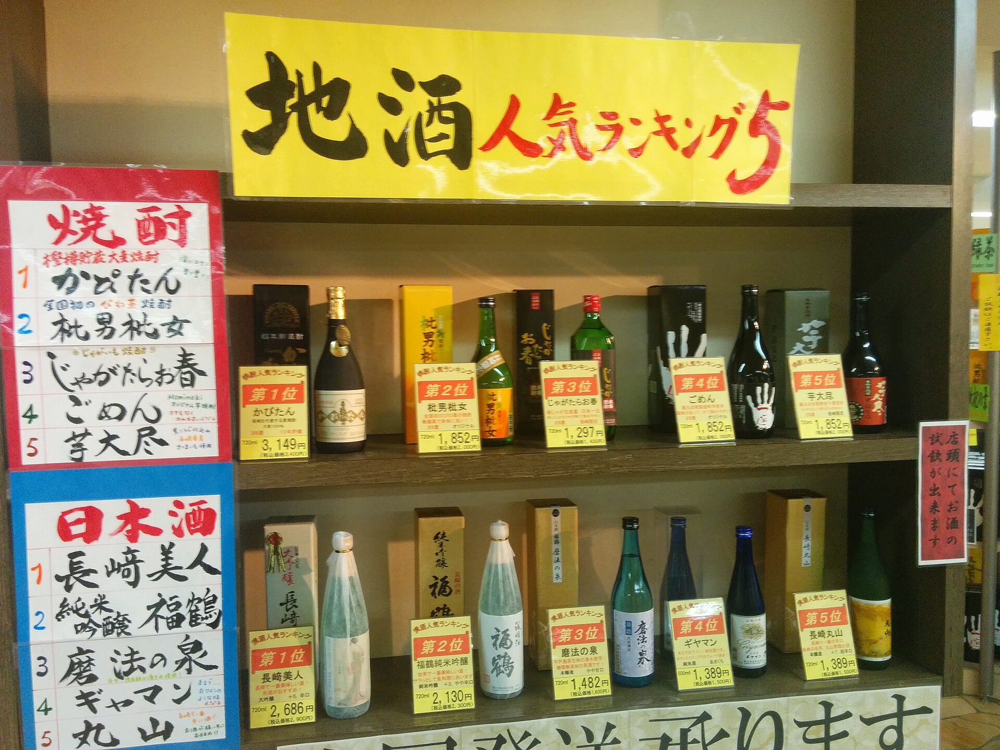

# Sake and shochu: both Japanese, but different crafts

In Chinese, “Japanese sake” is often used as a catch-all term, and sake and shochu are frequently confused. Both are linked to rice, water and Japanese brewing traditions, but their production paths differ: sake is a brewed drink and shochu is a distilled one. Once that line is clear, many label terms fall into place.

Figure: Related photograph of Sake and shochu: both Japanese, but different crafts. Image: NevinThompson, CC BY-SA 4.0, via Wikimedia Commons ([source page](https://commons.wikimedia.org/wiki/File:Local_sake_and_shochu_on_display_in_a_shop,_Nagasaki,_April_2015.jpg)).

## Where the question comes from

The confusion comes from three places. The first is naming: in Japanese, “nihonshu” usually refers to sake, while shochu is a separate category; Chinese calls both “Japanese sake”, which suggests they are two names for one drink. The second is raw material: sake is based on rice, and shochu also often uses rice, barley or sweet potato, so they look similar. The third is setting: both appear in Japanese restaurants, and temperature and drinking methods are often discussed side by side. As a result, consumers miss the key difference: sake is brewed, shochu is distilled.

## The system and its principles

The core of sake brewing is multiple parallel fermentation: starch in the rice is first saccharified by koji mould, and yeast then converts the sugar into alcohol, with saccharification and fermentation proceeding at the same time in the same system. To control flavour, rice is milled to remove the outer layers, leaving the core; this ratio is called the polishing ratio. Sake is usually pressed, filtered, pasteurised and stored, and the finished drink may be clear or retain some sake lees.

Shochu is fermented first and distilled afterwards. The mash is made by saccharification and fermentation, then passed through a still to concentrate alcohol and aroma. By distillation method, shochu is often divided into single distillation and continuous distillation. Single-distilled shochu (honkaku shochu) retains more of the raw material's character, while continuously distilled shochu is closer to neutral alcohol. Raw materials can include sweet potato, barley, rice, buckwheat and brown sugar, each bringing a different aromatic profile. Okinawan awamori, made from rice with a distinctive koji and single distillation, is often discussed alongside shochu but has its own name and tradition.

## Key categories and parameters

Common sake categories turn on whether only rice, water, koji and yeast are used, and on the polishing ratio. Junmai sake adds no brewing alcohol; honjozo adds a small amount of brewing alcohol; ginjo and daiginjo emphasise cool, long fermentation, usually with a lower polishing ratio. The exact thresholds and definitions follow the official Japanese classification, and Chinese translations of the names can vary between sources.

To read Sake and shochu, start with the subject it covers, then the sources it draws on, then what it adds to the general account; no single check settles it.

## Cases

For sake, the Niigata area is often discussed as a representative of the “light, dry” style, while Fushimi in Kyoto and the Nada district in Kobe each have their own water and brewing traditions. Tasting the same sake cold, at room temperature and warmed makes the differences in aroma and texture clear. For shochu, Kagoshima and Miyazaki are often associated with sweet potato, and the Kuma region of Kumamoto with rice, so the distillation traditions of Kyushu and Okinawa are often mentioned together. In drinking style, shochu is often diluted with water, ice or soda, while sake is more often adjusted through glass shape and temperature.

These cases are only entry points and cannot replace the label. Within the same region, different breweries, raw materials and methods still produce very different drinks. For a systematic introduction, start with [sake intro](ref:sake-intro), then compare the term pages for [sake](ref:sake) and [shochu](ref:shochu).

## Common misunderstandings

First, sake is shochu. Sake is brewed and shochu is distilled; the craft and flavour logic differ. Second, sake must be drunk warm. Sake can be served cold, at room temperature or warmed, depending on the drink and personal preference. Third, a lower polishing ratio is always better. A lower ratio means higher cost and a different flavour direction, not absolute quality. Fourth, all shochu is strong. Alcohol content varies by product, and “strong” is not part of the definition. Fifth, older sake is always better. Most sake is meant to be fresh; aged sake is a separate product to be judged from the label and the producer's advice.

## Controversies and limits

The discussion has its own boundaries. One is naming and translation: Chinese “sake”, “shochu” and “nihonshu” do not map one-to-one onto Japanese concepts, and translation can lose tax and category information. Another is raw material and origin protection: shochu raw materials, distillation methods and geographical names are being protected, and the rules follow official Japanese texts. A third is the market: sake's domestic consumption and exports behave differently, while shochu has had different waves of popularity; these trends need data, and this essay makes no estimates. A fourth is drinking advice: temperature, dilution ratio and food pairing vary by person and occasion, and there is no single answer.

This essay therefore does not prescribe “the right way” to drink either one, nor rank one category above another. For a specific product's category, alcohol content, raw materials and storage, follow the label and the producer; for tax and labelling rules, follow official Japanese publications.

## How to use it

For a beginner, classify first by “brewed or distilled”, then look at raw material, polishing ratio or distillation method. Sake works well in a smaller, inward-curving glass; try it from cold to warm; after opening, refrigerate and drink soon, away from light. Shochu can usually be kept at room temperature away from light, and can be diluted with water, ice or soda to taste, with attention to the resulting alcohol level. For food, sake is often paired with seafood and lighter dishes, while shochu is often mentioned with grilled food and stronger flavours; these are rules of thumb, and actual taste decides.

When buying, read the category name, raw materials, alcohol content and production date on the label. For words such as “junmai”, “ginjo”, “honkaku” and “barrel-aged”, confirm the definition before deciding whether it suits you. If sake and shochu are tasted in the same session, separate the glasses and temperatures so that one standard is not used to judge two different crafts.

Read [Sake](ref:sake) for the topic side of Sake and shochu, and [Fermentation](ref:fermentation) for the evidence side. Together they locate it.

## Further reading

- [Sake](ref:sake): categories and terms of the brewed drink.
- [Shochu](ref:shochu): categories and raw materials of the distilled drink.
- [Fermentation](ref:fermentation): the basis of multiple parallel fermentation in sake.
- [Distillation](ref:distillation): the core craft of shochu and awamori.
- [Japan](ref:japan): background on regions and drinking culture.
- [Sake intro](ref:sake-intro): a beginner's path from label to glass.
