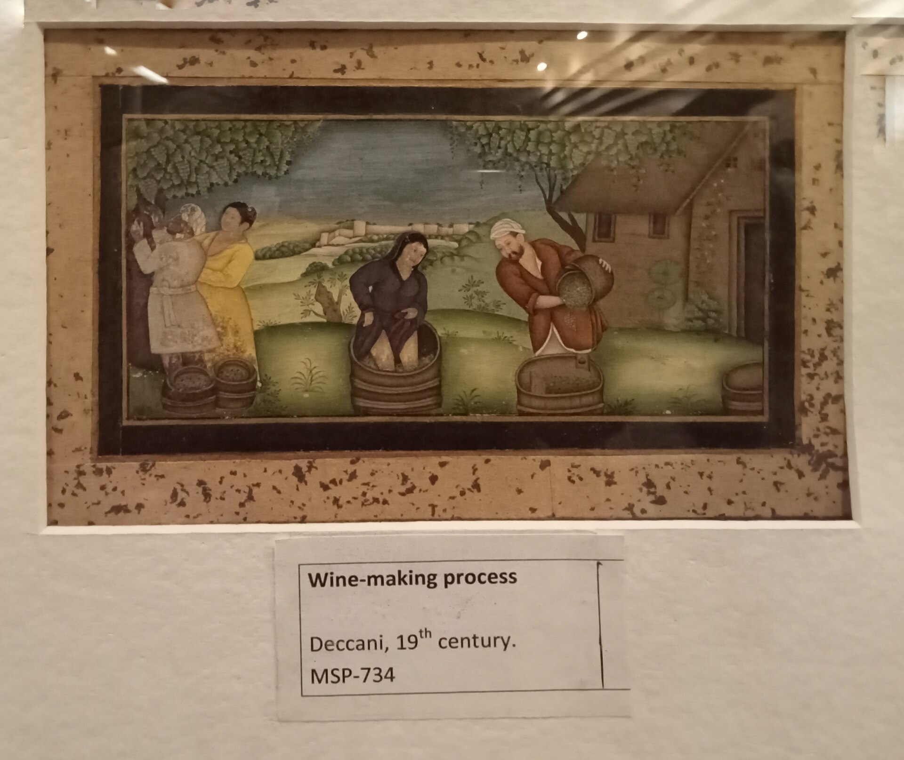

# Wine and painting: four ways to look at a drinking scene

In painting, wine is often not the subject, yet it is frequently the most informative detail. Who holds a cup, whether a jug stands on the table, where the light falls, what the other figures are doing: these arrangements describe status, time and relationships. Looking at a drinking picture only to ask “what wine are they drinking?” misses most of what is there.

This article proposes a method: read the vessels, then the space, then the relations between figures, then the narrative intention. The four layers are not a checklist but a chain from object to meaning. Four works stand for four kinds of scene and also expose the limits of the chain.

Figure: Related photograph of Wine and painting: four ways to look at a drinking scene. Image: Natasha Khaitan, CC BY-SA 4.0, via Wikimedia Commons ([source page](https://commons.wikimedia.org/wiki/File:Wine_making_process_-_Deccan_Painting_-19th_Century.jpg)).

## Argument

In painting, wine is less a beverage than an indicator of relations and institutions. The same cup on the counter of a street tavern speaks of commerce and consumption; on a low table at a night banquet it speaks of seating and power; in the hand of a mythological figure it speaks of divinity and invitation; on a Dutch household table it speaks of daily life, class and morality.

The central question is therefore not “what wine is this?” but “for whom, why and in what manner is this wine being used?” The shape of the vessel, the amount poured and the posture of the drinker are all part of the answer. But images are also constructions: they have conventions, idealisation and later copies, and cannot be read as social statistics.

## Evidence one: wine flags and the proper tavern

[Along the River During Qingming](ref:qingming) is a handscroll by Zhang Zeduan of the Northern Song, now in the Palace Museum, about 24.8 centimetres high and 528.7 centimetres long. Around the Rainbow Bridge the scroll shows dense commercial activity, with wine shops and taverns along the street, flags hanging at the doors, customers inside and grain boats on the river. Signs such as “Sun Yang shop” and the words “proper tavern” distinguish grades of wine seller.

The visual clue matches the texts. Dongjing Meng Hua Lu records that in Bianjing there were seventy-two “proper taverns”, with countless “foot shops” below them: the proper taverns had brewing rights and could wholesale to the foot shops, which sold at retail. Wine flags served as advertising, decorated gateways attracted custom, and night markets and seasonal new wine set the rhythm. Wine here is one link in an urban commercial network: grain arrives by water, wine is brewed and sold in the city, wholesale and retail are layered, and taxation and monopoly sit behind it.

When looking at the scroll, find the wine flags first, then follow them to warehouses, wharves and counters. The painter is interested in how the city works, not in the taste of one cup. Wine thus becomes a way into the urban economy of the Song rather than a still life.

## Evidence two: seating and vessels at a night banquet

[The Night Revels of Han Xizai](ref:han-xizai) is attributed to Gu Hongzhong of the Southern Tang and survives mainly in a Song copy in the Palace Museum. The scroll has five sections: listening to music, watching a dance, a pause, playing wind instruments and the dispersal of the feast. Wine runs through all of them: the seating of host and guests, the position of the performers, who raises a cup and who sits in thought are all carefully arranged. The traditional reading is that the painting had a surveillance purpose, and that Han Xizai used indulgence to avoid suspicion.

Whatever the exact political story, the image itself shows that a banquet can be watched, recorded and used to convey an attitude. The jug, warming bowl, dishes and low tables form a complete set of banquet vessels; where the jug stands and whom the cup faces are not casual choices. Wine here is not pleasure but a pose: drinking or not drinking, seeing and being seen, are part of a performance.

## Evidence three: myth and everyday life

[Caravaggio's Bacchus](ref:bacchus) was painted around 1596–1597 and is in the Uffizi. The young god holds a glass goblet, with fruit and a wine jug in front of him. The subject is classical, but the painter brings the figure very close: skin, reflections in the glass and insects on the leaves are all visible. The cup is therefore not only a symbol; it turns myth into a moment that could be touched. The figure faces the viewer and extends the cup, and the composition itself is an invitation.

The other pole is Dutch genre painting. Seventeenth-century Dutch painters often depicted indoor drinking, and [De Hooch's woman with a drink](ref:de-hooch), painted around 1658 and now in the National Gallery in London, places a figure in a softly lit room with a glass on the table and a calm, everyday relationship. Such paintings are often read as discussions of moderation, family and class: drinking is part of life and can also bring disorder.

Placed side by side, the difference is clear: myth turns wine into divinity, genre painting returns it to the room; the first confronts the viewer with a transcendent figure, the second lets the viewer recognise their own life. In both, wine is not “wine itself” but a different statement about the body, desire and social norms.

## Counterexamples and limits

First, images are not photographs. Along the River During Qingming survives in several versions and copies, and later works such as the Ming Qiu Ying version already change composition and detail; no single version can be treated as a full record of the Northern Song. Second, vessels in paintings may be idealised or archaic. A painter may combine periods and ranks for visual effect, so a single cup cannot date a whole scroll.

Third, the political reading of The Night Revels of Han Xizai comes mainly from colophons and legend, not from self-evident internal evidence. Making the surveillance story the only answer flattens the image. Fourth, the wine in Bacchus is a mythological prop, not a record of everyday drinking in 1590s Rome. Fifth, moral readings of Dutch genre painting are also disputed: not every drinking scene is a warning; some are records of life or products of market taste.

These limits do not deny the value of images. They remind us that images supply details texts do not, but cannot replace a chain of documentary evidence. The safest use is to let images, account books, notes, objects and laws correct one another.

## Division of labour with other entries

This article is about how to look at wine, not about cataloguing individual works. [The history of vessels](ref:vessels) covers the evolution of cups, jugs and bottles and the differences between materials; this article takes only the vessels visible in images as evidence. [The history of taverns](ref:history-of-taverns) covers the space and business of wine shops, inns and bars; this article asks how painters represent those spaces. Wine and ritual covers seating and the order of offerings; this article asks how that order is painted.

Attribution, date, dimensions and provenance belong to the individual artwork entries. This article does not repeat catalogue data and cites works only where the argument needs them. Seasonal drinking belongs to the festival entries. The division prevents a method article from becoming a list of works.

## See also

- [Along the River During Qingming](ref:qingming): visual material on the Song city and its wine shops.
- [The Night Revels of Han Xizai](ref:han-xizai): banquet, seating and political situation.
- [Caravaggio's Bacchus](ref:bacchus): a close-up treatment of the wine god.
- [De Hooch's woman with a drink](ref:de-hooch): everyday drinking in a Dutch genre scene.
- [The history of vessels](ref:vessels): changing shapes of cups, jugs and bottles.
- [The history of taverns](ref:history-of-taverns): wine shops and urban space.
