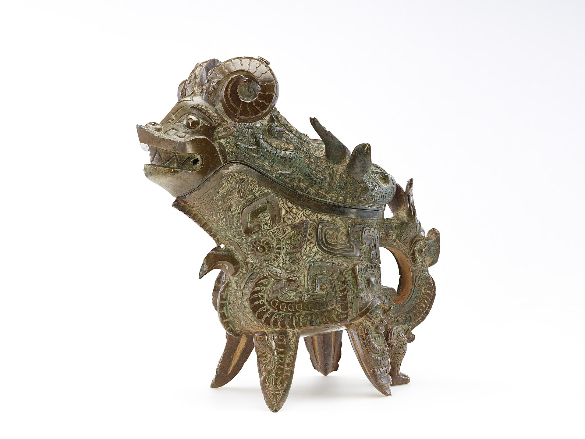

# Wine and ritual: from village drinking rites to the modern toast

In Chinese tradition, wine is first a ritual drink. It appears in sacrifice, capping, marriage, village drinking, audiences and banquets, and its role is not to quench thirst but to arrange relations into a visible order: who lifts a cup first, who drinks after, where the cup is placed, which vessel is used. Once that order is understood, many otherwise fussy rules make sense.

It should be said at the outset that the classics describe an ideal, while later practice was often simplified, transformed or distorted. Ritual books should be read as normative texts, not social records. This article therefore separates three layers: what the classics prescribe, how institutions operated, and how today's toasts descend from that prescription.

Figure: Related photograph of Wine and ritual: from village drinking rites to the modern toast. Image: anonymous, CC0, via Wikimedia Commons ([source page](https://commons.wikimedia.org/wiki/File:Ritual_wine_ewer_(gong)_with_masks_(taotie),_dragons,_and_real_animals.jpg)).

## Argument

The core function of wine in ritual is to order people, not to please the palate. It does so through three operable means: the rank of vessels, the order of seating and the number of offerings. Together they turn abstract seniority, closeness and hierarchy into actions that can be seen, imitated and criticised.

But ordering people is not the same as forcing drink. Ritual books also stress moderation: drinking should have a limit, and losing decorum is the real breach. Later pressure to drink turned “how much” into “face”, exactly inverting the purpose. Understanding wine and ritual is a way to see power at the table, not to justify pressure.

## Evidence one: wine officials and the five qi and three wines

The Rites of Zhou establishes offices such as the wine director, wine officer and beverage officer, responsible for brewing, storage and supply. The wine director “controls the orders of wine and issues the materials by rule”, distinguishing the five qi — pan, li, ang, ti and shen — and the three wines — shi, xi and qing. The five qi are distinguished by fermentation and clarity, the three wines by use and age.

This classification shows that wine was a manageable resource, not a casual consumer good. Sacrificial wine stressed purity and rank, while banquet wine was allocated by the status of guests. The Monthly Ordinances in the Liji also set seasonal brewing and drinking arrangements, with the state controlling production and consumption through a timetable grounded in both food security and ritual order.

## Evidence two: the village drinking rite in the Yili

The village drinking rite was an important local ceremony, found in the Yili and in the Liji's “Meaning of the Village Drinking Rite”. Its sequence includes welcoming guests, offering wine, performing music, circulating cups and seeing guests off. The point is not drinking but order: seating and drinking sequence were arranged by age, conduct and status, so that the young could observe and learn from their elders.

The Liji makes the rule concrete: “Those of sixty sit, those of fifty stand and serve, to hear the affairs of government, so as to make clear respect for elders. Those of sixty receive three dishes, seventy four, eighty five and ninety six, so as to make clear the care of the aged.” The dishes increase with age. Wine and food together turn respect and care into measurable treatment. The text also explains that the rite taught villagers seniority and avoided disputes. Wine was the medium; what was transmitted was the norm. For this reason drunkenness was strictly limited, and loss of decorum was recorded and criticised.

## Evidence three: sacrifice, chang and dark wine

Sacrificial wine had its own names and procedure. The [Book of Songs](ref:shijing) repeatedly uses chang and li in sacrificial poems. Chang was a fragrant wine made from black millet and tulip-like herbs, thought to invite the spirits; li was a sweeter, lighter wine. Wine was poured, offered and used to summon, and scent itself was a medium of communication.

The Liji's “Jiao Te Sheng” says that though wine and sweet liquor are beautiful, “dark wine and clear water are honoured, valuing the root of the five flavours”. Dark wine is plain water, clear water is dew gathered under the moon; the rite placed the plainest water alongside wine to express a return to the origin. This differs greatly from modern assumptions: people often think sacrifice means “offering a good bottle”, while the ancient rite cared more about type, temperature, vessels and the order of offerings. Quality mattered, but conformity to ritual mattered more.

## Evidence four: vessels, the wedding cup and later transformation

[Vessels](ref:history-of-vessels) were the material carriers of ritual. In Shang and Zhou bronzes, the number, form and combination of jue, gu, zun and you were often tied to status; the “jue” and “gong” of the Book of Songs and the ritual books were both drinking vessels and ritual objects. Once an object entered ritual, capacity alone was not enough; its place in the set mattered. This is why a combination in an archaeological find says more about its owner than a single piece.

The wedding cup shows how ritual becomes custom. The Yili's “Shi Hun Li” records “sharing the gourd and rinsing the mouth”, splitting a gourd in two so that bride and groom each drink from one half, symbolising union. Today's [wedding cup](ref:wedding-wine) or crossed-arm drink is related to the ancient rite, but the modern form is highly entertaining. In explaining such customs, it is best to separate a documented origin from contemporary reinvention.

## Counterexamples and limits

First, ritual books are norms, not records. Drinking was heavy in the Shang, and the many bronze wine vessels from Fu Hao's tomb show that the elite used wine in quantity; the “Announcement about Wine” in the Book of Documents is an early Zhou warning against drinking, reflecting Zhou criticism of the previous dynasty. Placed together, the two show that ritual was often a correction of reality, not a mirror of it.

Second, the village drinking rite changed later. It could merge with local ceremonies for the aged, the “deer call” banquet for examination graduates and clan banquets, and its sequence was no longer the pre-Qin original. Presenting later seating rules directly as “Zhou ritual” is a common misattribution.

Third, the ritual books differ among themselves. The Rites of Zhou leans toward institutional design, the Yili toward ceremony, the Liji toward explanation and elaboration; their dates and standpoints differ, and they cannot be treated as one code.

Fourth, modern pressure to drink is the opposite of ritual moderation. The Liji repeatedly stresses limit, and loss of decorum is the breach; “if you don't drink, you don't give me face” turns capacity into a test of power, unrelated to ordering people and even less to moderation.

## Division of labour with other entries

This article deals with how ritual uses wine to arrange relations and does not describe specific sacrificial operations. The [sacrificial wine](ref:china) entry covers household, grave and public sacrifice today, and this article takes only the structure of the three offerings and libation. [The history of vessels](ref:history-of-vessels) covers the forms and periods of jue, gu, zun and you, and this article discusses only their rank significance in ritual.

[The wedding cup](ref:wedding-wine) entry covers the origin and modern change of wedding drinking, and this article takes only the textual basis in the Shi Hun Li. [Qiang Jin Jiu](ref:poem-li-bai) covers the rhetoric of urging drink in banquet poetry, and this article does not develop literary analysis. [China](ref:china) provides the geographic background of ritual and local custom.

## See also

- [Book of Songs](ref:shijing): vessels and ritual language in sacrificial and banquet poems.
- [China](ref:china): the geographic background of ritual and local custom.
- [The wedding cup](ref:wedding-wine): origin and change of wedding drinking.
- [The history of vessels](ref:history-of-vessels): forms and rank of jue, gu, zun and you.
- [Qiang Jin Jiu](ref:poem-li-bai): the rhetoric of urging drink in banquet poetry.

Start with the author and publication. From there, consider what the article covers, then what it is cited for here. That is how a practical judgment about Wine and ritual is built.