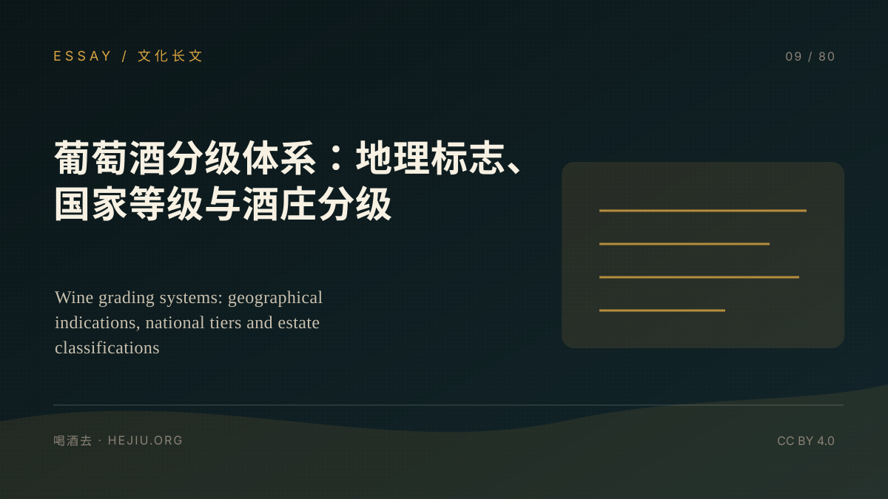

# Wine grading systems: geographical indications, national tiers and estate classifications

Wine labels carry a string of abbreviations: AOC, AOP, IGP, DOCG, DO, VP. All are translated into Chinese as “grading”, yet they point to different systems. Reading “grading” as a single ladder from low to high is one of the most common consumer misunderstandings. To read these labels, one must first separate what each is actually certifying.

Figure: thematic illustration for Wine grading systems: geographical indications, national tiers and estate classifications. Image: AI-assisted illustration generated with Doubao Seedream 5.0 (project-owned); not a photograph of the subject.

## Where the question comes from

The word “grading” covers at least three layers. The first is geographical indication protection: whether a wine comes from a defined area and follows that area's production rules. The second is a national or regional quality tier, such as France's AOC/AOP, Italy's DOCG/DOC/IGT or Spain's DO/VP. The third is a historical classification within estates, plots or villages, such as the classifications of Bordeaux estates or Burgundy's hierarchy from regional and village appellations to premier cru and grand cru.

These three layers often appear on the same bottle, so consumers stack them into a single score: the higher the tier, the better the wine. In reality, a geographical indication certifies origin and rules, while a historical classification records the choices of a particular evaluation system at a particular time. Neither directly proves the quality of the bottle in front of you.

## The system and its principles

The EU common organisation of the markets in agricultural products provides a shared framework for member states. Within it, wine can be broadly divided into wine with a protected designation of origin, wine with a protected geographical indication, and wine without a geographical indication. AOP requires grapes to come from the defined geographical area and production to follow that area's rules; IGP is less restrictive and allows a substantial share of local grapes, with the exact proportion and rules following the legal text.

On that foundation, countries have built their own names and tiers. France has INAO administering AOC/AOP and related origin marks; Italy uses DOCG, DOC and IGT; Spain uses DO and VP; Germany has a quality system centred on ripeness at harvest. The names differ, but the logic is often shared: geography, varieties, yields, minimum alcohol and production methods fix “a certain wine from a certain place”.

Estate and plot classification follows another logic. It does not try to cover every region; instead, history, markets or industry bodies rank estates, plots or villages within a specific area. Such classifications carry strong historical inertia and change with ownership, markets and rule revisions. When you see “classed growth”, “premier cru” or “grand cru”, ask first: which system, covering which area, recognised by whom?

## Key categories and parameters

To read the “grading” of a wine, work through the layers: first, whether it carries a geographical indication, and whether that is AOP or IGP; second, which country and which tier it belongs to; third, whether it also carries an estate, plot or village level. The region name, variety, vintage and producer on the label usually say more than an isolated abbreviation.

At the level of rules, the key parameters include the area of origin, permitted varieties, minimum alcohol, maximum yields, planting density, pruning methods, harvesting and winemaking methods, and the terms permitted on the label. These can change between regions, vintages and revisions, so specific figures and conditions should follow the officially published standard text. This essay does not list exact proportions or limits, precisely to avoid turning rules that change into fixed conclusions.

## Cases

France is the most frequently cited example. The AOC/AOP system ties region, variety and method together; [Champagne](ref:champagne) is one of the best-known origin designations, while [Bordeaux](ref:bordeaux) and [Burgundy](ref:burgundy) each have their own regional hierarchy and traditions of estate or plot classification. Within the same “Bordeaux” area, wines of different tiers, estates and vintages vary greatly and cannot be summed up by one label.

[Italy](ref:italy) uses DOCG, DOC and IGT for origin rules of differing strictness; Spain uses DO and VP, the latter recognising estate or specific-plot level. Germany's quality classification is often linked to ripeness at harvest, but that is not the same as sweetness, nor the same as consumer preference. Placing these systems side by side is not an exercise in ranking, but in seeing what kind of rules each uses to answer “where does this wine come from?”

## Common misunderstandings

First, the higher the tier, the better. Grading certifies origin and rules, not the current bottle's flavour. Second, AOP equals an absolute quality guarantee. AOP constrains origin and method, not whether every bottle will suit you. Third, IGP means low-end. IGP rules are broader, but that does not make the wine poor; many estates use IGP for more experimental products. Fourth, only the Old World grades wine. New World countries also have geographical indications, regional naming and estate classifications, with different names and legal foundations. Fifth, comparing tiers across countries directly. AOC, DOCG and DO are not marks on the same ruler.

## Controversies and limits

The disputes around grading begin with the mismatch between history and the present: estate rankings formed decades ago may not reflect today's climate, ownership and winemaking. Next comes expansion and revision: changing the area of a region, or loosening and tightening variety rules, gives old labels new meanings. Third is climate change: ripeness, acidity and style are shifting, and the old rules may need rethinking. Fourth is market communication: the more complex the abbreviations, the more easily they become marketing symbols.

This essay therefore explains the institutional framework without judging the actual level of any region or estate. For a specific product's tier, vintage, yields and label terms, consult the producer and the official rules. When comparing across countries, compare similar styles, vintages and price bands rather than the abbreviations themselves.

## How to use it

When reading a label, ask three questions: where does this wine come from? Which set of origin rules does it follow? Is the tier a geographical indication, a national tier, or an estate or plot classification? Then look at vintage, producer, variety and alcohol content. When buying, treat the tier as one filter rather than the only criterion; at the same price, comparing region, vintage and tasting notes is usually more useful.

For long-term storage, tier is not the only indicator of ageing potential; consider the type of wine, vintage, acidity, sugar, tannin and storage conditions, as discussed in [wine storage](ref:storage). To understand why origin matters, read further on [terroir](ref:terroir) and [appellation](ref:appellation). Finally, any claim about “grand cru”, “classed growth” or “premier cru” should be checked against the current official text of that system.

## Further reading

- [Wine](ref:wine): an overview of the category.
- [Appellation](ref:appellation): the core idea of geographical indications and naming.
- [Terroir](ref:terroir): how place, climate and soil enter the discussion of flavour.
- [Bordeaux](ref:bordeaux), [Burgundy](ref:burgundy) and [Champagne](ref:champagne): three frequently discussed French regions.
- [Italy](ref:italy): background on the DOCG/DOC/IGT system.
- [Wine storage](ref:storage): how to keep a wine after buying it.
