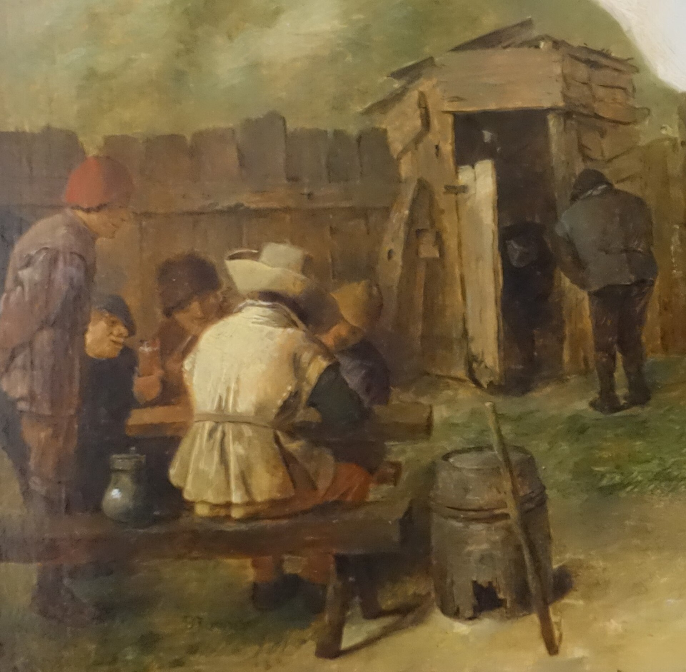

# Brouwer's The Drinker: A Tavern and a Face

The people in Brouwer's paintings are rarely respectable. They drink, smoke, quarrel and fall asleep, their faces flushed and their expressions out of control. Yet it is precisely these unrespectable faces that made his work feel new in the seventeenth century: he did not paint peasants as kind shepherds in a pastoral, nor as pure jokes; he painted people stripped of their guard by alcohol and noise, at once ridiculous and pitiable.

Figure: Artwork image of Brouwer's The Drinker: A Tavern and a Face. Image: Karmakolle, CC0, via Wikimedia Commons ([source page](https://commons.wikimedia.org/wiki/File:Seated_Drinkers_by_Adriaen_Brouwer_-_detail.jpg)).

## Object information

The painter is Adriaen Brouwer (c. 1605/1606–1638), a Flemish artist. The Mauritshuis in The Hague catalogues the work as Drunken Peasants at an Inn, dated about 1625–1626; the medium is oil, and the support, dimensions and inventory number should follow the museum record. In Chinese such scenes are often loosely called The Drinker or Peasant Drinking; this article follows the museum title while keeping the general label.

It is worth noting that Brouwer's works with similar or identical subjects are more than one, and different museums, auction catalogues and older literature may use titles such as The Drinker, Peasant Drinking or Drunken Peasants. When searching, use the museum number and title to avoid confusing different works.

## The picture and its drinking vessels

The scene is the interior of an inn. Several people sit or stand, drinking, smoking and talking; in the foreground a woman has slid off her stool and fallen asleep. The Mauritshuis description says, in effect, that no one in this inn is still sober: drink, tobacco and excitement have deprived everyone of their senses. That sets the tone clearly: this is not a quiet meal but a noisy, out-of-control scene with a comic edge.

The vessels are not refined. They are more like everyday jugs, cups or pots, matching the coarse clothes, wooden table and dim interior. Wine or beer is not an object of "tasting" but something drunk in large gulps; its role is not to display status but to push people into loss of control. This article does not list the liquid in the vessels, because reproductions make it hard to judge; what matters more is how the vessels are used: who pours, who drinks, who has already drunk too much.

## Links to drinking culture

Inns and taverns were important spaces in the urban and rural life of the seventeenth-century Low Countries. They were not only places to drink but also places for news, trade, argument and sociability. Brouwer paints this space as crowded, dim and slightly chaotic; drink is both the medium of sociability and the cause of loss of control. It lets people leave work and rules for a while, but also exposes greed, laziness and vulnerability.

Such pictures are often classified as "low-life genre": the painter does not paint aristocrats and myths but peasants, drunkards, smokers and vagabonds. But "low" does not mean "meaningless". Beneath the comic surface, Brouwer often observes human weakness coolly; he neither mocks his figures nor beautifies them. Drink and tobacco here are part of early modern consumer culture and objects of moral discussion. For tavern history, see [History of Taverns](ref:history-of-taverns); for bars and urban life, see [Pub and the City](ref:pub-and-city).

## Technique and historical context

Brouwer's brushwork is distinctive: he does not aim for a smooth finish but uses short, loose, almost sketch-like strokes to build faces, hands and clothes. Expressions are exaggerated but not structurally careless; drunkenness is painted concretely without becoming a cartoon. This "loose but not falling apart" handling gives the picture a sense of presence, as if the painter were watching from a corner of the inn.

He worked in the early seventeenth century, when Flemish and Dutch genre painting was developing. Inns, peasants, drinking and smoking were common subjects, but Brouwer's treatment is more direct and less polished. He influenced later Flemish genre painters such as David Teniers the Younger and Adriaen van Ostade, and his small works were valued by collectors of the time. The precise relationships and collecting history should follow art-historical research and museum material.

## Collection and provenance

The work is now in the Mauritshuis. Its early ownership, the date it entered the museum and its exhibition history should follow the museum record. For the viewer, its place in the seventeenth-century genre tradition matters: the same museum holds other tavern and drinking scenes, and seeing them together shows how different painters handled the relation between drink and people.

Brouwer's works are usually small and reward close viewing. This also shapes his handling: brushwork and expression become clear only at close range, while from a distance they may dissolve into a patch of colour. In a museum today, it is worth stepping closer to see the flush on a face, the looseness of a mouth and the unfocusing of an eye; these details explain the effect of drink better than the "story".

## Common misreadings

First, treating it as a "drunkard joke". There is comedy, but the painter's observation is cool and even sympathetic; it is not simple mockery.

Second, reading it as pure moral preaching. Drink and tobacco can be read as warnings, but the picture does not deliver a clear "lesson"; it is more like a mirror in which the viewer judges for themselves.

Third, treating the figures as "peasant types" without individuality. Brouwer paints faces with great specificity; each person has a distinct expression and posture, and a type label erases those differences.

Fourth, treating the vessels as irrelevant props. Jugs, cups and pipes drive the action and suggest consumption and sociability; they are not background decoration.

## How to look

Begin with the foreground: the woman who has slid off her stool, her posture putting "loss of control" at the front of the picture. Then look at the men's faces: who is laughing, who is staring, who is speaking. Then look at the vessels and pipes: whose hands hold them, and how they pass. Finally look at the space: how the walls, table and shadows enclose the figures.

If possible, compare a tavern scene by David Teniers the Younger or Adriaen van Ostade. Brouwer's pictures are usually smaller, coarser and more direct; Teniers is more narrative and polished, Ostade gentler. After the comparison, the drunkenness in this picture will no longer seem like a standard genre prop but a close observation of human nature.

## See also

- [Beer](ref:beer): beer types and drinking traditions.
- [History of Taverns](ref:history-of-taverns): how taverns became part of urban life.
- [Pub and the City](ref:pub-and-city): bars, neighbourhoods and urban life.
- [Beyond the Pub](ref:beyond-the-pub): drinking spaces beyond the traditional bar.

For Brouwer's The Drinker, begin with the maker and date, then the collection, and finish with the reproduction source; that order keeps the account grounded.

[Beer](ref:beer) explains creator; [Reading a city through its bars](ref:pub-and-city) adds medium. Put Brouwer's The Drinker between them before deciding what it is.
