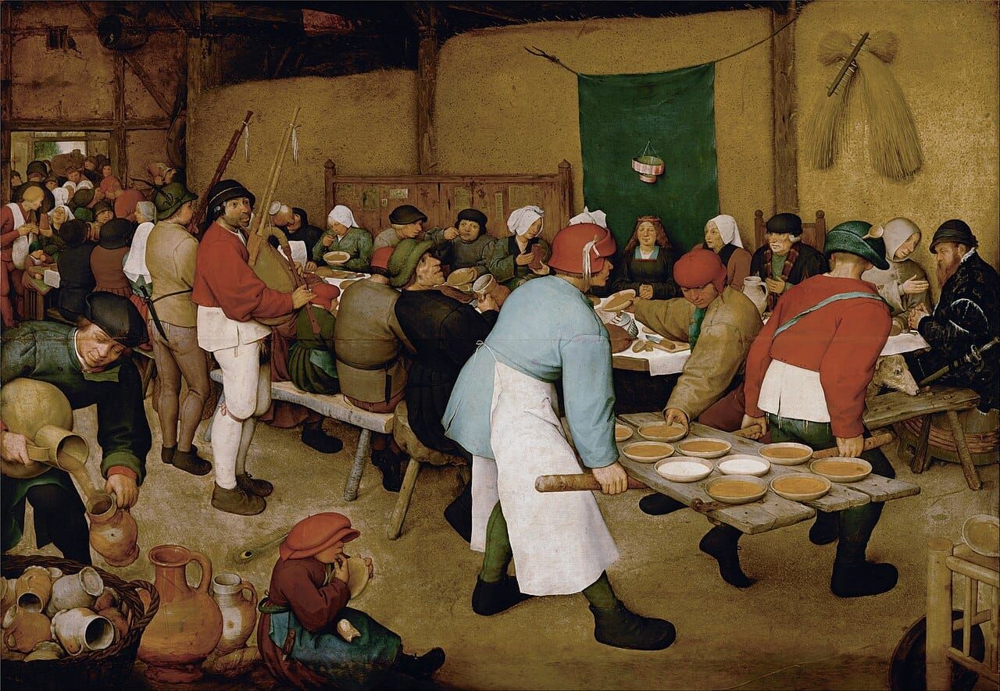

Figure: Reproduction of Bruegel's Peasant Wedding, 1568, Kunsthistorisches Museum, Vienna; not a documentary record of the wedding.. Image: Pieter Bruegel the Elder, Public domain, via Wikimedia Commons ([source page](https://commons.wikimedia.org/wiki/File:Pieter_Bruegel_the_Elder_-_Peasant_Wedding_-_Google_Art_Project.jpg)).

> **Quick verdict**
> **In one line:** This artwork entry helps you look at The Peasant Wedding: Bruegel Paints a Village Feast as a Cross-Section of Society, and place it in the history of drinking imagery.
>
> - **Best for:** Anyone who wants The Peasant Wedding: Bruegel Paints a Village Feast as a Cross-Section of Society in the history of drinking imagery, not as a standalone picture.
> - **Not for:** If you want want a single image without the period or drinking context.
> - **Check first:**
>   - The protagonist of the picture is not drink.
>   - Start with the diagonal: the long table runs from the lower left toward the back and leads the eye to the bride.

## A wedding crowded into a barn

The picture leaves almost no empty space. At the left, guests are still pushing through the door; in the middle, a long table is packed with people; at the right, a green cloth hangs against the wall, and the bride sits in front of it with a paper crown suspended above her head. In the foreground, two men carry a stack of porridge bowls on a door taken off its hinges. A servant in red pours beer from a large jug into smaller ones. A child sits on the floor eating. A dog lies under the table.

This is Pieter Bruegel the Elder's *Peasant Wedding*. The painter (c. 1525–1569) looks like a snapshot maker: a door used as a tray, guests crowding at the entrance, a child eating on the floor, a dog under the table. The details are so specific that the painter seems to have walked into the barn and recorded what he saw. But the museum's description warns us that the "snapshot" is carefully composed. The positions, gazes and gestures are arranged. The picture is not a photograph. It is an organised village feast.

## Object information

The panel is dated 1568 and painted in oil on oak. The Kunsthistorisches Museum gives dimensions of about 114 by 164 centimetres, with the painted surface about 113 by 164 centimetres. The inventory number is Gemäldegalerie 1027. It hangs in Room X of the Picture Gallery in Vienna.

The space is a Flemish barn or large peasant room, not a city dining hall. The wedding guests surround a long table set with bread, porridge and simple utensils; hay and farm tools hang near the wall. The bride sits in front of the green cloth, with the paper crown above her. The bridegroom is not in the picture. According to Flemish custom, he did not appear at the wedding table until the evening. That absence is essential: this is not a portrait of the couple. It is a picture of the bride at the table and the groom still to come.

Several figures do not belong to the peasant household: a lawyer or notary with a cap, a Franciscan monk, and the lord of the manor with his dog. They stand among the crowd, showing that a wedding was not only a family event. It involved land, church and law. Bruegel does not turn them into caricatures. He lets them mix naturally with the feast. That social mixture is more complex than a simple "peasant genre" label suggests.

## What the drink and food are doing

The protagonist of the picture is not drink. It is the logistics of the feast.

First, **beer is an everyday drink**. The clearest drinking action is the servant in red pouring beer from a large jug into smaller ones. In the sixteenth-century Low Countries, beer was a daily drink, especially in the countryside; it was cheaper than wine and safer than water. Drinking beer at a wedding was not "low". It was part of the local food system. The page on [beer](ref:beer) explains beer's place at the time.

Second, **food measures the feast**. Two men carry porridge on a door, which means there are too many guests for ordinary trays; the bread, bowls and spoons on the table are plain. Bruegel does not paint an abundant banquet. He paints a village meal that is sufficient but not refined. That plainness makes the scene credible and makes the door-tray the most famous gesture in the picture.

Third, **drink and order**. Who pours, who carries, who sits, who stands, who pushes in at the door: these positions form a village social order. Beer flows from the large jug to the small jug, from the servant to the guests. It is an invisible line connecting rank and procedure. This resembles the tavern space discussed in [the history of taverns](ref:taverns): drink is not an isolated beverage but a medium that organises people.

## Bruegel and the peasant subject

Bruegel was one of the most important genre painters of the sixteenth-century Netherlands. He painted peasants, festivals, proverbs, religious allegories and landscapes, but "the peasant" in his work is never simply rustic or ridiculous. He shows vulgarity and vitality, the noise of the feast and the solitude inside the crowd. Scholars still argue whether his peasant pictures are sympathetic, satirical or a detached observation. *The Peasant Wedding* is usually placed closer to observation: it neither turns the peasants into caricatures nor idealises them.

The composition is deliberate. The long table runs diagonally from the foreground toward the back left; the guests' bodies line up along it, and the gaze is led to the bride. She sits in front of the green cloth, the quietest person in the picture. She cannot eat or speak; she can only sit. The noise around her forms a contrast. That contrast is not accidental. Bruegel makes the "protagonist" of the wedding the most passive person, and the "supporting cast" the most active.

## Why it matters

**It turns daily life into history painting.** In the sixteenth century, history and religious painting ranked highest; a peasant wedding was a "low" subject. Bruegel uses a large panel, a complex composition and a crowd of figures to paint a village feast, raising ordinary experience to the level of serious observation.

**It preserves details of food and wedding custom.** The door-tray, paper crown, green cloth, beer jugs, porridge bowls and bagpipe player are not decoration. They are evidence of life in the sixteenth-century Low Countries. Historians of food and custom can read things in this picture that text sources do not record.

**It makes the feast an image of social relations.** A wedding is not only two people marrying. It brings family, neighbours, church, landlord and law into one room. Bruegel does not paint "how happy the peasants were". He paints how a village community organises a feast.

## Common misreadings

**Misreading one: this is a snapshot.** It looks like one, but the positions, gazes and gestures are designed. The museum explicitly calls the "snapshot" carefully composed. Treating it as a photograph misses the painter's arrangement.

**Misreading two: the groom's absence means the wedding is incomplete.** The groom was absent from the table by Flemish custom; the painter did not forget him. Understanding that custom explains why the bride sits alone in front of the green cloth.

**Misreading three: the peasants are all drunk.** The picture shows no drunkenness or chaos. The guests are crowded, the child eats on the floor, the servant pours beer, but the overall order holds. Bruegel paints the bustle of a feast, not its collapse.

**Misreading four: this is a satire of peasants.** There is humour, but the peasants are not turned into animals or cartoons. The lawyer, monk and lord show that this is not "the peasants' own world" but a village society penetrated by outside power. Whether it is satire remains a scholarly debate, and should not be settled by assertion.

## How to look at it

Start with the diagonal: the long table runs from the lower left toward the back and leads the eye to the bride. Then look at the door in the foreground. Two men carry it, bodies leaning forward, steps matched; it is the most dynamic action in the picture. Then look at the bride. She sits before the green cloth, the paper crown above her; the noisier the room, the quieter she becomes. Finally look at the door. Guests are still pushing in; the feast has begun, but not everyone has arrived.

Compare it with [The Drinker](ref:brouwer)'s *The Drinker*: Brouwer paints noisy individuals in a tavern; Bruegel paints a group order inside a feast. Compare it with the festival images discussed in [wine and festivals](ref:festivals): weddings, harvests and carnivals are occasions of collective eating, where food and drink bring people together and also display rank.

Finally, place [wine and painting](ref:painting) here. The relation between drink and art is not only "what drink appears in the picture". It also includes who is allowed into the feast and who is painted. Bruegel puts peasants, servants, children and a dog into a large panel. That choice is itself an attitude.
