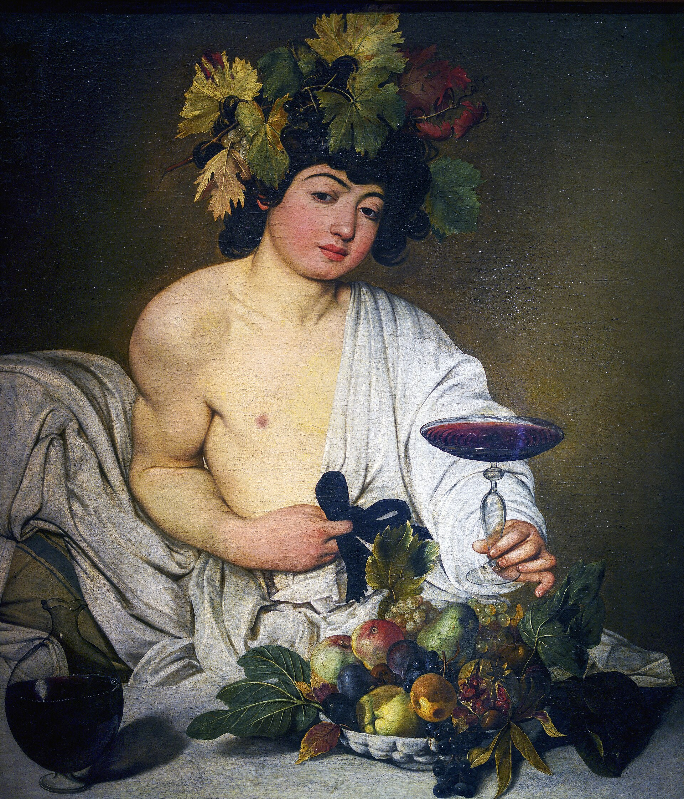

# Caravaggio's Bacchus: A Glass of Wine and a Basket of Fruit

In the Uffizi Galleries, Caravaggio's Bacchus is often taken in as a handsome portrait of a young man. The picture is not quiet, though: a glass is offered to the viewer, a basket of fruit is painted almost to the touch, and the wine god's gaze carries both intoxication and distance. Myth, still life and portrait are compressed onto one canvas, leaving a puzzle that is not read in a single pass.

Figure: Artwork image of Caravaggio's Bacchus: A Glass of Wine and a Basket of Fruit. Image: Caravaggio, Public domain, via Wikimedia Commons ([source page](https://commons.wikimedia.org/wiki/File:Bacchus_by_Caravaggio_1.jpg)).

## What is happening in the picture

The picture shows a half-length youth seated on cushions, wearing a wreath of vine leaves, with a white robe slipping from one shoulder. His left hand holds a shallow, wide glass filled with red wine, its rim turned towards the viewer as if inviting us to take the drink. In front, to the right, is a basket of fruit, with grapes, apples and other fruit piled up and described in great detail.

The Uffizi page describes the gesture as “the cup of wine proffered by the god” and notes that Bacchus has a stunned expression because of his state of inebriation. The wording reminds us that the figure is not merely a mythological sign: his body and expression belong to someone who has been drinking. Wine here is both an attribute—Bacchus is of course connected with wine—and an action: he is handing it to you.

## Basic information about the painting

The Uffizi page gives the following information: the artist is Michelangelo Merisi, known as Caravaggio (1571–1610); the date is about 1598; the medium is oil on canvas; the dimensions are 95 × 85 cm; the inventory number is 1890 n. 5312. Different publications may date it slightly differently, but the common range is the late 1590s, during Caravaggio's early years in Rome.

The painting belongs to an early series of half-length figures. The official page groups it with the Boy with a Basket of Fruit (Galleria Borghese, Rome), the Boy Bitten by a Lizard (Fondazione Longhi, Florence), and the Basket of Fruit (Pinacoteca Ambrosiana, Milan). All are close-up half-length compositions with strong light and finely painted still life. Bacchus is therefore not an isolated masterpiece but a key to Caravaggio's early style.

## A glass of wine and a basket of fruit

What is most easily overlooked is the weight of the still life. The fruit basket is not decoration and the glass is not a prop; both are painted as if they could stand alone as pictures. The Uffizi page says that Caravaggio displays a masterful naturalistic portrayal of still life here, and that the details of the basket and the cup are surprising.

The page also notes that some critics have interpreted these elements as a Horatian invitation to frugality, conviviality and friendship. That reading need not be the only answer, but it shows that the picture is not simply “Bacchus drinking”. Wine and fruit together can be read as pleasure and as a limit on pleasure; as hospitality and as a test of the viewer.

For readers today, the easiest mistake is to map the wine directly onto some modern drink. Caravaggio painted the drinking imagination of late-16th-century Italy; the shape of the glass, the colour of the wine and the manner of drinking all belong to that period. For today's classification of wine, see [Wine](ref:wine); for wine's place in a longer cultural history, see [Time in a Cup](ref:time-in-a-cup).

## Bacchus's drunkenness and classical models

The Uffizi page notes that the figure of Bacchus looks like a sculpture, and that his drunken state gives him a stunned expression; the image draws on classical art, especially portraits of Antinous, and is given a languid sensuality. The art historian Mina Gregori also detected in the painting a vision of antiquity that celebrates the freedom of the senses and points to Bacchic rites and initiation ceremonies in Rome.

This layer matters. It shows that Caravaggio was not painting “Bacchus” as a merely charming young man, but layering classical sculpture, religious ritual and contemporary life on top of one another. Bacchus is both a mythological figure and a body under observation; his drunkenness can be read as excess or as a state beyond the everyday.

## Who commissioned the painting

The Uffizi page says the painting belongs to Caravaggio's early Roman period, when he was under the patronage of Cardinal Francesco Maria del Monte. In 1608 Del Monte gave the painting, together with the Medusa, to Ferdinando I de' Medici on the occasion of the wedding of his son Cosimo II.

This provenance places the work in a specific network of people: it was not a casual studio exercise but a gift exchanged, celebrated and displayed among patrons. With this in view, the Bacchus is not only “the artist's imagination” but an object with a place in early-17th-century court and collecting systems.

## From storeroom to the Uffizi

The painting's modern fame also has a discovery story. The Uffizi page records that it was found in the Uffizi's storerooms in 1913 and attributed to Caravaggio by the art historian Roberto Longhi. Before that, it was not publicly known under its present name and status.

This history is a reminder that the status of a classic is not innate. Attribution, archives, exhibitions and scholarship all change a painting's fate. A “masterpiece” in a gallery today may have spent years in storage, misidentified or forgotten. Keeping this layer in mind makes looking at the picture more interesting, not less.

## Common misreadings

First, treating Bacchus as a simple portrait. There is a specific face and body, but the Bacchic attributes, the still life and the classical models show that it is more than a portrait.

Second, fixing the date too precisely. The Uffizi says “about 1598”, and other sources may give slightly different years; without new evidence, “about” is the safer word.

Third, taking the glass as a modern stemmed wine glass. Late-16th-century glassware had different shapes, and the shallow, wide, transparent vessel is part of the pictorial effect.

Fourth, reading Bacchus's expression as simple happiness. The official description stresses intoxication and a stunned look; it is a state changed by wine, not a festive smile.

## Why it is still worth seeing today

The painting brings three things together: myth, still life and the human body. It shows that wine in art is never only “something to drink”; it can be an attribute of a god, a gesture of hospitality, a moral test, or an image of the classical world.

If you are interested in the actual taste of wine, start with [First Tasting](ref:first-tasting); if you are more interested in wine's place in culture, this painting is a good starting point. It offers no drinking advice, but it offers a way of looking: first the glass, then the figure, then the viewer outside the picture who is being invited in.

**At a glance:** Caravaggio's Bacchus, painted around 1598 and now in the Uffizi Galleries in Florence, shows a young wine god offering a glass to the viewer beside a minutely painted basket of fruit. It reads both as an invitation and as a puzzle about drunkenness and classical models.

## Further reading

- [Wine](ref:wine): the basic types and styles of wine.
- [Time in a Cup](ref:time-in-a-cup): how wine entered seasons, ritual and literature.
- [First Tasting](ref:first-tasting): an introduction from colour and aroma to the first sip.
