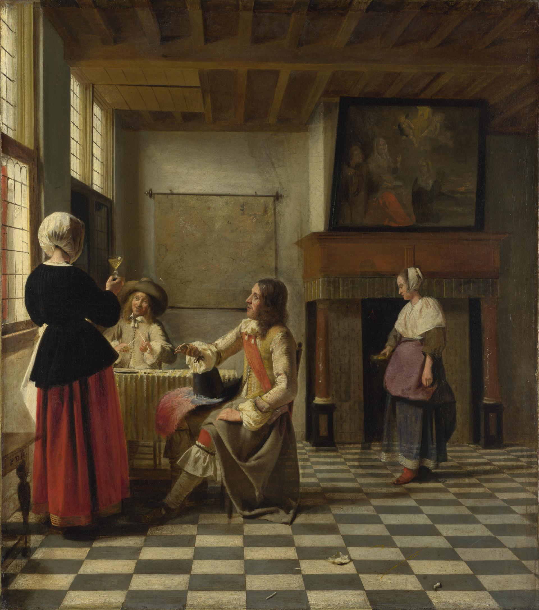

# An Interior with a Woman Drinking and Two Men: A Glass of Wine in Delft

The painting is often shortened to “A Woman Drinking with Two Men”, but its full title is longer: `An Interior, with a Woman drinking with Two Men, and a Maidservant`. The title already contains most of the scene: an interior, a woman, two men, a maid. What makes the picture rewarding is not the identity of these figures but the relationships that are never stated outright.

Figure: Pieter de Hooch, A Woman Drinking with Two Men, c. 1658, oil on canvas, The National Gallery, London. Image: Pieter de Hooch, Public domain, via [source page](https://www.nationalgallery.org.uk/paintings/pieter-de-hooch-a-woman-drinking-with-two-men).

## What is happening in the picture

On the right, a woman sits with her back to us, holding a glass; her left hand may hold a jug, or may simply be held against her chest. Behind the table, one man uses two clay pipes as a pretend “violin and bow”, while the other gestures as if conducting a duet. The National Gallery page therefore suggests that the woman may be singing rather than only drinking.

The interpretation is not “proved” by the picture, but it fits the gestures. The woman's back is turned, so we cannot see her expression or the whole action of her left hand; the men's gestures really do look like an accompaniment to a performance. The picture places “drinking” and “singing” in the same action, making it impossible to sum up with one label.

## An open interpretation

The National Gallery page notes that this openness is characteristic of 17th-century Dutch genre painting, and that depictions of musical gatherings were especially ambiguous: they could represent innocent entertainment or something more salacious. Here we cannot even be sure that this is a musical gathering, let alone whether it is innocent.

The uncertainty is not a failure of painting but part of its structure. The woman's turned back, the exaggerated gestures, the objects scattered on the table and floor—all keep the viewer guessing without supplying a definite answer. Looking at such a picture is less about finding the “correct” reading than about seeing how the painter keeps several readings alive at once.

## The wine glass, pipes and suggestion

The wine and pipes are not casual props. The official page notes that the men's attention is concentrated on the woman with the glass, and that a broken pipe lies discarded on the chequerboard floor; in the 17th century both tobacco and alcohol were regarded as aphrodisiacs. These details push “drinking” from a simple daily act towards a social scene with erotic overtones.

The glass also has a social function: it makes the woman the centre of attention. The two men do not touch her, but through music, glances and pipes they gather their attention around her. Wine is not an instrument of violence but a regulator of distance—it makes proximity between relative strangers look natural, and makes the viewer aware that the proximity may not be innocent.

## The painting above the fireplace: the education of the Virgin

Above the fireplace hangs a painting that the official page identifies as the education of the Virgin Mary: the young Mary kneels before her mother, Saint Anne. It is an exemplary image of how virtue is instilled in a young woman. Placed above a scene in which the maid may be flirted with, the irony is clear.

The page also notes, however, that the picture originally included another man standing near the maid and probably flirting with her; he was later removed. Had he remained, the contrast between the painting above and the scene below would have been more direct. With him gone, the irony becomes more oblique but does not disappear: the picture still measures the distance between “virtue taught” and “desire at work”.

## Space, floor tiles and perspective

De Hooch was skilled at creating a sense of real interior space. The official page says that the lines and sizes of the black-and-white floor tiles help the viewer understand the relative positions of figures, furniture, walls and windows. The tiles are not mere decoration; they are a visual measure.

Interestingly, the painter did not aim for absolute perspectival accuracy. The page notes that a strict analysis of the room's geometry suggests the size of the woman in the foreground is wrong—relative to the other figures she must be about seven feet tall. In other words, De Hooch adjusted perspective for effect. The detail reminds us that the “realism” of genre painting is constructed, not photographic.

## Changes visible under infrared

Infrared photographs show that the picture originally included another man, standing very close to the maid who carries hot coals, and probably flirting with her. The official page says he may have been removed before the maid was added; if not, erasing him softened the potential implication of dalliance.

The change shifts the moral weight of the picture. Keeping the man would have made the “temptation” more explicit; removing him leaves the viewer to infer it from the men's glances, the broken pipe and the painting of the Virgin above. De Hooch did not fix the moral conclusion but left the judgement to the viewer.

## Collection and provenance

The National Gallery page gives the basic information: full title `An Interior, with a Woman drinking with Two Men, and a Maidservant`; artist Pieter de Hooch (1629–after 1684); date probably 1658; oil on canvas; dimensions 73.7 × 64.6 cm; signed and inscribed; inventory number NG834; bought in 1871.

Its early provenance is not entirely clear. The page says it may be the picture in the David Jetswaart sale in Amsterdam in 1749, but the description is too vague to confirm; it was certainly in the van Leyden sale in Paris in 1804, bought by Paillet; in 1826 Emmerson and Smith bought it from the Comte de Pourtalès in Paris and sold it to Sir Robert Peel; in 1871 it entered the National Gallery with the Peel collection.

## Common misreadings and how to look today

First, treating the picture as a simple moral satire of a “drunken woman”. There is a moral framework, but the woman's action may also be singing, and the painter does not supply a single conclusion.

Second, treating the scene as a photographic record of space. The tiles and perspective are adjusted, and the foreground woman's scale does not strictly fit the room's geometry.

Third, treating the pipes and glass as neutral everyday props. In the 17th-century context they carry social and erotic meanings that cannot be read only through today's habits.

Fourth, treating the painting of the Virgin above the fireplace as irrelevant decoration. It forms a contrast with the scene below and is central to the picture's moral layering.

Looking at the painting today, wine can serve as a thread: it connects figures, objects, space and moral judgement without letting any one of them stand alone. For the basic types of wine, see [Wine](ref:wine); for the relationship between bars and urban life, see [Pub and the City](ref:pub-and-city); to turn looking into tasting, start with [First Tasting](ref:first-tasting).

## Further reading

- [Wine](ref:wine): the basic types and styles of wine.
- [Pub and the City](ref:pub-and-city): bars, neighbourhoods and urban life.
- [Time in a Cup](ref:time-in-a-cup): how wine entered seasons, ritual and literature.
- [First Tasting](ref:first-tasting): an introduction from colour and aroma to the first sip.
