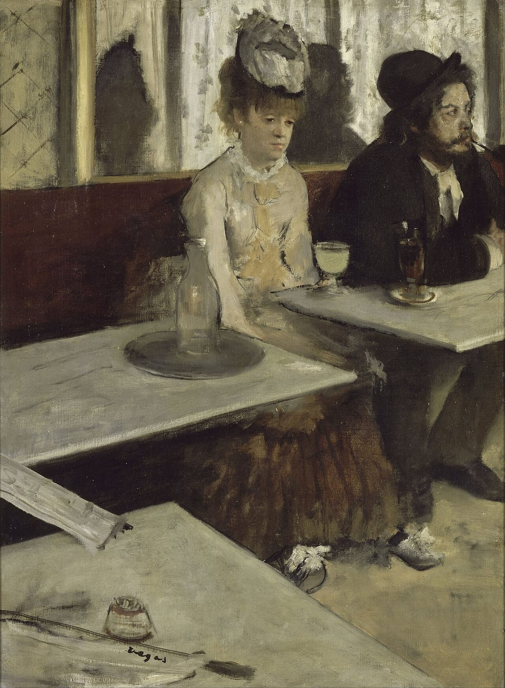

Figure: Reproduction of Degas's In a Café (L'Absinthe), 1875–1876, Musée d'Orsay; not a photograph of the café.. Image: Edgar Degas, Public domain, via Wikimedia Commons ([source page](https://commons.wikimedia.org/wiki/File:Edgar_Degas_-_In_a_Caf%C3%A9_-_Google_Art_Project.jpg)).

> **Quick verdict**
> **In one line:** This artwork entry helps you look at L'Absinthe: Degas Paints Two People Sitting Together and Looking Past Each Other, and place it in the history of drinking imagery.
>
> - **Best for:** Anyone who wants L'Absinthe: Degas Paints Two People Sitting Together and Looking Past Each Other in the history of drinking imagery, not as a standalone picture.
> - **Not for:** If you want want a single image without the period or drinking context.
> - **Check first:**
>   - Absinthe occupies a small patch of the canvas, but it anchors the whole picture.
>   - Start with the two gazes: hers down, his to the right.

## Two people, looking past each other

A man and a woman sit at the same café table. She wears a pale dress and an elaborate hat, her eyes lowered toward some uncertain point on the table. He wears a dark coat and a black top hat, smokes a pipe, and turns his face toward the right edge of the canvas, as if watching something outside. They do not speak. They do not touch. On the table is a glass of pale green absinthe and an open newspaper.

Degas called the picture *In a Café* (Dans un café). Only when it was exhibited in London in 1893 was it retitled *L'Absinthe*. The new name changed the way viewers read it: a café interior became an illustration of the dangers of absinthe. Degas did not particularly like the later title, but he could not control what viewers saw. The history of this painting is partly a history of how a title changes a picture.

## Object information

Degas (1834–1917) made the work around 1875–1876. It is oil on canvas, about 92 by 68 centimetres, now in the Musée d'Orsay in Paris. It entered the French national collections through the 1911 bequest of Count Isaac de Camondo and was later assigned to the Orsay.

The figures are not anonymous passers-by. The woman is usually identified as the actress Ellen Andrée, the man as the painter and printmaker Marcellin Desboutin. Both belonged to Degas's circle. He placed them in the Café de la Nouvelle Athènes, a meeting place for Impressionist painters, on the Place Pigalle. The picture is therefore not a street snapshot. It is a composed interior, with models, a known location and a deliberate arrangement.

Degas loved interiors: theatres, dance halls, cafés, rehearsal rooms. Unlike Monet, he did not chase light; unlike Renoir, he did not soften his sitters. He cared about position, posture and the direction of the gaze. Here the woman sits at the front left, the man to her right and slightly behind. Table, mirror and the edge of the canvas cut them into separate zones. The viewer stands opposite them but cannot enter their conversation, because there is no conversation.

## Where the drink sits

Absinthe occupies a small patch of the canvas, but it anchors the whole picture.

First, **it gives the woman an action**. She is not raising the glass or drinking. It sits on the table near her hand. Her eyes go down, perhaps to the glass, perhaps to nothing. The drink has been ordered, not enjoyed. That tense matters: the picture pauses between waiting, silence and exhaustion.

Second, **it gives the viewer a label**. Without the glass, the picture could be read as "a man and a woman in a café". With it, a late nineteenth-century audience immediately thought of absinthe, bohemia, degeneration and nervous illness. Degas does not paint drunkenness, but viewers bring their knowledge of absinthe and read the woman's fatigue as its consequence.

Third, **it gives the space a centre**. There is no window and no clear exit; table, mirror and wall enclose the pair. The glass sits on the table like a small heartbeat, pulling the eye from her face to her hand, then to his profile. The drink is not the subject, but it is the pin that keeps the composition from falling apart.

## Degas and urban solitude

Degas was the most "indoor" painter of the Impressionist group. He rarely painted sunlight in the open air; he preferred backstage, boxes, rehearsal rooms and cafés. His interest in people was not in expression but in posture: how someone sits, turns the head, rests a hand on a table. In this picture the woman's shoulders sink slightly and the man leans back. Neither faces the viewer. They are not being painted; they are being observed.

That sense of observation comes from the composition. The right side is cropped, and the man's body approaches the edge; the table in the foreground cuts diagonally into the picture and separates us from the sitters; the mirror behind them reflects vague figures but gives no more information. Degas does not let us see the whole room. He lets us see only the small blank space between two people.

The nineteenth-century Paris café was a new public space. People of different classes and professions could sit together, drink, read newspapers and watch others. It was a place of sociability and also a display case for solitude. Degas does not paint the bustle of café life. He paints being alone in a crowd. That is closer to the core of the picture than absinthe itself.

## From In a Café to L'Absinthe

For L'Absinthe, begin with the maker and date, then the collection, and finish with the reproduction source; that order keeps the account grounded.

Critics said her face looked "hollowed out by alcohol" and that the painting proved France was destroying itself. Those reactions tell us more about British anxieties than about Degas's intention. He painted two specific people, a specific interior and a specific silence. He did not paint a fable about what absinthe does to women.

The retitling also shaped art history. Many later texts treated the picture as evidence of the dangers of absinthe and even as a force behind the temperance movement. In fact, France did not ban absinthe until 1915, nearly forty years after the painting. To treat the picture as a cause of the ban is to reverse cause and effect.

## Common misreadings

**Misreading one: this is a café snapshot.** The sitters were actors and artists known to Degas, and the café was a regular meeting place. It looks like a snapshot because Degas deliberately creates a "cut-off moment", not because he secretly photographed anyone.

**Misreading two: the woman is already drunk.** Her glass is almost full and her posture is not that of someone out of control. She looks tired, absent or impatient. To explain her state entirely by absinthe ignores Degas's interest in posture and space.

**Misreading three: the man is looking at the woman.** His face turns to the right, past her, toward something outside the canvas. They sit side by side but do not communicate. That "not looking" is the source of the picture's tension.

**Misreading four: this is an anti-absinthe poster.** Degas did not paint a moral drama. He painted the distance between two people in the modern city. Absinthe is a title and a later layer of meaning, not the painter's only subject.

## How to look at it

Start with the two gazes: hers down, his to the right. The lines do not meet. Then look at the table. It cuts diagonally into the picture and keeps the viewer outside; the glass, the newspaper and the pipe each occupy a separate zone. Then look at the mirror behind them. It does not open the room; it presses the space tighter. Finally look at her hand and his shoulder. They are more honest than the faces.

Compare it with [The Absinthe Drinker](ref:manet)'s *The Absinthe Drinker*: Manet paints one man standing, Degas paints two people sitting; Manet puts solitude in the street, Degas puts it in a café. Compare it with [Interior with a Woman Drinking](ref:de-hooch)'s *Interior with a Woman Drinking, and Two Men*: the Delft picture is a room full of talk, Degas's is a room without talk. Together the three paintings trace the café from a social space to a space of isolation, as explored in [the history of taverns](ref:taverns).

Finally, read [absinthe](ref:absinthe) and [wine and painting](ref:painting) together. In the late nineteenth century absinthe was both an everyday drink and a symbol of moral panic. Degas's picture works like a mirror: it shows the viewer's fear, not the sitter's disease. Today the question is not what she drank, but why she and the man beside her have nothing to say to each other.

**Short definition:** Edgar Degas's canvas of 1875–1876, originally titled In a Café, hangs in the Musée d'Orsay. A actress and a painter share a Paris café table with a glass of absinthe; the subject is not the drink but the solitude of the modern city.
