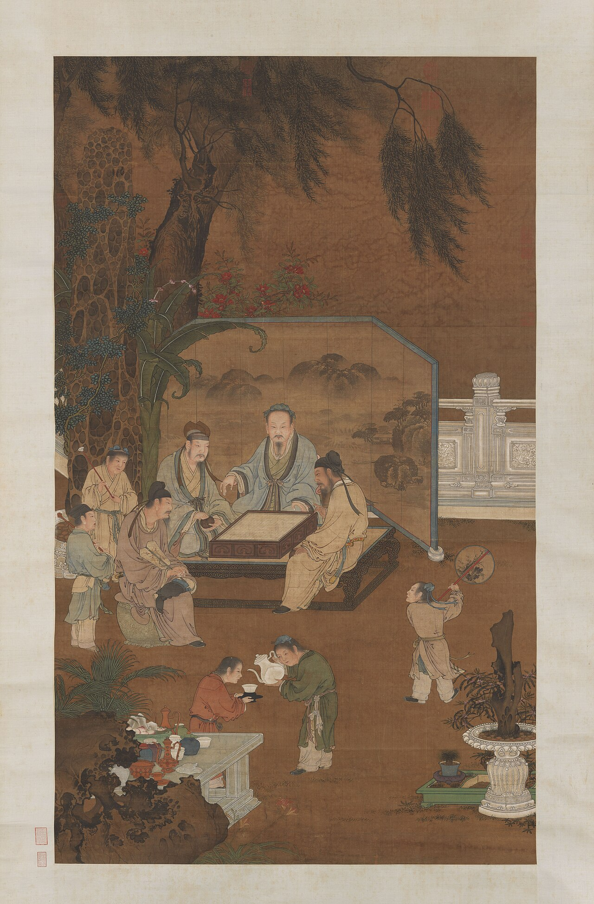

Figure: One hanging scroll from the set traditionally titled The Eighteen Scholars, National Palace Museum, Taipei; not a life portrait of Taizong's eighteen scholars.. Image: Unknown author Unknown author, Public domain, via Wikimedia Commons ([source page](https://commons.wikimedia.org/wiki/File:%E5%AE%8B%E4%BA%BA%E5%8D%81%E5%85%AB%E5%AD%A6%E5%A3%AB%E5%9B%BE%E8%BD%B4.%E7%BB%A2%E6%9C%AC%E8%AE%BE%E8%89%B2.%E5%8F%B0%E5%8C%97%E6%95%85%E5%AE%AB%E5%8D%9A%E7%89%A9%E9%99%A2%E8%97%8F.jpg)).

## Four paintings, four kinds of literati life

The National Palace Museum's *Eighteen Scholars* is not one painting. It is a set of four hanging scrolls. Each has a theme: qin, chess, calligraphy and painting. In each, scholars sit around a table or a mat in a garden. Some play the qin, some play chess, some open a book, some look at a painting. Servants carry tea, hold ewers, move books and spread mats. Together the four scrolls form a visual course in the four arts of the scholar.

The set is often labelled "Song dynasty Eighteen Scholars", but curators at the National Palace Museum suggest it may date as late as the mid-to-late Ming. The old "Song" label comes from the Qing imperial catalogue *Shiqu baoji sanbian*; later research has revised it. What we see is therefore not a life portrait of the Eighteen Scholars of Taizong's Tang court. It is a later re-painting of a subject.

The historical origin of the Eighteen Scholars is clear. Before he became emperor, Li Shimin established the Institute of Literary Studies and gathered eighteen scholars around him. After taking the throne, he ordered the painter Yan Liben to portray the eighteen, in order to show that he honoured men of learning. This was a political project: turn a group of scholars into the pillars of the court and let the world see the success of civil governance. Later painters repeated the subject, but what they painted was no longer eighteen specific individuals. It was an ideal of how scholars should gather.

## Object information

The set is ink and colour on silk, each scroll about 173.7 by 102.9 centimetres, now in the National Palace Museum, Taipei. The four scrolls take the qin, chess, calligraphy and painting as their themes. The compositions are crowded, the objects finely described, and the garden settings built from rocks, trees, bamboo and balustrades. The old attribution is Song; current opinion often places the set in the Ming. The artist is unknown.

The "eighteen scholars" do not necessarily appear as eighteen people in every scroll. The four scrolls are four scenes, and figures recur across them like a continuous narrative. Each scene centres on a table or a mat; scholars sit around it while servants attend. Wine cups, tea ware, books, scrolls, a chess board and a qin sit on the table. These objects are not arbitrary. They correspond to the four arts and to the identity of the scholar.

What matters is that the set turns "scholars" into a way of life rather than a set of political portraits. Their faces are not strongly individualised, their gestures are not violent. They play the qin, play chess, read and look at paintings, elegantly and in response to one another. The painter cares less about "who is who" than about "how they live together". That is the basic grammar of later Eighteen Scholars pictures.

## What the wine is doing

The wine in the picture is restrained. There are cups on the table and servants with ewers, but no one drinks heavily and no one is drunk. Wine is part of the gathering, not its centre.

First, **wine is a fifth art alongside the four**. Qin, chess, calligraphy and painting are the four skills of the scholar; wine and tea are the media that connect them. A cup before playing the qin, another while playing chess, another while opening a scroll: wine gives the gathering rhythm and slows time. It does not steal the scene, but it is indispensable.

Second, **wine is a marker of status**. The vessels, tea ware, books and scrolls extend the scholar's studio into the social table. They show that this is not an ordinary restaurant but a private setting with cultural capital. Wine is not for thirst. It is proof that "we know how to gather". This connects with the wine ritual discussed in [wine and ritual](ref:ritual): vessels, seating and sequence all express relationships.

Third, **wine is political memory**. The Eighteen Scholars theme began as Taizong's political project. Later versions repeatedly paint wine, tea, qin, chess, books and paintings, and in doing so repeat a message: when scholars sit together, the court is stable. Wine here is a sign of harmony, not of excess.

## From Taizong to the Ming: the transformation of a subject

Taizong's Eighteen Scholars were a specific political group. Li Shimin set up the Institute of Literary Studies during the Wude era and gathered eighteen men, including Fang Xuanling, Du Ruhui, Yu Shinan and Chu Liang, known as the Eighteen Scholars. After he became emperor, he ordered Yan Liben to paint them and turned the group into a symbol of the regime. The subject was political from the start. It was not an ordinary "literati gathering" but an image of an alliance between the throne and men of learning.

After the Song, the Eighteen Scholars gradually became a general subject of "literati gathering". Painters stopped caring about who the individuals were and began to care about how scholars should live: playing the qin, playing chess, reading, looking at paintings, drinking wine and tea. The Taipei set is a result of that generalisation. It splits the eighteen into four scenes, each tied to one art, so that a viewer immediately recognises "this is a scholar".

The transformation matters. It shows how a political subject can become a cultural symbol: from "the eighteen staff members of Taizong" to "the ideal life of all scholars". Wine changes with it: from "wine at a court banquet" to "wine at a literati gathering". The first speaks of power; the second speaks of taste.

## Why it matters

**It is a late representative of the Eighteen Scholars theme.** The four scrolls divide qin, chess, calligraphy and painting into four scenes, with complete compositions and rich objects. It is important material for studying the theme's evolution.

**It turns literati life into a reproducible template.** Later painters of "elegant gatherings", "literary meetings" and "Eighteen Scholars" often borrow this structure: a table, a ring of sitters, servants, a garden. It shapes not only painting but the later imagination of what a literati gathering looked like.

**It preserves the Ming re-creation of Song literati culture.** The set is labelled Song but is often dated to the Ming. It shows how Ming painters imagined the Song: not Song reality, but a Ming understanding of "Song elegance". That retrospective imagination is itself material for cultural history.

## Common misreadings

**Misreading one: this is a life portrait of Taizong's Eighteen Scholars.** It is not. Yan Liben's original portraits did not survive; the Taipei set is a later re-painting, possibly as late as the Ming. It paints the subject, not the event.

**Misreading two: this is one painting.** It is a set of four hanging scrolls, corresponding to qin, chess, calligraphy and painting. Treating them as one long scroll misses the four-art structure.

**Misreading three: all eighteen scholars appear in every scroll.** The four scrolls are four scenes, and figures recur across them; the number of figures is not eighteen in each. The subject is the group, not a roll call.

**Misreading four: everyone in the picture is drinking wine.** Wine cups and tea ware sit together; servants prepare both wine and tea. Qin, chess, calligraphy and painting are the themes. Reducing the Eighteen Scholars to a drinking party misses its literati character.

## How to look at it

Start with the centre of each scroll: qin, chess, calligraphy and painting each has a visual focus. Then look at the people: who is performing, who is watching, who is serving. Then look at the objects: wine cups, tea ware, books, scrolls and the chess board, and where each is placed. Finally look at the relation between the four scrolls. They are not four independent scenes but four sides of one literati life.

Compare the set with [Literary Gathering](ref:wenhui)'s *Literary Gathering*: both show scholars around a table, but *Literary Gathering* is one specific gathering, while *Eighteen Scholars* is a historical subject in four variations. Compare it with [Lanting ji xu](ref:lanting)'s *Lanting ji xu*: the Lanting preface is about a "floating cups along a winding stream" gathering; the Eighteen Scholars are about the daily life of qin, chess, calligraphy and painting. Together they show "gathering" and "everyday life" as two faces of literati culture.

Finally, place [Night Banquet of Han Xizai](ref:han-xizai) and [wine and painting](ref:painting) here. Han Xizai's night banquet is private, political and anxious; the Eighteen Scholars' gathering is public, idealised and conflict-free. Two images of literati gathering show how wine can carry completely different meanings in different settings.
