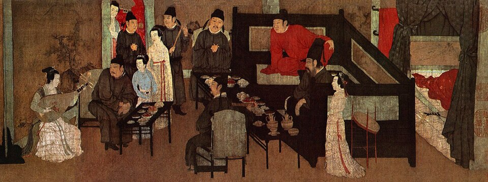

# The Night Revels of Han Xizai: a banquet turned into a painting

The scroll's modern travels are more tangled than the banquet it depicts. In 1921 Puyi took it out of the palace and sold it. The painter Zhang Daqian later bought it in Beijing from Ma Jichuan of the Yuchi Studio for five hundred taels of gold and carried it to Hong Kong. In the 1950s the government bought it back, and in 1959 the cultural relics bureau transferred it to the Palace Museum. It is ink and colour on silk, 28.7 cm high and 335.5 cm long, graded first class A. The painting has no artist's signature; it is traditionally attributed to Gu Hongzhong of the Southern Tang, and most scholars regard the surviving scroll as a Song copy.

Figure: "Listening to the Pipa", detail of The Night Revels of Han Xizai, attributed to Gu Hongzhong, Song-dynasty copy, ink and color on silk, Palace Museum, Beijing. Image: Anonymous Song dynasty artist after Gu Hongzhong (crop by BabelStone), Public domain, via [source page](https://commons.wikimedia.org/wiki/File:Night_Revels_of_Han_Xizai_pipa_player.jpg).

## The work and its collection

The Palace Museum record dates the work to the Five Dynasties through the Southern Song and lists the artist as "attributed to Gu Hongzhong". The formula is cautious: it preserves the traditional attribution and admits that the surviving scroll may be later than the Five Dynasties. The medium is silk, the dimensions 28.7 by 335.5 cm, the grade first class A. It entered the Qing palace in the early Qianlong reign and is recorded in the first imperial catalogue, Shiqu Baoji Chubian. A colophon by Cheng Nanyun of the Ming follows the painting and forms one link in the transmission chain.

The picture has five scenes: listening to music, watching a dance, resting, a pipe ensemble, and seeing guests off. There are no hard borders between them. Screens, beds, curtains and furniture provide the divisions, and Han Xizai appears in every scene, turning five settings into a single night.

## Reading the picture

In the first scene the guests sit around a musician while Han Xizai leans slightly forward on a couch. In the second, a dancer performs and Han rolls up his sleeves to beat the drum himself, while guests clap or turn to watch. The third slows the tempo: a bed, bedding, attendants and a basin shift the group from public display to private rest. In the fourth, several musicians sit in a row and play wind instruments while Han, loosely dressed, sits to one side. In the fifth, guests and entertainers talk in the doorway, and one guest looks back over his shoulder.

Wine vessels are distributed across all five. A ewer and a warming bowl hold heated wine; cups and dishes stand on food tables; fruit plates and jars fill the surfaces. They keep the banquet continuous, and the pause between the third and fourth scenes is an interval, not the end.

## What wine does in the picture

Wine is the clock of the evening. It brings people to the table, fuels the dance, withdraws during the rest, returns for the pipe ensemble and lingers as the guests leave. No precise hour is given, but the state of the vessels tells us where the night has reached.

Wine is also social lubrication with a performative edge. Han Xizai keeps urging guests and raising cups, apparently the generous host. Yet the banquet has an invisible audience: the painter sent to observe him, and the ruler behind the painter. Wine is therefore a prop in a performance, and the more unrestrained Han appears, the more he seems to be using drunkenness as cover.

What lingers is his sobriety. Around him people laugh, talk and dance, while his expression is often quiet, even tired. Wine does not make him lose control; it makes him more clearly aware that he is performing. This contrast between a noisy crowd and a watchful host says more about the picture than any count of cups. The drink in the picture belongs to the grain-wine and [yellow wine](ref:yellow-wine) tradition, not to modern spirits.

## Making and context

Han Xizai (902–970), courtesy name Shuyan, came from Qingzhou and passed the metropolitan examination under the Later Tang. After his father was killed he fled south and served the Southern Tang, rising to vice director of the Secretariat. Sources describe his late years as a round of music and women; Li Yu, the last ruler, considered making him chancellor but hesitated over his reputation. The Xuanhe Huapu turns this into an origin story: Li Yu sent Gu Hongzhong and others to observe Han's household, and Gu recorded what he saw and painted it after returning to the palace.

Gu Hongzhong was a Southern Tang academy painter known for figures. The Southern Tang capital was Jinling, today's Nanjing, and court and scholar life form the background of the scroll. In a period of rapid dynastic change, self-protection through apparent dissipation was a familiar strategy. Han's self-corruption can be read as pleasure or as politics, and the textual and visual evidence complement rather than replace each other.

## Attribution, dating and copies

Whether the scroll is Gu Hongzhong's original is the central dispute. The Palace Museum's dating, Five Dynasties to Southern Song, already signals uncertainty, and the majority view treats it as a Song copy; whether late Northern Song or Southern Song is still argued. There is no signature, and costume, furniture and vessel types can narrow the range but rarely fix a year.

The second dispute concerns the five scenes. Some scholars suggest the scroll was assembled from several screen paintings or album leaves, with the joins adjusted later; others accept it as one continuous composition. The third concerns narrative: reading the Xuanhe Huapu account as a caption for the painting treats a text that may be late or embellished as documentary evidence. The fourth concerns provenance. The 1921 removal, Zhang Daqian's purchase, the 1950s repurchase and the 1959 transfer are well documented, but they describe modern collecting, not Five Dynasties creation.

## Common misreadings

First, the Song copy is not a Five Dynasties original. It is a copy, not Gu Hongzhong's hand.

Second, the painting is not a sketch made on the spot. Even if Gu visited the house, no one could complete such a scroll during a banquet; it is more likely a later reconstruction from memory and studies.

Third, Han's dissipation is not simple hedonism. The quiet, tired face points to a political predicament.

Fourth, the five scenes are not unrelated. They share figures, objects and space, and form five slices of one night.

Fifth, the wine is not modern distilled spirits. Southern Tang drinking belonged to the grain-wine tradition, before distilled spirits became dominant.

## Looking closer

Read from right to left without rushing to identify people. First pass: space only, noting screens, beds and doorways. Second pass: people, noting where Han stands, how he sits and where he looks. Third pass: objects, noting whose hand is near a cup and what remains on the table. Only then return to the Xuanhe Huapu account, and you will see more clearly what is painted and what is written.

In a high-resolution image, watch Han's hands and eyes. His hands often rest on his knees or disappear into his sleeves, and his eyes rarely meet a guest directly. That state of being present without joining in is the emotional centre of the scroll.

## See also

- [Along the River During the Qingming Festival](ref:qingming): another Song handscroll that unfolds urban life.
- [Yellow wine](ref:yellow-wine): the grain-wine tradition behind the banquet.
- [Time in a cup](ref:time-in-a-cup): how wine enters seasons, gatherings and writing.
- [China](ref:china): the country page, providing the geographical and regulatory frame.
