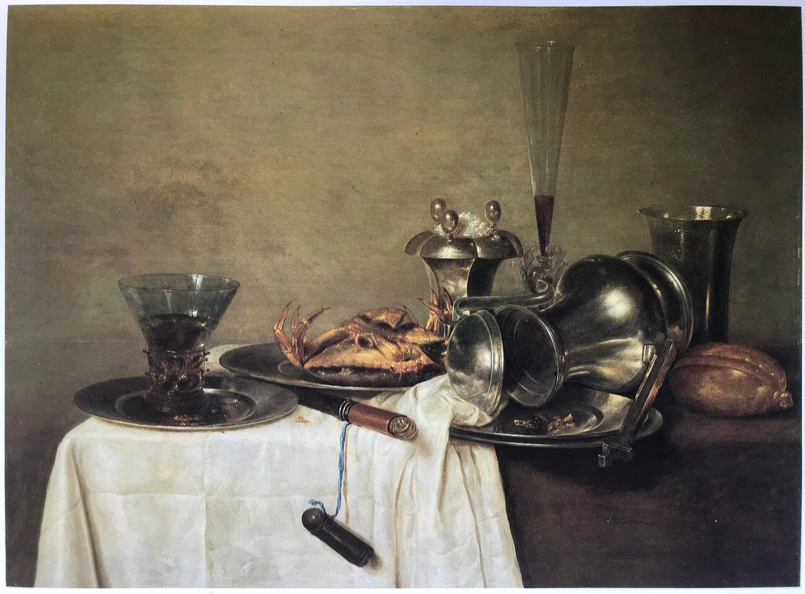

# Heda's Still Life with Drinking Vessels: A Roemer and a Watch

Still life looks like the quietest kind of painting: no people, no story, only objects on a table. But Dutch Golden Age still life was not merely arranging things to look good. Cups, silver, food and watches placed together often carry a double suggestion of pleasure and time. Heda's picture is exactly like that: a large drinking glass occupies the visual centre, a watch sits nearby to remind us of time, and the reflections of cloth and metal bind the two into a quiet but uneasy world.

Figure: Artwork image of Heda's Still Life with Drinking Vessels: A Roemer and a Watch. Image: Willem Claesz. Heda, Public domain, via Wikimedia Commons ([source page](https://commons.wikimedia.org/wiki/File:Willem_Claesz_Heda_-_Still_life_with_upturned_Jan_Steen_pitcher,_crab,_and_drinking_vessels.jpg)).

## Object information

The painter is Willem Claesz. Heda (c. 1596–1680; some sources give c. 1594, so follow the museum record), a still-life painter of Haarlem in the Dutch Republic. The Mauritshuis in The Hague catalogues the work as Still Life with a Roemer and Watch, dated 1629; the medium is oil, and the support, dimensions and inventory number should follow the museum record. This article uses that museum work as the representative of Heda's "drinking vessels" theme; the Chinese title is a paraphrase, and the English title should not be treated as the only name.

It is worth noting that Heda's still lifes are often loosely called "still life with drinking vessels", "breakfast pieces" or simply "still life" in Chinese; different museums, auction catalogues and older literature may give different English titles. When searching, use the museum number and title to avoid confusing similar compositions by different hands.

## The picture and its drinking vessels

At the centre is a "roemer": a type of drinking glass common in seventeenth-century Dutch painting, with a relatively wide bowl and a decorative, studded base that catches the light. Beside it is a watch; Heda's table usually also carries silver, food, a knife and a cloth, though the exact objects should be checked against the museum image. Heda does not paint each object as an isolated specimen; he places them under one light so that they reflect one another: glass reflects silver, silver reflects cloth, cloth scatters light back onto the objects.

The meaning of the vessels lies in use. An empty glass, a half-full glass and an overturned glass suggest completely different things. This article does not list the liquid in the glass, because reproductions and screens alter colour and transparency; the position and state of the glass matter more. It sits near the edge of the table, as if waiting for a hand; the watch beside it suggests that the drinking has a time limit. Specific objects and arrangement should follow the museum's high-resolution image.

## Links to drinking culture

In the Dutch Golden Age, drink was both an everyday commodity and a display of social position. Wine, beer and other beverages occupied different places in the market, and the material and shape of a vessel hinted at class and occasion. Heda's picture does not tell us directly "this is wine or beer"; it creates a "leisurely table" through glassware, silver and food. Such still lifes are often called "breakfast pieces" or "banquet pieces": they place abundant food, drinking vessels and valuables together, displaying wealth while also reminding the viewer of moderation.

The watch is the key. It puts "drinking" and "time" side by side: wine brings pleasure, time brings loss; the glass draws us to the present, the watch points to the end. This combination is related to the vanitas tradition: however refined the objects, they will pass. Wine here is not simply a drink but a metaphor for how time is used. For tavern and urban drinking life, see [History of Taverns](ref:history-of-taverns); to turn looking into tasting, start with [First Tasting](ref:first-tasting).

## Technique and historical context

Heda belongs to the Haarlem still-life tradition and, with Pieter Claesz and others, helped develop a "near-monochrome" style. The picture is dominated by grey, brown, silver-grey and a few warm accents; richness comes from texture and reflection rather than bright colour. The transparency of glass, the cold light of metal, the surfaces of food and the folds of cloth are painted as if they could be touched; this materiality is one of the central achievements of Dutch still life.

The style relates to the market, consumption and domestic life of the period. Dutch urban middle-class and wealthy households liked to display silver, porcelain, drinking vessels and imported foods on their tables; still life both records these objects and participates in a discussion about "abundance". It is not necessarily a moral sermon, but it usually carries a hint of "pleasure in moderation". Heda does not paint a chaotic banquet; he arranges the objects in relative order, and that sense of order is itself an attitude.

## Collection and provenance

The work is now in the Mauritshuis. Its early ownership, the date it entered the museum and its exhibition history should follow the museum record. For the viewer, its place in the collection matters: the Mauritshuis holds a large group of Dutch Golden Age paintings, and seeing Heda's still life alongside genre scenes and portraits helps one understand how common drinking vessels were in Dutch visual culture.

The fate of still life is also worth noting. It was long regarded as "lower" than history painting and portraiture, and only later was it revalued as an important record of the material world and daily life. Looking at Heda today, it helps to drop the assumption that "it is only a table of things": every object speaks, only quietly.

## Common misreadings

First, treating it as a "food photograph". The composition, light and selection of objects are arranged, not casually snapped.

Second, reading every object as "luxury". Silver and glass may be expensive, but food and ordinary utensils have their place too; overemphasising wealth misses the theme of moderation and time.

Third, deciding that the large glass is a beer glass or a wine glass. The roemer was a common type of glass drinking vessel; the liquid cannot be judged from the image alone, and the specific drink and vessel type should follow museum material and object research.

Fourth, assuming still life has no moral meaning. Watches, tilted objects and the state of food often carry hints of time, moderation or vanitas; one need not force a sermon, but one should not ignore them either.

## How to look

Begin with the large glass: its shape, reflection and position. Then look at the watch: where it is and what relation it creates with the glass. Then look at the silver, food and cloth: how they reflect light and build the foreground and background. Finally step back and look at the overall tone: why did the painter choose near-monochrome grey-brown rather than bright colour?

If possible, compare a still life by Pieter Claesz. Both belong to the Haarlem tradition, but Heda's compositions pay more attention to vertical and horizontal relationships, and the "conversation" between objects is clearer. After the comparison, the watch in this picture may feel different: not decoration, but a second protagonist.

## See also

- [Wine](ref:wine): the basic types and styles of wine.
- [Beer](ref:beer): beer types and drinking traditions.
- [History of Taverns](ref:history-of-taverns): how taverns became part of urban life.
- [First Tasting](ref:first-tasting): an introduction from colour and aroma to the first sip.
