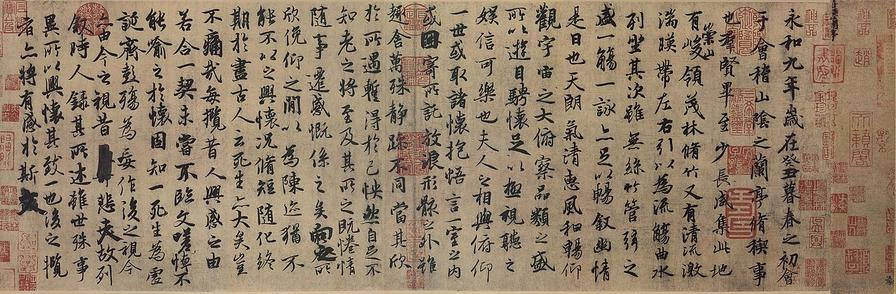

# The Lantingji Xu: a floating-cup gathering and a preface

On the third day of the third month in 353, a group gathered at the Orchid Pavilion in Shanyin, Kuaiji. They sat beside a winding channel and set cups afloat; wherever a cup stopped, the person in front of it drank, wrote a poem, or paid a forfeit. When the poems were collected, Wang Xizhi wrote a preface describing the weather, the landscape, the pleasure of the company and the sudden sadness that followed it. Wine was not an accessory to that gathering. It was the rule that made the poems possible.

Figure: Main text of Feng Chengsu's Tang-dynasty copy of Wang Xizhi's Lantingji Xu (Shenlong version), ink on paper, Palace Museum, Beijing. Image: Feng Chengsu, after Wang Xizhi, Public domain, via [source page](https://commons.wikimedia.org/wiki/File:LantingXu.jpg).

## The work and its collection

The most famous surviving version is the Palace Museum's copy in running script, traditionally attributed to Feng Chengsu of the Tang. It is ink on paper, 24.5 cm high and 69.9 cm wide. The mounting before the text carries a four-character title, "Tang copy of the Lanting", and the frontispiece has a title by the Qianlong emperor. The Qing catalogue Shiqu Baoji Xubian records it as stored in Chonghua Palace with the full set of eight seals.

The copy uses two sheets of mulberry-bark paper joined together: thirteen lines on the first, with looser spacing, and fifteen on the second, more tightly packed. The common count is twenty-eight lines and 324 characters. Twenty-four colophons and colophon-like notes follow, with more than 180 seals. Only some are original to this manuscript, including inscriptions by Guo Tianxi, Xianyu Shu and Deng Wenyuan of the Yuan and Li Tingxiang, Wen Jia and Xiang Yuanbian of the Ming; others were cut from the Dingwu stone version or from other manuscripts and pasted in. A famous work's attachments are not all reliable.

## Reading the picture

There is no image, only text and handwriting, so reading happens on two levels. The first is the text. It opens with the date, place, company and occasion, moves to the landscape, the bright weather and the pleasure of floating cups, then turns from joy to anxiety, from the present to the thought that later readers will look back at this moment as we look back at the past. The emotional line descends; the brightness at the beginning exists to set off the gloom at the end.

The second level is the writing. On the first sheet the lines are relaxed; on the second they tighten and the strokes begin to connect. Corrections and additions remain visible, and the rewritten characters preserve the order of writing. This is the evidence of a draft: not a finished performance but a text composed as it was written. The many instances of the character zhi are each formed differently, which later copybooks used to teach variation in running script.

Put the two levels together and they move in step. Where the text describes pleasure, the brush is light; where it reaches the line that birth and death are great matters, the characters contract and the line tightens.

## What wine does in the picture

Wine supplies a procedure. The spring purification was originally a ritual of washing away misfortune by water; the Orchid Pavilion gathering combined it with drinking and poetry. A cup floated downstream, stopped in front of someone, and that person drank and composed, or paid a fine of wine. Later generations called the game floating cups along a winding stream. Ear-cups known as [yushang](ref:yellow-wine), with handles on both sides, were common because they floated steadily.

The procedure turned strangers into table companions and cut time into small units: cup arrives, wine is drunk, poem is made, cup moves on. The preface says that one cup and one poem were enough for deep conversation. Wine made the rhythm visible; poetry left a trace of it.

## Making and context

Wang Xizhi (303–361), courtesy name Yishao, held the title of General of the Right Army and served as interior minister of Kuaiji, hence the name Wang Youjun. In the Yonghe years he lived in Kuaiji and associated with figures such as Xie An and Sun Chuo. The gathering is usually said to have involved more than forty people and more than thirty poems; the exact number and names vary between accounts, and citations should say which account they follow.

After the eastern Jin court moved south, Kuaiji became a centre for elite families. The Orchid Pavilion landscape suited purification and literary gatherings. The poems were later collected as the Lanting Collection, with Wang's preface at the front. The preface was meant to explain the poems, but its calligraphy made it more famous than the collection. That inversion is essential to understanding the work.

## Attribution, dating and copies

The original is said to have been buried with Emperor Taizong of Tang, who admired it deeply. Everything seen today is a copy, a tracing or a rubbing. The Shenlong version belongs to the Tang tracing group and takes its name from a half-seal bearing the Shenlong reign period at the start of the scroll.

The Palace Museum record states clearly that this Shenlong half-seal is not an original palace seal of Emperor Zhongzong but a later addition. Treating it as Tang imperial certification overstates the manuscript's originality. The attribution to Feng Chengsu rests instead on Guo Tianxi's Yuan colophon and Xiang Yuanbian's Ming inscription; after Xiang, the name Feng Chengsu became fixed.

The other major system is the Dingwu version, a stone engraving associated with a copy by Ouyang Xun. One is a paper tracing, the other a rubbing, and their brush details cannot be compared directly. In 1965 Guo Moruo questioned whether the preface and its calligraphy were really by Wang Xizhi; Gao Ershi replied, and the exchange became known as the Lanting debate. It remains unresolved, but it separates the authorship of the text from that of the calligraphy.

## Common misreadings

First, the Shenlong version is not Wang Xizhi's original. It is a Tang copy; the original is lost.

Second, the Shenlong seal is not an original Tang palace seal. The Palace Museum record identifies it as a later addition.

Third, the Lantingji Xu is not only calligraphy. It is first a preface, and its text and its writing matter equally.

Fourth, floating cups were not the only drinking game. They were one combination of spring purification and wine, alongside many other forfeit games.

Fifth, "more than forty" is not a fixed number. The accounts differ, and the figure should be given with its source.

## Looking closer

Look at the Shenlong copy at a magnification that shows the brush tips and corrections. Find the rewritten characters first and watch the layering of ink; then compare the spacing of the two sheets; then read the text through and feel the shift from brightness to gloom.

## See also

- [China](ref:china): the country and setting of the gathering.
- [Yellow wine](ref:yellow-wine): background on traditional vessels such as ear-cups.
- [Wine and painting](ref:wine-and-painting): how wine entered the visual arts.
- [Time in a cup](ref:time-in-a-cup): wine, seasons and writing from the Book of Songs to Tang poetry.
- [The Night Revels of Han Xizai](ref:han-xizai): another recorded banquet.

[China](ref:china) explains creator; [Wine and painting: four ways to look at a drinking scene](ref:wine-and-painting) adds medium. Put The Lantingji Xu between them before deciding what it is.
