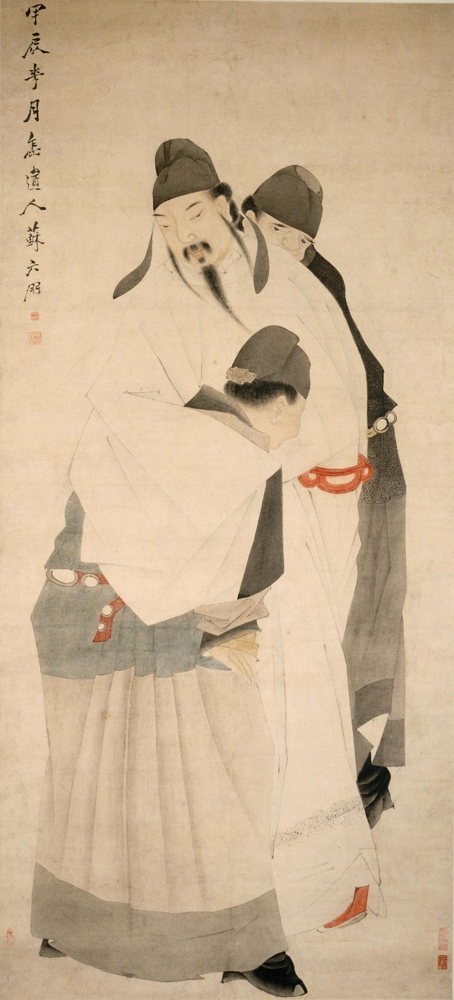

# Li Bai Drunk: a subject painted again and again

The Shanghai Museum owns a hanging scroll by Su Liupeng inscribed "Jiachen, flower month, Zendao ren Su Liupeng". Jiachen is the twenty-fourth year of the Daoguang reign, 1844. Ink and colour on paper, 204.8 cm high and 93.9 cm wide, it shows Li Bai collapsed drunk in a Tang palace while two attendants hold him up, one on each side. The picture is not unique. It is one late-Qing landing point for a subject that had been repainted for centuries.

Figure: Su Liupeng, Li Bai Drunk, 1844, ink and color on paper, Shanghai Museum. Image: Su Liupeng, Public domain, via [source page](https://www.shanghaimuseum.net/mu/frontend/pg/m/article/id/CI00020511).

## The work and its collection

Su Liupeng, courtesy name Zhenqin and style name Zendao ren, came from Shunde in Guangdong and worked in the Daoguang and Xianfeng reigns, mainly as a figure painter. The Shanghai Museum record dates the scroll to the Qing dynasty, the twenty-fourth year of Daoguang, and lists paper, ink and colour, hanging scroll, with the subject given as Li Bai drunk, Li Bai and attendants. The background is omitted; three figures carry the whole composition.

Two other works are usually brought in for comparison. The first is Li Bai Walking and Reciting by Liang Kai, in the Tokyo National Museum, object TA-164: ink on paper, 81.1 by 30.5 cm, dated to the thirteenth century, and designated an Important Cultural Property in Japan. The second is a Boston scroll, Poet Li Bai drinking with Emperor Minghuang, object 08.81, ink and colour on silk, 29.6 by 83 cm.

Each work tells a different story: one is about drunkenness, one about walking and reciting, one about a ruler and his poet. Calling all three "Li Bai Drunk" erases exactly what distinguishes them.

## Reading the picture

Su Liupeng's composition is simple. Li Bai sits at the centre with his body tipped back, his weight resting on the attendants' arms. He wears a scholar's cap and a five-strand beard; his face is painted in fine outlines with layered washes, and a trace of arrogance survives in the eyes and brows. The attendants are placed at different heights, their robes drawn with faster strokes that contrast with the careful modelling of Li Bai's face. The background is blank: no palace, no banquet table, not even a wine pot.

That omission is the clever part. The wine is absent, but the drunkenness is present. The viewer supplies the previous night from the poet's posture, the attendants' effort and the loosened robe. By removing the vessels, the painter makes drunkenness itself the subject. Liang Kai's scroll does the opposite with equal economy: Li Bai walks slowly, sleeves wide, lines reduced to a minimum, and the emphasis falls on reciting. The Boston scroll restores a setting, placing emperor and poet in one room, where wine mediates the relationship between ruler and subject.

## What wine does in the picture

Wine functions here as proof of character. Li Bai was already famous as a drinker in his own lifetime, and Du Fu's line that he produced a hundred poems on a dou of wine, sleeping in a Chang'an tavern, tied literary genius to drunkenness. Su Liupeng is not painting the taste of wine but the way Li Bai refuses to bow even when his body will not hold him up.

Wine also reverses a social order for a moment. The palace is the most regulated space in the empire, yet an unsteady poet with a disordered robe stands at its centre, supported by attendants. Drinking suspends rank and lets a Hanlin retainer be rude without punishment. The picture's energy comes from that brief impropriety.

## Making and context

Li Bai (701–762) was summoned to Chang'an in 742, served at the Hanlin Academy, and was sent away with a gift of gold in 744. That stay of less than three years was later elaborated into stories: the eunuch Gao Lishi pulling off his boots, the consort grinding his ink, the drunken draft that overawed foreign envoys. These are legends rather than reliable history, but they supplied the most popular plots for later pictures. The date 1844 matters because it gives the scroll a fixed point in time.

## Attribution, dating and copies

The Su Liupeng scroll rests on its inscription and date. "Jiachen, flower month, Zendao ren Su Liupeng" names the artist, the year and the alias. A later hand could of course have added it, but the inscription agrees with the Shanghai Museum record, which is the firmest starting point available.

The Liang Kai attribution is more complicated. The painting has no artist's signature, only collector seals, including a large seal in the Phags-pa script read as "Grand Minister of Education", said to be the seal of the Yuan monk and architect Anige. The name Liang Kai therefore rests on style and early records, not on a signature. Tokyo keeps the attribution while protecting the work as an Important Cultural Property, which represents the mainstream Japanese view.

The Boston scroll is titled as an audience with Emperor Minghuang, not as Li Bai drunk. Its narrative is different, and mixing the three works produces meaningless conclusions such as "Li Bai drunk pictures have a Song style and a Qing style".

## Common misreadings

First, Liang Kai's Li Bai Walking and Reciting is not a Li Bai Drunk. One walks and recites, the other collapses; composition, props and mood all differ.

Second, the boot-pulling episode is not in the picture. Su Liupeng shows two attendants supporting the poet, nothing more; legend and image must be kept apart.

Third, one work cannot stand for the whole subject. Shanghai, Tokyo and Boston already offer three different Li Bais, before prints, porcelain and New Year pictures are counted.

Fourth, the wine is not Tang distilled spirits. Li Bai more likely drank grain wine, and the spread of [baijiu](ref:baijiu) came later.

Fifth, a late-Qing commercial painting is not a Tang record. Su Liupeng painted a nineteenth-century imagination of Li Bai, not an eighth-century scene.

## Looking closer

Begin with the centre of gravity: is Li Bai falling backward or sideways? Then measure the distance between him and the attendants: is he carried, or can he still walk? Then read the face: eyes closed, half-open or open? Those three choices set the degree of drunkenness. Only then check the inscription and seals to establish which work you are looking at.

## See also

- [China](ref:china): the cultural tradition to which the subject belongs.
- [Li Bai](ref:li-bai): the protagonist of the subject.
- [Wine and poetry](ref:wine-and-poetry): Li Bai's wine poems and Tang drinking culture.
- [The Eight Immortals of the Wine Cup](ref:ba-xian): the same figure inside a group portrait.
