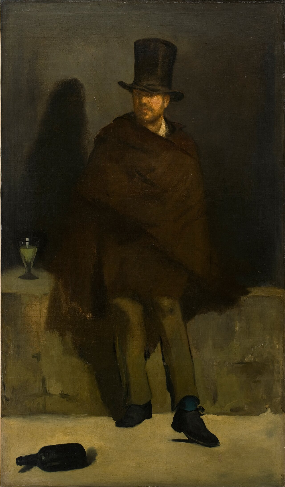

Figure: Reproduction of Manet's The Absinthe Drinker, c. 1859, Ny Carlsberg Glyptotek; not a café photograph and not a Manet self-portrait.. Image: Édouard Manet, Public domain, via Wikimedia Commons ([source page](https://commons.wikimedia.org/wiki/File:Edouard_Manet_-_The_Absinthe_Drinker_-_Google_Art_Project.jpg)).

## One man, one empty bottle

The picture is almost empty. A man stands against a grey-brown wall, wrapped in a heavy brown cloak and wearing a black top hat. An empty bottle lies at his feet. He does not look at the viewer and has no clear action; his body turns slightly, as if waiting for something, or as if simply standing. At the lower left, a small glass sits on a ledge with a pale liquid in it.

This is Manet's *The Absinthe Drinker*. Its size is close to a history painting or a full-length portrait: about 1.8 metres high and 1.06 metres wide. Yet the sitter is not an emperor, saint or general. He is a man living at the edge of Parisian society. Manet gave this "person without a role" the scale that usually belonged to the powerful. That choice matters more than the drink.

## Object information

Manet (1832–1883) painted the work around 1858–1859, usually dated to about 1859. It is now in the Ny Carlsberg Glyptotek in Copenhagen, inventory number MIN 1778, oil on canvas, about 180.5 by 105.6 centimetres.

It was Manet's first truly independent painting and the first work he submitted to the Paris Salon. The 1859 jury rejected it; one account says it received a single vote, sometimes attributed to Delacroix, though that remains anecdotal. There was probably more than one reason: the handling was rough, the subject was not respectable, and the scale violated the hierarchy of genres. A drunkard painted life-size made the jury uncomfortable.

The canvas was cut down when Manet held his own exhibition in 1867, and he adjusted it afterwards. The glass of absinthe was added between 1867 and 1872, according to technical study of the surface. In other words, the drink that gave the work its later name may not have been in Manet's first conception. That detail matters: the title belongs to the painting's reception, not only to its making.

## Where the drink sits

There is very little wine or spirits in the picture, and that is the point.

First, **the empty bottle is on the floor**. It is not a raised glass but the residue of drinking. It pushes the narrative backwards in time: the drinking has already happened, and what remains is the aftermath. It also makes the man's posture heavier. He is not tasting; he is standing in the blank space after the drink.

Second, **the small glass is on the ledge**. It sits below the figure, near the edge of the canvas, as if someone put it down casually. It does not interact with the man, yet it supplies the label "absinthe". In nineteenth-century France, absinthe was associated with bohemia, marginal artists and parts of the working class; only later, around 1900, did it become the object of a moral panic and eventually a ban. Manet paints 1859, not 1915.

Third, **drink as a marker of social position**. Manet does not paint the warmth of a tavern or the abundance of a banquet. He paints an isolated person. Wine here is not a medium of sociability; it is a sign of where the man belongs. The page on [absinthe](ref:absinthe) explains the drink's history and production, but the picture should not be reduced to a warning about alcoholism. It does not preach. It simply places a person who is usually avoided at the centre of the canvas.

## Manet, Velázquez and the Salon

Manet's early style owes much to Velázquez. Velázquez painted beggars, philosophers and court servants against shallow, empty backgrounds; costume and posture often register before the face. Manet moves that formula to the Paris street. The cloak takes up nearly half the canvas, while the face is pressed down by the hat brim and shadow. The viewer sees a mass of colour and contour before recognising a person.

The 1859 Salon's rejection is not surprising. The Salon expected myth, history, portraiture and moral narrative. A full-length image of an anonymous drunkard had no story and no identifiable rank. Manet was asking who deserved to be painted. Later realists and Impressionists continued along that road: ordinary people, daily life, the unnoticed corners of the city.

The painting is often read alongside Courbet and Baudelaire. Baudelaire's *The Painter of Modern Life* argued that artists should find beauty in the transient, accidental and fleeting life of the city. Manet did not illustrate Baudelaire's theory, but he did put a contemporary Parisian moment on canvas. The man is neither hero nor victim; he is a person seen in the city.

## Why it matters

**It puts a marginal figure on a large scale.** In mid-nineteenth-century France, history painting ranked highest. Manet used a scale close to history painting for a drunkard, challenging the academic hierarchy of subjects.

**It turns "unfinishedness" into language.** The background is almost a blank wall, the edges of the figure are loose, and the folds of the cloak are not polished. That "not finished" quality later became central to modern painting. The Salon saw a technical fault; Manet made it expressive.

**It makes drink a social sign rather than a moral fable.** The drink does not make the man ridiculous or monstrous. It tells us which part of the city he belongs to. Manet refuses the viewer a safe moral distance.

## Common misreadings

**Misreading one: this is a self-portrait.** It is not. The sitter's identity is uncertain; he is usually described as a marginal Parisian type or a model known to Manet. There is no reliable evidence that it is Manet himself.

**Misreading two: this is a temperance poster.** Absinthe was not banned in France until 1915. The painting was made in 1859. It does not perform the moral work of "showing the dangers of absinthe". Later viewers read it that way because of the ban.

**Misreading three: the man is drinking absinthe in the picture.** He is not holding a glass; the glass is on the ledge, and the empty bottle is on the floor. The picture is closer to a pause after drinking than to the act itself. That "after" is more tense than "during".

**Misreading four: absinthe madness explains his expression.** That is a late nineteenth-century anti-absinthe trope, not Manet's evidence. Poverty, fatigue, cold or the dullness after drinking can all explain the figure. Attributing everything to "absinthe poison" simplifies the work.

## How to look at it

Start with the silhouette: hat, cloak, trousers, shoes, almost one dark shape. Then look at the face, pressed under the brim, with very little expression. Then find the empty bottle at his feet and the small glass on the ledge; they supply the missing time. Finally step back and measure how much of the canvas the man occupies. He nearly reaches the top edge, while the ground below him is narrow. The composition makes him both monumental and trapped.

Compare it with [Interior with a Woman Drinking](ref:de-hooch)'s *Interior with a Woman Drinking, and Two Men*: the latter places wine inside a social interior where people relate to one another. Manet places the drink at one man's feet, and the man relates to nobody. Compare it with [The Drinker](ref:brouwer)'s *The Drinker*: Brouwer paints the noisy crowd inside a tavern; Manet paints one person after the noise has stopped. Three paintings, three distances between drink and human being.

Finally, read [wine and painting](ref:painting) and [Prohibition](ref:prohibition) together. The relation between wine and art is not only "what drink appears in the picture". It also includes who is allowed to drink, where, and how they are seen afterwards. Manet paints that last question.
