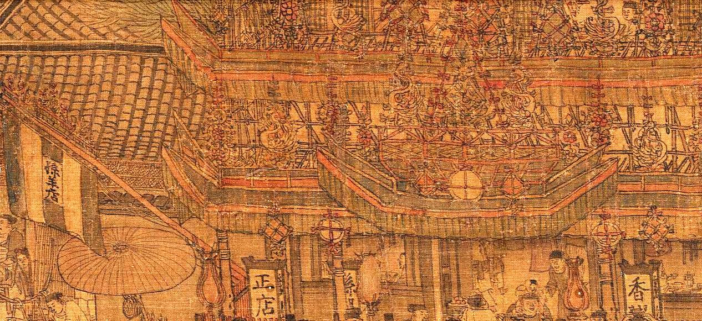

# Along the River During the Qingming Festival: taverns and urban rhythm in Bianjing

Unroll the scroll and you have a street five metres long and less than a quarter-metre high. It is not a landscape to be admired from a distance but a compressed city: countryside, river port, Rainbow Bridge and finally the streets inside the gate. Taverns sit inside that rhythm. Some have imposing facades with decorated gatehouses; others put out a single sign that could be lit at night. Reading those differences is more rewarding than counting how many wine shops appear.

Figure: Detail of Zhang Zeduan's Along the River During the Qingming Festival: the Sun Yang wine shop and its decorated gate, Northern Song dynasty, ink and color on silk, Palace Museum, Beijing. Image: Zhang Zeduan, Public domain, via [source page](https://digicol.dpm.org.cn/cultural/detail?id=4e1f69d35f7d419e9f1269e3a5fa2271&source=1).

## The work and its collection

The scroll is by Zhang Zeduan of the Northern Song, ink and colour on silk, 24.8 cm high and 528.7 cm long. It is in the Palace Museum, Beijing, with object number 00087177. There is no artist's signature or seal on the painting; the attribution rests on a colophon at the end by Zhang Zhu, a man of the Jin dynasty, who names Zhang Zeduan, courtesy name Zhengdao, a native of Dongwu, today's Zhucheng in Shandong, and says he served the Hanlin painting academy.

The Qing palace catalogue Shiqu Baoji Sanbian records it as stored in Yanchun Pavilion with the full set of five seals. The end section carries thirteen colophons, including those of Zhang Zhu, Zhang Gongyao, Li Quan, Zhang Shiji, Yang Zhun, Liu Han, Li Qi, Wu Kuan, Li Dongyang, Lu Wan, Feng Bao and Ru Shou. The provenance is unusually well documented: the Song imperial collection, the Jin north, the Yuan court, repeated Ming moves between court and officials, the Qing collection of Bi Yuan, confiscation into the palace, removal by Puyi's brother Pujie, and return to the Palace Museum in 1957.

The museum's description offers a rough count: about six hundred figures, more than eighty animals, over thirty buildings and more than a hundred trees. The numbers are not a census, but they convey the density of a selected observation of a city.

## Reading the picture

The scroll is normally read in three parts. The first is open country: sparse trees, farm buildings, a pack train, a slow tempo. The middle section centres on the Bian River and the Rainbow Bridge, where grain boats, trackers and market stalls crowd together; this is the climax. The last part enters the city through what is identified as the East Jiaozimen gate, where shops line both sides of the street and pedestrians, chairs, horses and stalls layer over one another.

The rank of a wine shop is written on its facade. The Sun Yang shop is a licensed brewery, its entrance crowned by a tall decorative gatehouse made of bamboo and wood, the equivalent of a huge signboard; inside there are a counter and wine jars. The Shiqian shop is a retail outlet, much smaller, with a lantern sign that could be lit for night trade. The difference is not only scale but rights: a licensed brewery could brew and wholesale, while a retail shop could only sell.

The Rainbow Bridge passage deserves attention too. Chairs, horses and porters crowd the deck; below, a grain boat is lowering its mast while boatmen pole against the bridge supports and people on the bank shout. In this most tense scene the taverns move to the edge of the picture, but they do not vanish: the stalls and shops at the bridgehead are the reason the crowd stops at all.

## What wine does in the picture

Song wine was a monopoly trade. Licensed breweries bought yeast from the state, brewed and wholesaled; retail shops bought from them and sold by the cup. The Dongjing Menghualu says Bianjing had seventy-two licensed breweries, with countless retail outlets beyond them. The Sun Yang and Shiqian shops mark the two ends of that system: one with brewing rights, one dependent on retail and night trade.

Wine is therefore the end of a chain rather than an isolated commodity. Boats bring grain up the Bian River, breweries turn grain into wine, retail shops sell it to passers-by, and taverns in turn support food, storytelling, drama and lodging. Banners, lantern signs and gatehouses are the visible markers of that chain in urban space.

## Making and context

Northern Song Bianjing was one of the largest cities in the world, and the Bian River carried grain from the Huai and Yangzi regions to the capital. Around Qingming, transport, spring outings, tomb visits and trade all peaked at once. Zhang Zeduan chose the moment when everyone was moving.

His training shaped the picture. He served the Hanlin painting academy and was skilled in ruled-line architecture, so bridges, hulls and roofs are structurally convincing. Yet this is not an engineering drawing: the scale of figures, the density of streets and the moving viewpoint are all arranged.

## Attribution, dating and copies

The surviving scroll is generally accepted as Zhang Zeduan's original, but the debates have not closed. First, what does Qingming mean: the Qingming festival, a ward named Qingming, or a phrase praising good government? Each has supporters. Second, is the season spring or autumn? Some scholars point to fans, charcoal braziers and certain drinks and argue for autumn; others find the evidence insufficient. Third, does Shanghe refer to the Bian River or another stretch of water?

Fourth, is the scroll complete? The transition from countryside to river seems abrupt to some, who suggest a missing opening section; others accept the present sequence. Fifth, later copies are numerous. The Qing court version in Taipei and Qiu Ying's Ming version are often mistaken for Zhang's original, so the version must be identified before the content is discussed.

## Common misreadings

First, the scroll is not a photograph or a map. Perspective is inconsistent and figure scale is not strictly realistic; it is a composed picture.

Second, Qingming is not settled as the Qingming festival. The premise is still argued, so it should not be stated as a conclusion.

Third, the Sun Yang shop is not the only tavern. The Shiqian shop and other wine stalls form a hierarchy of brewery, retail outlet and vendor.

Fourth, the wine is not today's baijiu. Urban Song drinking was dominated by rice and yellow wines, and the status of distilled spirits is a separate question.

Fifth, the Qing court or Qiu Ying versions are not Zhang's original. They are important paintings with different authors and dates.

## Looking closer

Go slowly. First pass: follow the scroll from right to left and feel the rhythm, from the quiet country to the crowded bridge and the dense city. Second pass: look only for wine, noting banners, gatehouses, lantern signs and jars at shop doors. Third pass: look at people, distinguishing customers, staff and passers-by.

With a digital image, check the version first. The Palace Museum's digital collection uses object number 00087177, which identifies the Beijing scroll. To understand how a tavern works as an entry point into urban life, continue with [understanding a city through a tavern](ref:pub-and-city); for the drink itself, see [yellow wine](ref:yellow-wine).

## See also

- [The Night Revels of Han Xizai](ref:han-xizai): another handscroll, from the Five Dynasties, depicting a banquet and interior space.
- [Yellow wine](ref:yellow-wine): the craft lineage of Song rice wine and yellow wine.
- [Understanding a city through a tavern](ref:pub-and-city): how a tavern becomes an entry point for observing urban life.
- [China](ref:china): the country page, providing the geographical and regulatory frame.
