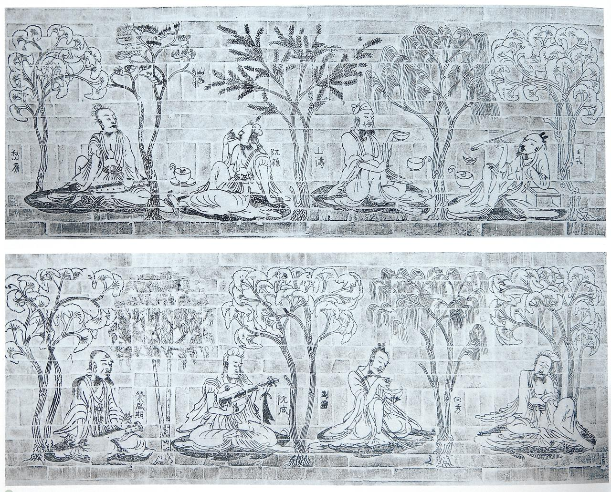

# The Seven Sages of the Bamboo Grove and Rong Qiqi: a brick relief in a Southern Dynasties tomb

In 1960 a tomb was cleared at the northern foot of Gongshan at Xishanqiao, Nanjing. Each of the two long walls of the chamber carried four figures, eight in all. They were not ordinary guests: Xi Kang, Ruan Ji, Shan Tao, Wang Rong, Xiang Xiu, Liu Ling and Ruan Xian, the Seven Sages of the Bamboo Grove, together with Rong Qiqi, a recluse of the Spring and Autumn period. The reliefs entered the Nanjing Museum and became one of the most cited objects for the image of Wei-Jin scholars and for Southern Dynasties painting. It is not a scroll but part of a tomb, and that fact governs its size, composition and viewing.

Figure: Rubbings of the two walls of The Seven Sages of the Bamboo Grove and Rong Qiqi, Southern Dynasties, from the tomb at Xishanqiao, Nanjing, Nanjing Museum. Image: Anonymous Southern Dynasties craftsmen, Public domain, via [source page](https://www.njmuseum.org.cn/en/collectionDetails?id=465).

## The work and its collection

The Nanjing Museum holds two groups. One measures 78 cm high and 242.5 cm long; the other 78 cm high and 241.5 cm long. They originally faced each other on the north and south walls of the chamber, and each was assembled from nearly three hundred moulded bricks. The image was impressed before firing, then the bricks were numbered and set into the wall. The process allowed repeated production and demanded close workshop coordination; it belongs to a different system from painted murals.

Every figure is seated on the ground and carries a name label beside him. Trees separate the figures: ginkgo, pine, locust and weeping willow, among others. Labels, trees and seated poses form the basic reading frame of the composition.

## Reading the picture

Xi Kang, hair in double buns, sends his gaze after the autumn geese while playing a five-string qin. Ruan Ji, in a long robe, props one hand on a hide mat and rests the other on his knee, whistling. Shan Tao wears a cloth cap, pushes back one sleeve and holds a cup. Wang Rong leans against an armrest and plays with a jade ruyi. Xiang Xiu, in a head cloth, bares one shoulder and closes his eyes in thought. Liu Ling stares at the cup in his hand and dips a finger into the wine to taste it. Ruan Xian, ribbons trailing behind his head, plays a four-string instrument. Rong Qiqi, hair loose and beard long, a rope at his waist, sits thinking while playing a five-string qin.

No two poses repeat. Xi Kang and Rong Qiqi both play the qin, but one follows the geese and the other turns inward. Shan Tao and Liu Ling both drink, but one raises his cup easily and the other studies it. Small differences in gesture, rather than exaggerated expressions, distinguish the characters.

## What wine does in the picture

Wine appears sparingly. Only Shan Tao and Liu Ling are directly engaged with it: one holds a cup, the other stares into his cup and dips a finger. The other six play music, whistle, hold a ruyi or sit in thought. Wine is not the prop that unifies the scene; it is one item in a scholar's way of life, alongside music, pure conversation and silence.

This fits the Wei-Jin self-image. Liu Ling is famous for his Ode to the Virtue of Wine, which treats drinking as a condition close to virtue; here wine is less pleasure than distance from ritual. Shan Tao's raised cup is more ordinary, an action in progress rather than a manifesto. Rong Qiqi has no wine, and that absence separates the seven from the older recluse.

## Making and context

The Seven Sages are recorded together in texts around the Book of Jin, whose volume 49 contains the biographies of Xi Kang and his companions. They lived at the end of the Cao Wei period and were known for pure conversation, drinking and disregard for convention. By the Southern Dynasties they had become cultural signs: personal freedom on one side, detachment from a changing regime on the other. Painting them in a tomb honoured the patron and advertised his taste.

This was not an isolated commission. Several Southern Dynasties tombs in the Nanjing and Danyang area have yielded reliefs of the same subject, which suggests a recognised image tradition in high-status burials. The workshop probably worked from a model, adjusting the number and arrangement of figures to the chamber.

## Attribution, dating and copies

No author is named, and the relief is workshop production; that much is uncontested. The disputes concern three things: the absolute date of the tomb, the identity of its occupant, and the relation of the design to famous painters, especially Gu Kaizhi and Lu Tanwei.

The date is usually placed in the mid to late Southern Dynasties, on the evidence of tomb form, brick types and grave goods, but whether the tomb is Liu Song or Southern Qi is still argued. The occupant is unknown. The scale suggests a very high elite or imperial burial, yet no epitaph gives a name, so identifying the tomb with a particular emperor lacks hard proof.

The "Gu Kaizhi model" argument rests on style: the continuous robe lines, the tree forms and the seated poses resemble paintings associated with Gu Kaizhi's tradition. Resemblance is not authorship. The image passed through a model, moulds and assembly, so even if the design came from a famous hand, the finished relief cannot be attributed to that painter. Citations should also state whether they refer to the original bricks, a copy or a line drawing.

## Common misreadings

First, this is not a scroll. It is part of a tomb wall, and its "handscroll" look comes from assembly rather than mounting.

Second, not all eight are Seven Sages. Rong Qiqi is a Spring and Autumn figure, added to make eight and to extend the lineage of reclusion.

Third, there is no bamboo grove in the picture. The plants are ginkgo, pine, locust and willow; the bamboo grove is a cultural name, not a botanical record.

Fourth, it is not a painted mural. The image was fixed in moulds before firing, and the faceted lines are a result of the process, not a sign of weak brushwork.

Fifth, the patron is not known. Without an epitaph there is no name, and every imperial identification remains a hypothesis.

## Looking closer

Start with the labels. The eight names are written beside the figures, making them the most reliable entry point; identify the names first, then match the poses. Next look at the trees, noting how each species changes shape and how the spacing controls the rhythm. Finally follow the brick joins, watching how a line is interrupted and resumed. That will make the craft dimension of the object clear.

If you are looking at a rubbing or a line drawing, remember that colour and surface have been filtered out. If you are looking at a replica, the order of the figures may have been adjusted. Cite the version you used and check the dimensions against the Nanjing Museum record.

## See also

- [China](ref:china): the country of excavation and collection.
- [Yellow wine](ref:yellow-wine): the craft background of Wei-Jin grain wine.
- [Wine and ritual](ref:wine-and-ritual): the different place of wine in ritual and in scholarly life.
- [The Night Revels of Han Xizai](ref:han-xizai): another painted object centred on banqueting figures.

Further reading: [Brouwer's The Drinker: A Tavern and a Face](ref:c-extra-1).
