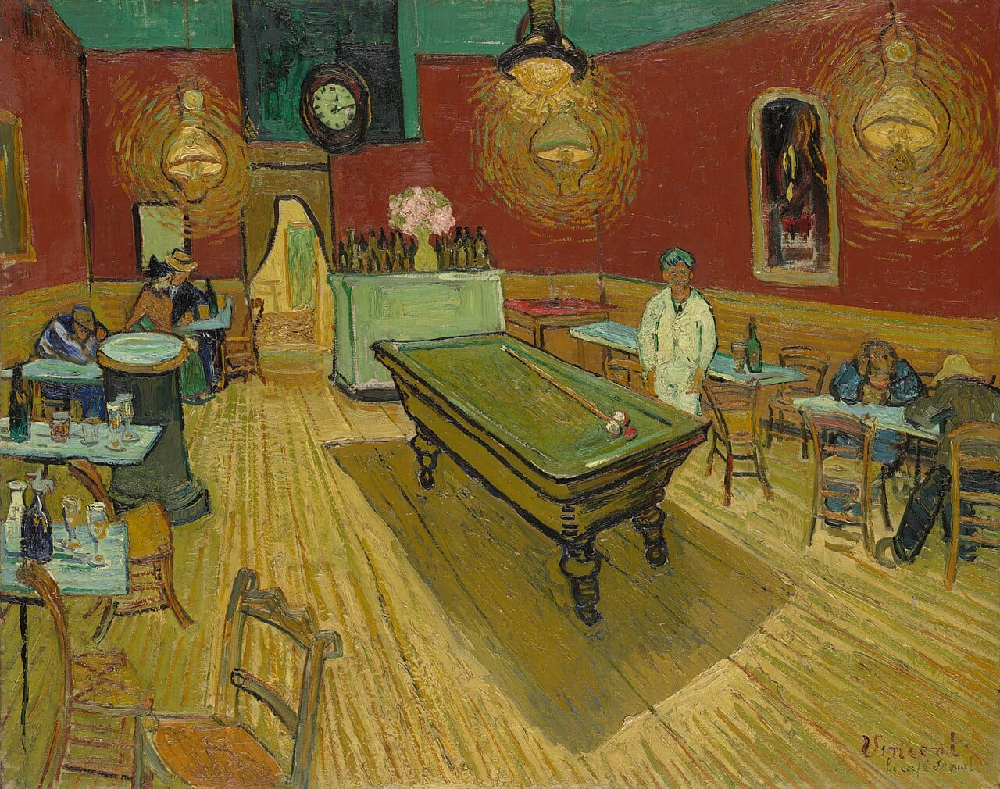

Figure: Reproduction of Van Gogh's The Night Café, 1888, Yale University Art Gallery; not a photograph of the Arles café.. Image: Vincent van Gogh, Public domain, via Wikimedia Commons ([source page](https://commons.wikimedia.org/wiki/File:Van_Gogh_-_The_Night_Caf%C3%A9_(1888).jpg)).

> **Quick verdict**
> **In one line:** This artwork entry helps you look at The Night Café: Van Gogh Paints a Gaslit Room as an All-Night Fever, and place it in the history of drinking imagery.
>
> - **Best for:** Anyone who wants The Night Café: Van Gogh Paints a Gaslit Room as an All-Night Fever in the history of drinking imagery, not as a standalone picture.
> - **Not for:** If you want want a single image without the period or drinking context.
> - **Check first:**
>   - There is wine and beer in the picture, but none of it is centre stage.
>   - Start with the lamps.

## A room that will not go to sleep

The picture is a café at night. The walls are blood red, the ceiling green, the floor a faded yellow. A billiard table occupies the centre, its green top like a cold pond. Four gas lamps hang from the ceiling, each with a lemon-yellow halo. At the back, a proprietor in white stands near the bar; at several tables, customers slump, lean and sit as if pressed down by the light. In the foreground there is an empty table, a few chairs and a bottle.

This is Van Gogh's *The Night Café*. It is not a genre scene about cheerful drinking. It is more like a room that refuses to sleep: the light will not let anyone relax, the red will not let anyone settle, the green will not let anyone wake up properly. In a letter to his brother Theo, Van Gogh said he wanted to use red and green to express "the terrible passions of humanity." In a letter to his sister, he said he had used "six or seven reds, from blood red to delicate pink, and the same number of pale or dark greens." These are not later interpretations; they are the painter's own instructions.

## Object information

Van Gogh (1853–1890) painted the work in September 1888 in Arles, in the south of France. It is oil on canvas, about 72.4 by 92.1 centimetres, now at the Yale University Art Gallery in New Haven, Connecticut, accession number 1961.18.34. It came to Yale in 1961 as the bequest of Stephen Carlton Clark.

The room is the Café de la Gare in Arles, on the Place Lamartine, run by Joseph-Michel Ginoux and his wife Marie. Van Gogh ate there often during his time in Arles. In some letters he calls the place "Café de l'Alcazar," and scholars differ on the exact correspondence of names, but the space is clear: an all-night café near the railway station.

In September 1888 Gauguin had not yet arrived. He came to Arles only in late October. This painting is therefore not a product of the famous collaboration. It is Van Gogh working alone with colour. He wanted a painting that expressed feeling through colour rather than merely recording natural light. The night café gave him a laboratory: no sunlight, only artificial light; no natural colour, only red, green and yellow stained by the lamps.

## Where the drink sits

There is wine and beer in the picture, but none of it is centre stage. There are bottles on tables, bottles behind the bar, perhaps a bottle near the billiard table. No one is drinking heavily; no one raises a glass. Drink belongs to the fact that the café stays open all night. It is a prop in the room, not the subject of the painting.

First, **drink and time**. The café is open all night; alcohol is fuel for staying awake. The customers do not look as if they are enjoying themselves. They look as if they are consuming time. Bottles, glasses, the billiard table and the clock all remind us that this room does not belong to daylight. It belongs to people with nowhere else to go.

Second, **drink and the social margin**. In his letters Van Gogh described the café as "a place where one can ruin oneself, go mad, or commit a crime." Its customers were associated with vagrants and prostitutes. Drink here is not the wine of a middle-class dinner. It is part of marginal life. It helps people forget time and makes time heavier.

Third, **drink and colour**. The most "drunk" thing in the picture is not a person but the colour. Red walls, green table and yellow lamps clash like an after-image. Van Gogh does not paint intoxication through the bodies; he paints a kind of over-alertness: the light is too bright, the night too long, and no one can sleep. That "sober intoxication" is closer to the picture than any bottle.

## Van Gogh in Arles

Van Gogh arrived in Arles in February 1888, hoping to found a "Studio of the South" and invite Gauguin and other artists to work with him. He was drawn to the southern light, colour and exotic atmosphere, and also troubled by loneliness and money. The Arles period was one of his most productive and least stable: sunflowers, wheat fields, the Rhône, the bedroom, cafés and night scenes.

*The Night Café* belongs with *Starry Night over the Rhône* and *The Yellow House* in a group of night pictures. Van Gogh's interest in night was not merely visual. He wanted night to show what daylight hides. He described the café as a place of "terrible passions": not because someone might commit a crime, but because the emotions that daylight keeps in order are allowed to expand there. Red and green amplify those emotions until the room itself seems feverish.

## Why it matters

**It turns colour from description into emotion.** Van Gogh no longer uses colour to copy reality; he uses it to produce a psychological state. The red wall is not there to "look like" a red wall. It is there to make the room feel uneasy. The green table is not there to "look like" a billiard table. It is there to cool the centre. Expressionist painters later learned much from this use.

**It turns an interior into a psychological space.** The perspective is steep: the floor rushes toward the viewer while the tables recede; the billiard table holds the centre and pushes the figures to the edges. The viewer is not standing at the door looking into a room. The viewer is being pulled into it. The composition creates a feeling of being unable to leave.

**It makes the café a scene of modern solitude.** A café is normally a social space. Van Gogh paints a room where people cannot communicate. Customers slump separately; the proprietor stands alone; the lamps divide everyone. That "alone in public" feeling later became a common subject of modern urban painting, as explored in [the pub and the city](ref:pub).

## Common misreadings

**Misreading one: this is the room where Van Gogh lived.** It is the Café de la Gare in Arles, where he often ate, not his home. He lived nearby in the Yellow House. Treating the picture as his domestic interior confuses his life and his subject.

**Misreading two: the customers are all drunks.** The picture does not show drunkenness or violence. The customers are tired, asleep or blank. Drink is part of the environment, not the sole explanation of behaviour. Van Gogh's "terrible passions" refer to the space and the colour, not to "everyone is drunk".

**Misreading three: this is a record of Van Gogh's breakdown.** Van Gogh did experience a serious crisis in Arles, but this painting was made in September 1888, before the December episode in which he cut his ear. It can express his state of mind, but it is not a diary of the breakdown.

**Misreading four: the red-green contrast is only decorative.** Van Gogh used complementary colours deliberately: placed together, they intensify each other and produce a vibration. He wanted unease, not prettiness. That is what separates the picture from decorative painting.

## How to look at it

Start with the lamps. Four gas lamps press down from the ceiling, each with a halo like a small sun. Then look at the billiard table. It holds the centre and cuts the red room with a green surface. Then look at the people. The proprietor stands at the back; the customers slump at their tables; nobody looks up. Finally look at the floor. The boards radiate toward the viewer, as if to pull you in.

Compare it with [The Glass of Wine](ref:vermeer)'s *Wine Glass*: Vermeer paints one person and one window, with light coming in from outside; Van Gogh paints a group and a room of lamps, with light pressing down from above. Compare it with [Interior with a Woman Drinking](ref:de-hooch)'s *Interior with a Woman Drinking, and Two Men*: the Delft picture is an ordered interior, Van Gogh's is an interior whose order has loosened. Together they show the interior moving from Dutch genre painting to modern painting.

Finally, read [wine](ref:wine) and [wine and painting](ref:painting) together. Drink is not the protagonist in Van Gogh's picture, but it is part of the night economy: the café survives on alcohol, lamps and all-night opening; the customers survive the night on alcohol. Van Gogh does not paint the drink. He paints the room that will not go to sleep.
