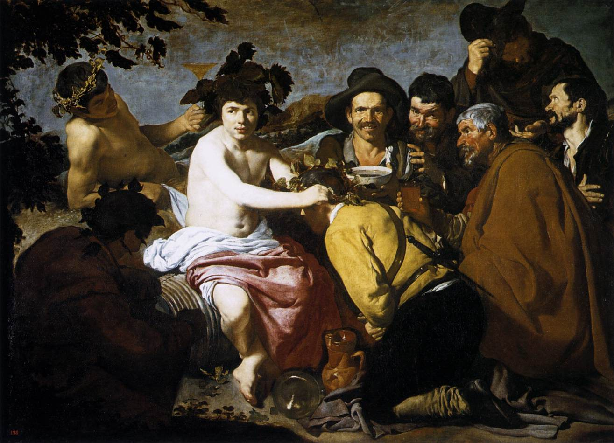

# Velázquez's The Triumph of Bacchus: Bringing Myth into the Crowd

In the traditional Bacchus painting, the god is usually idealised: young, nude, surrounded by attendants, carrying a beauty that belongs to another world. Velázquez's The Triumph of Bacchus puts the god among Spanish peasants. He is still young and still wears a vine wreath, but the people around him have wrinkles, sweat and drunkenness; they are not nymphs and satyrs but faces one could meet in a village or a street. The tension comes precisely from this mismatch between god and crowd.

Figure: Artwork image of Velázquez's The Triumph of Bacchus: Bringing Myth into the Crowd. Image: Diego Velázquez, Public domain, via Wikimedia Commons ([source page](https://commons.wikimedia.org/wiki/File:Diego_Vel%C3%A1zquez_-_The_Triumph_of_Bacchus_(Los_Borrachos,_The_Topers)_-_WGA24375.jpg)).

## Object information

The painter is Diego Velázquez (1599–1660), one of the central artists of the Spanish Golden Age. The work dates from about 1628–1629, is oil on canvas, and is now in the Museo Nacional del Prado in Madrid. In Spanish it is often called Los borrachos ("the drunkards"); in English it also appears as The Drinkers or The Feast of Bacchus. The Prado's material notes that the crown paid Velázquez in July 1629 for a painting of Bacchus, which identifies it as a royal commission or a work made for the court; dimensions, inventory number and acquisition details should follow the museum record.

The commission matters. It shows that this is not a casual street picture of drunkards but an object that entered the court system. Precisely because it was to be seen at court, the "peasants" in it are not merely genre records but a deliberate contrast: the high and the low are placed on the same canvas.

## The picture and its drinking vessels

Bacchus is at the centre. He sits, crowned with vine leaves, his body painted as an idealised youth; around him are several plainly dressed men, some raising a cup, some approaching, one apparently about to receive a crown or a drink. The figures are close together, but their actions are not orderly; no one is entirely dignified and no one is entirely out of control. The drinking vessels pass between the figures and become the connecting points: who holds the cup, who pours, who waits, determines the direction of the viewer's gaze.

It is worth remembering that the vessels are seventeenth-century Spanish objects, not modern stemmed glasses or tasting cups. Their shape, capacity and use belong to that period, and the liquid in them cannot be judged from reproductions alone. Mapping the picture directly onto "a modern wine" misses its real point: wine here is not a product but a mixture of ritual, joke and status.

## Links to drinking culture

Bacchus in the Western tradition is the patron of grapes, winemaking and revelry. Velázquez does not paint him as a remote ancient god but brings him into a contemporary rural drinking scene. This produces two effects. The first is debasement: the god is pulled down to earth, and the solemnity of myth is dissolved by everyday drunkenness. The second is elevation: the peasants, by sharing a table with a god, acquire an almost ritual position; their drinking is no longer merely coarse excess but connected to an ancient tradition.

Wine here stands for both festival and social levelling. God and peasant alike enter the same condition through the cup; wine temporarily blurs rank and exposes the body's weakness. For wine in festival, see [Wine and Festivals](ref:wine-and-festivals); for wine as ritual, see [Wine and Ritual](ref:wine-and-ritual). The picture can also be read against [Caravaggio's Bacchus](ref:caravaggio-bacchus): both are wine gods, but Caravaggio offers the cup to the viewer outside the picture, while Velázquez puts the god back into the crowd.

## Technique and historical context

Velázquez's early work was shaped by Caravaggesque naturalism: direct observation of people, attention to texture and light, and a refusal to turn mythological figures into smooth symbols. The Bacchus here has an idealised body, but the peasants' faces are closer to life studies; the two manners are placed side by side, producing a subtle "inconsistency". That inconsistency is not a mistake but part of the subject: the gap between myth and reality is painted as a visual gap.

In colour, the picture is dominated by warm earth tones, browns and reds, with the green of the vine wreath and the reflections of the vessels as accents. Light enters from one side, and the figures emerge from a dark background; this handling makes drunkenness and expression easier to see. It belongs to Spanish Golden Age court painting, yet carries the smoke of genre scenes; the mixture is what makes it unusual within Velázquez's work.

## Collection and provenance

The painting was connected with the Spanish royal collection early on. The Prado's material mentions the payment record of 1629, which shows that it was not a work recognised only later. It then entered the royal collection and eventually became part of the Prado; the precise chain of ownership, acquisition date and exhibition history should follow the museum record.

Placed in history, the provenance raises an interesting point: a painting that contains both a "god" and "drunkards" was accepted at court and became a classic. This suggests that seventeenth-century viewers did not reject the domestication of myth; on the contrary, bringing the classical world closer may have been exactly what made it pleasurable.

## Common misreadings

First, treating it as a simple "drunken party". There is drunkenness, but the presence of Bacchus, the vine wreath and the crowning gesture show that it is a Bacchic subject, not a genre record.

Second, taking Bacchus as a self-portrait of the painter. There is no reliable evidence for this; the figures are types—a god and peasants—not portraits of particular people.

Third, reading it as a mockery of religion. It can be read as a parody of classical myth, but parody is not denial; Velázquez treats myth with both distance and respect.

Fourth, treating it as purely "high art" and ignoring its social layer. The peasants, vessels and drunkenness are essential clues to the drinking culture of contemporary Spain.

## How to look

Begin with Bacchus: how his body, posture and vine wreath are idealised. Then look at the people around him: how their faces, hands, clothes and drunkenness are observed from life. Then look at the vessels: who holds the cup, who pours, who receives. Finally look at the light: which faces are illuminated and which bodies remain in shadow.

If you have seen Caravaggio's Bacchus, compare the two: Caravaggio's god is more like a young man under observation, already marked by wine; Velázquez's god is a "god" surrounded by a crowd, whose divinity exists through the contrast with the peasants. Neither handling is the answer, but both help us see how wine in art can be used to talk about human nature, society and belief.

## See also

- [Wine](ref:wine): the basic types and styles of wine.
- [Spain](ref:spain): Spanish wine tradition and regions.
- [Wine and Festivals](ref:wine-and-festivals): wine in festival and public life.
- [Caravaggio's Bacchus](ref:caravaggio-bacchus): another treatment of the wine god.
- [Wine and Ritual](ref:wine-and-ritual): drinking as ritual and social exchange.

Velázquez's The Triumph of Bacchus is best read by starting with the maker and date, moving to the collection, and ending with the reproduction source.