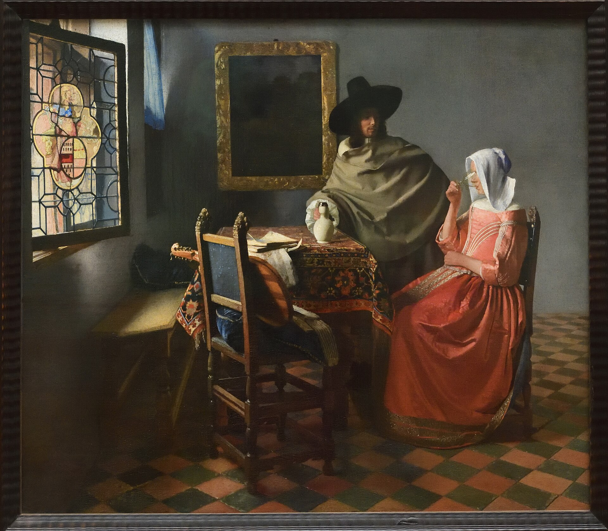

# Vermeer's The Glass of Wine: A Drink and a Window

In Vermeer's interiors, wine is rarely an isolated still life. It appears inside an action: someone raises a glass, someone pours, someone offers a cup to another person. The Glass of Wine is exactly such a picture: quiet on the surface, but with a clear action. The figures say nothing, yet the wine has already done its social work. It turns "a drink" into a slow, restrained, slightly ambiguous ritual.

Figure: Artwork image of Vermeer's The Glass of Wine: A Drink and a Window. Image: Dosseman, CC BY-SA 4.0, via Wikimedia Commons ([source page](https://commons.wikimedia.org/wiki/File:Jan_Vermeer_van_Delft_The_glass_of_wine_-_1661-2_-2049.jpg)).

## Object information

The painter is Johannes Vermeer (1632–1675), the Dutch artist of Delft. The English title is The Glass of Wine, the Dutch Het glas wijn. The Staatliche Museen zu Berlin record dates the work to about 1658–1660, in Vermeer's mature period of interior scenes; the medium is oil on canvas, and the painting is now in the Gemäldegalerie in Berlin. Dimensions and inventory number should follow the museum record.

It is not a portrait, nor a purely mythological scene, but an interior genre picture: a man and a woman, a room with a window, a wooden table covered with cloth, and a few vessels. There is no dramatic plot, but there is a clear pivot—the pouring of wine. Because the action is simple, the viewer's attention goes to the relationship between the figures, the light and the objects.

## The picture and its drinking vessels

A woman sits at the table holding a glass; a man stands beside her, pouring wine from a jug into the glass. The table is covered with a cloth and carries vessels; behind them, a window lets light into the room, and a painting hangs on the wall. Vermeer does not give the figures exaggerated expressions. He stops the action halfway: the wine is being poured, the glass is being filled, a conversation may have just begun or may already be over.

The drinking vessels are the visual pivot. The clear glass makes the liquid, the reflection and the hand visible at once; the height and tilt of the jug determine the movement of the picture; the folds of the tablecloth and the shadows of the objects fix the action in space. The colour of the wine and the exact shape of the glass are best checked against the museum's high-resolution image, not against reproductions. The drink does not need to be mapped onto a modern wine; in seventeenth-century Holland, the kinds of wine, the shapes of glasses and the habits of drinking were different from today.

## Links to drinking culture

The most direct link is wine as a medium of hospitality and social contact. Pouring is not merely service; it puts two people into the same rhythm: one gives, one receives; one stands, one sits. Wine here creates closeness and keeps distance at the same time. The woman's posture is not abandoned and the man's gesture is not rough; the picture places drinking within a frame of courtesy and restraint, without excluding a hint of ambiguity.

In Dutch Golden Age interiors, wine often appears with music, letters, games and courtship. It can be a social lubricant or an object of moral warning. Vermeer is more reserved: he does not say "this is good behaviour" or "this is bad behaviour"; he lets the viewer infer from posture, glance and objects. Wine is therefore not the whole picture, but it is the key to the relationship. For wine's place in a longer cultural history, see [Time in a Cup](ref:time-in-a-cup); for wine as ritual and social exchange, see [Wine and Ritual](ref:wine-and-ritual).

## Technique and historical context

Vermeer uses light to organise the picture. Window light enters from one side and falls on the figures, the tablecloth and the wall, creating soft transitions rather than theatrical spotlighting. This is the light of a room, not of a stage. It makes the picture quiet and gives the objects texture: the reflection of glass, the folds of cloth and the grain of the wall are all distinguished by light.

Compositionally, the figures are placed close to the table, and their glances and gestures divide the space into foreground and background. The viewer stands on the other side of the room, close but not entering. Whether Vermeer used optical aids such as a camera obscura is a long-running discussion in art history; it can help explain his perspective and sense of light, but it is not accurate to say "his paintings are photographs". This article does not settle the question; it only notes that the "realism" of the picture is constructed by painting.

## Collection and provenance

The painting is now in the Gemäldegalerie in Berlin. It passed through various collections, and the date of its acquisition and its earlier provenance should follow the museum record. For the general viewer, its place in the Berlin display matters more: it sits with other Vermeer interiors, forming a sequence that can be compared.

When looking at it, it helps to compare it with other Vermeer interior scenes: the same window light, tables and figures—why does this one feel more "active"? The answer may lie in the pouring. It cuts time in half: the wine is not yet fully poured, the sentence is not yet finished, and the viewer is left in the middle.

## Common misreadings

First, treating it as "a portrait of a polite couple". The figures have no clear identity; the point is the action and the relationship, not who they are.

Second, deciding that the wine is red or white. Reproductions change colour, and the shape of the glass and the kind of wine cannot be settled from the image alone; follow the museum image and record.

Third, treating the scene as a photographic record of space. Vermeer's light and perspective are organised; the picture is more "complete" and quieter than a real room.

Fourth, treating Vermeer as an isolated "genius". His interiors relate to the Delft school, the Dutch genre tradition and the objects and furnishings of his time; placing him in that context makes his distinctiveness clearer, not smaller.

## How to look

Begin with the pouring: the tilt of the jug, the position of the glass, the hands of both figures. Then look at the light: where it falls and where it is left dark. Then look at the table and wall: how the cloth, the vessels and the painting hold the space together. Finally look at the faces and the distance between them: are they close? Who is leading? Who is waiting?

If possible, look at the original or the museum's high-resolution image rather than a compressed phone screen. Vermeer's details are small; the reflection in the glass, the texture of the cloth and the surface of the wall need close attention. After this painting, find another Vermeer interior and compare how he handles "nothing much happening".

## See also

- [Wine](ref:wine): the basic types and styles of wine.
- [Time in a Cup](ref:time-in-a-cup): how wine entered seasons, ritual and literature.
- [First Tasting](ref:first-tasting): an introduction from colour and aroma to the first sip.
- [Wine and Ritual](ref:wine-and-ritual): drinking as ritual and social exchange.

**At a glance:** Vermeer's interior, painted around 1658–1660 and now in the Gemäldegalerie in Berlin, shows a woman at a table holding a glass while a man pours from a jug. The picture places drinking, hospitality and Dutch Golden Age domestic life in the same window light.
