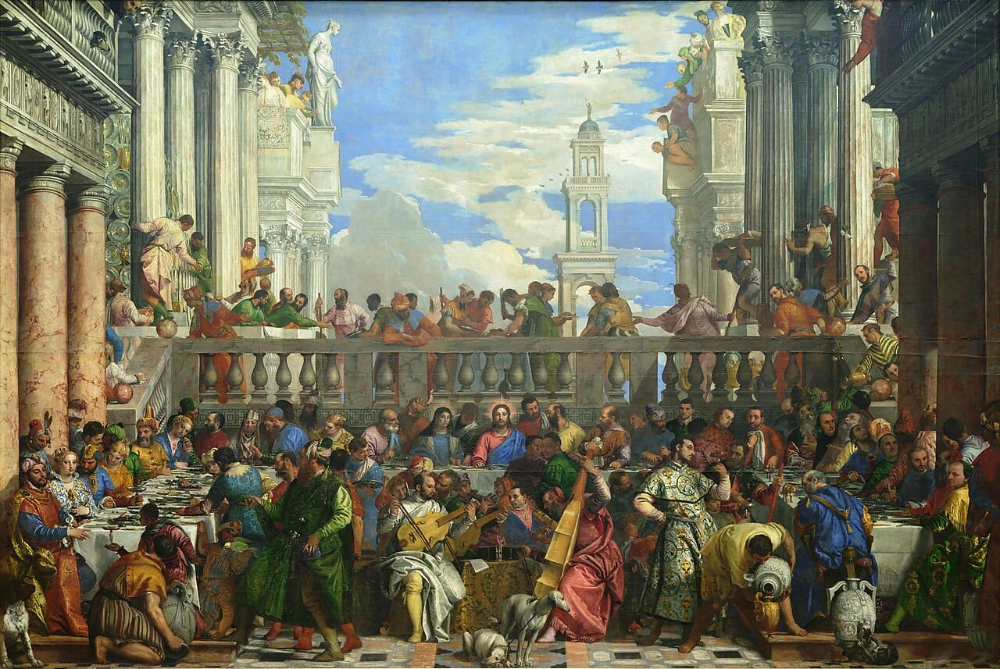

Figure: Full reproduction of Veronese's The Wedding at Cana, Musée du Louvre; not an installation photograph and not a detail.. Image: Paolo Veronese, Public domain, via Wikimedia Commons ([source page](https://commons.wikimedia.org/wiki/File:Les_Noces_de_Cana_-_Paolo_Veronese_-_Mus%C3%A9e_du_Louvre_Peintures_INV_142_;_MR_384.jpg)).

> **Quick verdict**
> **In one line:** This artwork entry helps you look at The Wedding at Cana: A Wall-Sized Feast with a Miracle at the Edge, and place it in the history of drinking imagery.
>
> - **Best for:** Anyone who wants The Wedding at Cana: A Wall-Sized Feast with a Miracle at the Edge in the history of drinking imagery, not as a standalone picture.
> - **Not for:** If you want want a single image without the period or drinking context.
> - **Check first:**
>   - It is hard to approach The Wedding at Cana as a religious painting.
>   - The artist is Paolo Caliari, known as Paolo Veronese (1528–1588).

## A feast that fills a wall

It is hard to approach *The Wedding at Cana* as a religious painting. It is too wide, too loud, too obviously in the middle of a party. Two enormous columns frame a two-storey stage; above the balustrade there is sky, below it a chain of tables. More than a hundred figures crowd the scene. Servants carry platters, a dog looks up from under a table, musicians tune their instruments in the foreground. Christ sits near the centre with the Virgin beside him, but the eye is first captured by the banquet itself.

The canvas measures about 9.94 by 6.77 metres. It is one of the largest paintings in the Louvre, yet it was not made for a museum. Veronese painted it for the refectory of the monastery of San Giorgio Maggiore in Venice. The monks looked up from their own meal and saw a wedding feast; at the centre of that feast was the Gospel miracle of water turned into wine. The picture is therefore not a genre scene of Venetian luxury. It is a religious image that places a miracle inside an ordinary dining room.

## Object information

The artist is Paolo Caliari, known as Paolo Veronese (1528–1588). The Louvre catalogue dates the work to the sixteenth century, usually 1562–1563. It is oil on canvas, inventory number INV 142, originally made for San Giorgio Maggiore. In 1797 Napoleonic troops removed it from Venice and brought it to Paris; it has remained in the Louvre since then.

The subject comes from John 2:1–11. At a wedding in Cana the wine runs out. Jesus tells the servants to fill six stone jars with water; the water becomes wine. The steward tastes it, does not know where it came from, and calls the bridegroom: "Everyone serves the good wine first, and when the guests have drunk freely, then the poor wine. But you have kept the good wine until now." The verse already contains a small social comedy. The miracle happens inside the mechanics of hospitality, not on a public stage.

Veronese does not make the six jars the centre of the picture. He puts them at the right, close to the servants, and brings the steward, the cupbearer and the pourers into the foreground. The viewer has to look for the moment of transformation. That choice turns the miracle into part of banquet management: is there enough wine, when should it be served, who tastes it first?

## What the wine is doing in the picture

The wine is not decoration. It works on three levels.

First, it establishes **the scale of the feast**. Cups, jugs, glassware and silver plates, together with silk, velvet and gold embroidery, tell us that this is not a peasant wedding. It is an image of Venetian patrician abundance. The quantity of wine is a measure of the host's honour.

Second, it is **the clue to the miracle**. At the right, servants draw from the stone jars; the steward lifts a glass to taste. Those two actions connect water and wine. A viewer who only looks at Christ in the centre will miss the narrative hinge. Veronese lets the everyday logic of the banquet stand first, then lets the miracle enter from the edge.

Third, it is **a metaphor of order**. Who sits, who stands, who carries, who watches from the balcony: these positions form a precise social map. Wine flows from the jars to the servants, from the servants to the great vessels, from the vessels to the tables. It links people of different ranks in one chain of service. The comparison with later Dutch tavern scenes is useful, as discussed in [the history of taverns](ref:taverns), but Veronese is not interested in drunkenness. He is interested in the organisation of a feast.

## Veronese and Venetian banquet culture

Veronese was born in Verona and later worked in Venice. Sixteenth-century Venice was a Mediterranean centre for trade and luxury: sugar, spices, glass, silk and wine all passed through it. His palette of silver-grey, blue-green, pink and deep red, his crowded compositions and his bright, theatrical spaces are often described as painting as stagecraft.

The architecture in *The Wedding at Cana* is not a literal Venetian street. The columns, balustrades, domes and distant tower look more like a set. They divide the figures into an upper and a lower register. The result feels both interior and open-air: a crowded table below, fresh sky above. Veronese pushed the same structure further in *The Feast in the House of Levi*, a picture that eventually drew the attention of the Inquisition because it was too crowded and too worldly for a religious subject. Seen together, the two works explain why he kept placing sacred stories inside Venetian high society: he believed that holy events could happen in the most social of rooms.

There is a detail that is easy to miss. In the quartet of musicians in the foreground, the man in white playing a stringed instrument is widely identified as a self-portrait of Veronese. The painter puts himself inside the feast, not to steal the scene but to declare that he organised it. This is a Renaissance signature: not a name in the corner, but a body looking back at the viewer.

## From refectory to Louvre

The painting originally hung in the refectory of San Giorgio Maggiore. The monks saw it every day while eating: the wedding at Cana, the first miracle of Christ, a wall of wine and guests. The location dictated its scale. It had to cover a wall and be legible to a room full of diners. It also dictated its tone: not a small cabinet picture for a private collector, but a collective image for a public room.

In 1797, under the Treaty of Tolentino, Napoleonic troops removed large numbers of works from Venice. *The Wedding at Cana* was brought to Paris. After the fall of the empire in 1815, many works were reclaimed; this one was too large and too risky to move, and it stayed in the Louvre. France gave a painting by Charles Le Brun in exchange, though accounts differ on which work. The usual explanation is simply scale: the picture could not travel back safely. It was removed and packed again during the wars of 1870 and 1939.

Today it hangs opposite the *Mona Lisa*. The pairing is telling: one Renaissance portrait, one Renaissance banquet; one quiet face, one noisy room. Visitors usually look at the *Mona Lisa* first, then turn and meet the wall of guests. The installation asks them to compare two kinds of Renaissance: private mystery and collective order.

## Common misreadings

**Misreading one: this is a record of Venetian life.** The costumes, objects and architecture have Venetian roots, but the painting was made for a monastic refectory and tells a sacred story. The figures, the space and the light are composed. Treating it as a photograph of sixteenth-century Venice misses its theological work.

**Misreading two: because Christ is central, the miracle is central.** Christ stands on the central axis, but the transformation happens at the right, among servants. Veronese hides the miracle in the workflow of the feast. The viewer has to move across the canvas to find it. That edge-centred storytelling is the point.

**Misreading three: more wine means more decadence.** Wine here is first the duty of hospitality and then the vehicle of the miracle. Veronese is not painting a moral satire. He is showing how abundance becomes the stage for a sacred event. The page on [wine](ref:wine) helps explain wine's social place, but the picture should not be read as a temperance poster.

**Misreading four: the white musician must be Veronese himself.** The identification is widely accepted but is not a written signature. What is certain is that Veronese placed himself inside the feast. Whether the figure is literally him remains an interpretation, not a document.

## How to look at it

Step back first. Read the lower zone as a horizontal band of tables, the upper zone as vertical columns and sky. Find Christ slightly right of centre, with the Virgin beside him. Then follow the diagonal formed by the servant, the stone jars and the steward at the lower right. Move closer and look at three details: the servant pouring, Christ's hand, and the musicians in the foreground. Finally, look at the edges: the dog, the parrot, the child, the servant carrying a platter. These "extra" people are what Veronese really wants you to see.

Place the canvas beside [The Glass of Wine](ref:vermeer)'s *Wine Glass* and the difference is immediate. Vermeer paints one person and one window; Veronese paints a crowd and a wall. Vermeer pulls wine into a private interior; Veronese spreads it across a public room. Set it against [Bacchus](ref:bacchus)'s *Bacchus* and the scale shifts again: Caravaggio turns a god into a single body, while Veronese turns a crowd into the background of a miracle. Together they offer three scales of wine and painting, as explored in [wine and painting](ref:painting).

What matters most today is not the number of figures but the direction of service. Wine leaves the jars, passes through servants, enters the steward's glass, then reaches the guests. The miracle does not abolish hierarchy; it flows along it. That may be the most religious thing about this very worldly painting: the miracle happens inside a feast, and the feast has its own rules.
