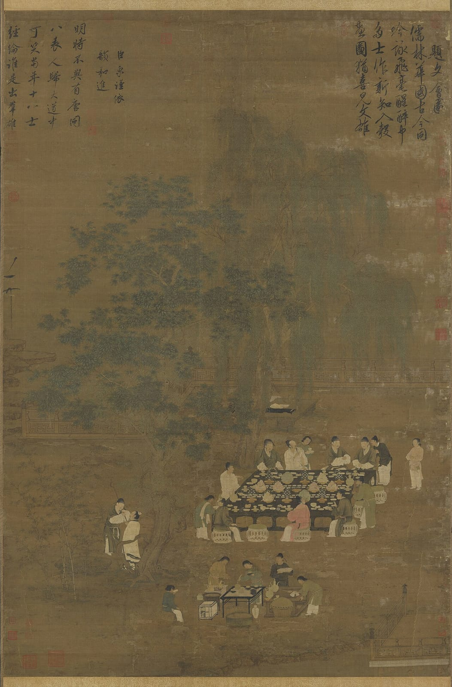

Figure: Reproduction of the Literary Gathering scroll, traditionally attributed to Emperor Huizong, National Palace Museum, Taipei; not a documentary record of a Song gathering.. Image: Emperor Huizong of Song, Public domain, via Wikimedia Commons ([source page](https://commons.wikimedia.org/wiki/File:%E6%96%87%E4%BC%9A%E5%9B%BE%E8%BD%B4.%E5%AE%8B%E4%BB%A3.%E5%AE%8B%E5%BE%BD%E5%AE%97%E8%B5%B5%E4%BD%B6.%E7%BB%A2%E6%9C%AC%E8%AE%BE%E8%89%B2.%E5%8F%B0%E5%8C%97%E6%95%85%E5%AE%AB%E5%8D%9A%E7%89%A9%E9%99%A2%E8%97%8F.jpg)).

## One large table, a ring of scholars

The picture first gives you a garden: trees, bamboo, rocks, a balustrade, and a pale distance that reads like mist. Then it gives you a huge black lacquer table covered with fruit dishes, bowls, wine vessels, tea ware and a flower arrangement. Around the table sit a dozen or so scholars in robes, some facing front, some turned, some raising a cup, some talking. Beyond the table stand servants: one holds a ewer, one carries a tray, others prepare something in the distance. At the lower edge, another group seems to be warming wine or preparing tea.

This is the scroll traditionally attributed to Emperor Huizong of Song (1082–1135), *Literary Gathering* (Wen Hui Tu). It is in the National Palace Museum in Taipei, ink and colour on silk, about 184.4 by 123.9 centimetres. The title refers to a literati gathering: a group brought together by writing, scholarship or office, eating, drinking, reciting poetry and discussing art. It is not simply a picture of drinking. It is an image of how scholars are supposed to behave in public.

## Object information

The scroll is traditionally attributed to Huizong, but scholars disagree about authorship and authenticity. It carries Huizong's inscription and seals, and its style is close to the Xuanhe painting academy. But an imperial inscription does not prove an imperial hand. Song court painting often involved academy painters working under an imperial title, with the emperor adding calligraphy. The safer description is that the work belongs to the Northern Song Xuanhe court painting system, is traditionally attributed to Huizong, and remains uncertain in authorship.

The medium is ink and colour on silk. The figures, furniture and objects are finely painted; the trees and rocks are looser. This "tight figures, relaxed setting" treatment is common in Song court figure painting. It concentrates attention on posture, drapery and objects, while the environment supplies atmosphere rather than competing for attention.

The "literary gathering" is not an informal meal. It has clear seating, service and objects: who sits at the main place, who sits to the side, who stands, who remains outside the table. All of this shows rank and relationship. For Song literati, a gathering was both social and political. It displayed scholarship, taste and connections in public, and it built alliances in private. Huizong paints such an occasion in order to make the ideal of "civil governance" visible.

## What the wine is doing

The wine in the picture is not noisy. Wine cups, wine vessels and tea ware sit together on the table; servants hold ewers; but no one drinks heavily and no one is drunk. Wine is part of the gathering, not the whole of it.

First, **wine is ritual**. A literati gathering expects wine and poetry. Wine supports conviviality and completes courtesy. Who raises a cup first, who drinks with whom, who abstains: all of this has rules. More is not better; fitness is better. This connects with the discussion of wine ritual in [wine and ritual](ref:ritual): wine displays relationships.

Second, **wine is status**. The vessels, tea ware, fruit dishes and flower arrangement extend the scholar's studio into the banquet table. They show that this is not an ordinary restaurant but a cultivated private or court setting. Wine is not thirst-quenching drink here. It is proof that "we know how to live".

Third, **wine is politics**. Northern Song literati politics depended on banquets, poetry meetings and letter networks. A gathering could strengthen bonds and display a position. Huizong paints the gathering as an orderly image, as if to say: if these scholars sit at one table, the court is stable. Wine is the adhesive and the lubricant of power.

## Huizong, the academy and the image of civil rule

Huizong was the eighth emperor of the Northern Song, reigning under the Xuanhe era name. He was not successful in politics, but he was enormously influential in art. He promoted the painting academy, valued observation, method and poetic meaning, and took part in painting and calligraphy himself. Xuanhe academy works are often precise, rich and carefully composed, serving both court taste and political expression.

*Literary Gathering* belongs in this context. It is not an ordinary genre picture of scholars meeting. It is an image of how the court wanted to see scholars. The academicians are painted upright, composed and orderly; the servants are busy, deferential and discreet. There is no conflict, no drunkenness, no transgression. The picture presents an idealised order of civil governance: men of learning each in their place, linked by wine and tea.

That idealisation also means omission. Real gatherings involved arguments, factions and failures. The picture has none. It turns the gathering into a harmonious performance rather than a political event that might go wrong. Understanding this is the key to its importance: it is not a record. It is a projection.

## Why it matters

**It is a representative image of the Song literati gathering.** Later paintings of "literary gatherings", "elegant meetings" and the "Eighteen Scholars" often borrow this composition: a large table, a ring of sitters, servants, a garden, and objects. It provides a visual template for how scholars are supposed to gather.

**It turns food and vessels into cultural signs.** Wine cups, tea ware, fruit dishes, flowers and furniture are not mere props. They are a material inventory of Song literati life. Historians of food, objects and furniture can read many details in this picture.

**It shows the political function of court painting.** Huizong is not simply painting a pleasant party. He is painting the ideal of civil governance. The more harmonious the image, the more the court wants to be seen that way. This "government through painting" is an important aspect of Song court art.

## Common misreadings

**Misreading one: this is a record of Huizong drinking with scholars.** The work may be by academy painters; the imperial inscription does not prove his hand, and does not prove he was present. Treating it as a photograph of an imperial dinner ignores its idealisation.

**Misreading two: this is the "Eighteen Scholars".** The Eighteen Scholars were the eighteen academicians of Li Shimin's Qin princely establishment; later artists painted the subject repeatedly. *Literary Gathering* is a different title, with a different number of figures and a different composition. The two are related but not interchangeable.

**Misreading three: everyone in the picture is drinking wine.** Wine vessels and tea ware sit together; servants also prepare tea. This is a gathering that includes drinking, tea, food and conversation, not a pure drinking party. Reducing it to "wine" misses its literati character.

**Misreading four: this is a realistic genre painting.** It has realistic details of people, objects and garden, but the whole is an idealised order. A real gathering would not be this tidy and would not lack conflict. Its "truth" is institutional, not documentary.

## How to look at it

Start with the table. It is the centre and the intersection of every figure. Then look at seating: who is at the main place, who to the side, who stands, who is outside the table. Then look at the objects: wine cups, tea ware, fruit, flowers, and where each is placed. Finally look at the servants. Their actions turn the picture from a static portrait into an event in progress.

Compare it with [Night Banquet of Han Xizai](ref:han-xizai)'s *Night Banquet of Han Xizai*: the latter paints a private, indulgent and politically anxious night party; *Literary Gathering* paints a daytime, public, orderly meeting. Compare it with [the Qingming Scroll](ref:qingming)'s *Qingming Scroll*: the latter paints urban commerce and street taverns; *Literary Gathering* paints the indoor world of court scholars. Together they show three levels of Song drinking culture: court, literati and city.

Finally, place [yellow wine](ref:yellow-wine) and [wine and painting](ref:painting) here. Song wine was mainly yellow rice wine and rice wine; the vessels and rituals of a literary gathering are not the same as today's baijiu table culture. Understanding this prevents us from reading *Literary Gathering* as a generic illustration of "an ancient dinner party".
