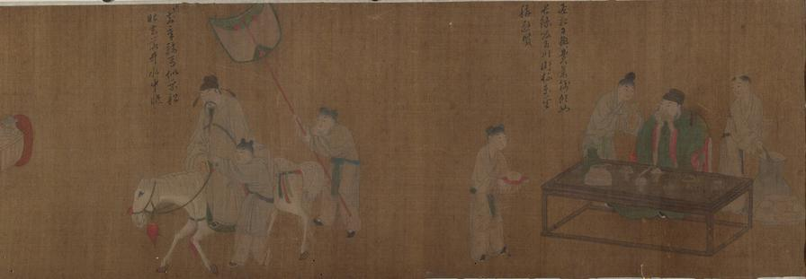

# The Eight Immortals of the Wine Cup: eight drunks in one painting

Du Fu compressed eight drinking lives into one song. The poem has no banquet plot, only eight moments enlarged by wine: a horse ride, a court audience, a raised cup, a brush lifted before princes, a sudden burst of talk. Later painters broke those moments into figure groups, and the result is a subject rather than a single picture. At least two versions can be checked today, one in Taipei and one in New York.

Figure: Detail of The Eight Drunkards (Metropolitan Museum of Art version), ink and color on silk, Ming or Qing dynasty, The Met, New York. Image: Unidentified Chinese artist, Public domain, via [source page](https://www.metmuseum.org/art/collection/search/51533).

## The work and its collection

The National Palace Museum in Taipei holds a handscroll traditionally attributed to the Yuan official and painter Ren Renfa. It is ink and colour on paper, 26.7 cm high and 447.3 cm long, with a colophon section 26.7 cm high and 57.7 cm long. The scroll is recorded in the third imperial catalogue, Shiqu Baoji Sanbian, in the Ningshou Palace section, and the colophon section carries a clerical-script inscription by Yu Ji dated 1325 that opens with the text of Du Fu's poem. The words "traditionally attributed" matter: the museum does not treat the authorship as settled.

The Metropolitan Museum of Art holds a different scroll, titled The Eight Drunkards, object number 19.149. It is dated to the Ming or Qing dynasty, ink and colour on silk, 21.6 cm high and 233.7 cm long, and entered the museum in 1918 through the Rogers Fund. It bears a false signature of the Southern Song painter Liu Songnian, and the museum says so plainly in its record. That false signature is a useful sample of how a later workshop could lift a modest picture into the Song dynasty with a single added name.

The eight names are fixed by the poem: He Zhizhang, Li Jin the Prince of Ruyang, the former chancellor Li Shizhi, Cui Zongzhi, Su Jin, Li Bai, Zhang Xu and Jiao Sui.

## Reading the picture

The practical way to read a long scroll of this kind is to follow the poem and look for each figure. He Zhizhang rides so drunkenly that he seems to be in a boat; Li Jin, on his way to court, meets a wine cart and nearly drools; Li Shizhi drinks like a whale drawing in a hundred rivers; Cui Zongzhi lifts his cup, rolls his eyes at the sky and is compared to a jade tree in the wind; Su Jin keeps a vegetarian vow before a Buddhist image yet escapes into wine; Li Bai sleeps in a Chang'an tavern and will not wake even when the emperor summons him to a boat; Zhang Xu, after three cups, throws off his cap and writes before princes; Jiao Sui only comes alive after five dou, when his talk startles the whole table.

The Taipei scroll, over four metres long, gives each figure room; the Metropolitan scroll, just over two metres, packs them tightly. In both, line and colour carry the story, and the wine vessel is usually a small object in a hand rather than the centre of the composition.

## What wine does in the picture

Wine here classifies character. All eight drink, but each drunkenness is different: He Zhizhang loses his balance, Li Jin loses his dignity to appetite, Li Shizhi drinks with scale, Cui Zongzhi with arrogance, Su Jin with a broken vow, Li Bai with genius, Zhang Xu with a brush, Jiao Sui with a tongue. The painter's task is not to show a beautiful ever but to make the reason for each man's drunkenness legible at a glance.

## Making and context

The date of Du Fu's poem is not settled; it is usually placed in the Tianbao era. The eight men belong roughly to the Kaiyuan and Tianbao reigns. He Zhizhang (659–744) was the elder, Li Bai (701–762) was in his prime, and Li Shizhi rose to chancellor before being exiled and taking his own life. Du Fu calls them immortals not because they were gods but because Tang usage treated heavy drinkers with a mixture of envy and teasing.

After the Song, poems increasingly served as painting subjects, and the Eight Immortals became a common motif. A Yuan handscroll appeared under Ren Renfa's name, and Ming and Qing prints, New Year pictures and porcelain reused the theme.

## Attribution, dating and copies

The Taipei attribution deserves care. Yu Ji's colophon is dated 1325, but a colophon and a painting are not necessarily original to each other; inscriptions can be added later or moved from another work. The museum's phrase "traditionally attributed to Ren Renfa" preserves that uncertainty. Some cataloguers also find the brushwork weak and suggest a Ming hand. That is a stylistic opinion rather than a verdict, but it is enough to show why a famous name should not be repeated as fact.

The Metropolitan scroll shows a different mechanism. No one needed to repaint it; adding a Liu Songnian signature was enough to move a Ming or Qing work back to the Southern Song. By dating it to the Ming or Qing and calling the artist unidentified, the museum removes that packaging.

## Common misreadings

First, the Eight Immortals of the Wine Cup are not the eight Daoist immortals such as Lu Dongbin and Iron Crutch Li. The names coincide; the people do not.

Second, the wine in the painting is not today's baijiu. Tang drinkers mostly had grain wines and unfiltered brews, and the spread of distilled spirits in the Tang is still debated, so a modern [baijiu](ref:baijiu) label would project a later category onto an earlier picture.

Third, a signature is not proof. The Metropolitan scroll's false Liu Songnian signature is the obvious counter-example, and the Taipei scroll still carries the qualifier "traditional".

Fourth, there is more than one version. Taipei and New York alone offer two different sizes, materials and arrangements; details from one cannot be used to reject the other.

Fifth, the eight men did not gather at one table. Du Fu wrote about them separately, and the painting assembles separate passages into a sequence.

## Looking closer

Read the poem once before looking at the picture, and memorise one gesture for each man. Then stop at each section: who is this, what is he doing, whose hand holds the cup. End with the colophons and seals; a dated colophon often says more about when a scroll entered a collection than the picture says about when it was painted.

## See also

- [China](ref:china): the cultural and geographical setting of the subject.
- [Baijiu](ref:baijiu): the counter-entry for the distilled-spirits question.
- [Wine and poetry](ref:wine-and-poetry): Du Fu's drinking poems and Tang wine culture.
- [Li Bai](ref:li-bai): one of the eight and a central figure in the wine-poetry tradition.
- [The Lantingji Xu](ref:lanting): another work that begins with a drinking gathering.
