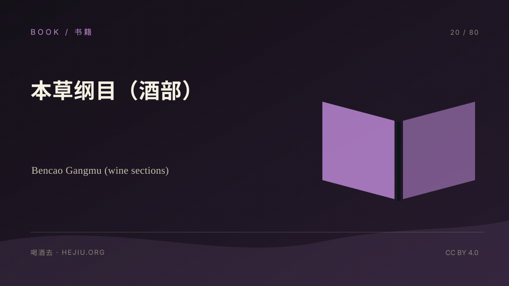

# Bencao Gangmu (wine sections)

Bencao Gangmu is the great pharmacological compendium compiled by Li Shizhen in the Ming dynasty, in fifty-two volumes. Its wine material is concentrated in volume 25, in the fermented-and-brewed class of the grain section, with entries on wine, shaojiu and grape wine, recording names, methods, properties, indications and formulas.

Figure: thematic illustration for Bencao Gangmu (wine sections). Image: AI-assisted illustration generated with Doubao Seedream 5.0 (project-owned); not a photograph of the subject.

## Author and background

Li Shizhen (1518–1593), courtesy name Dongbi and art name Binhu, was born in Qizhou, Hubei, into a medical family. He failed repeatedly in the examinations and turned to medicine. Convinced that earlier materia medica were confused in nomenclature and contradictory in their accounts of drugs, he searched widely, consulted more than eight hundred earlier works, and combined field inquiry with clinical experience over roughly twenty-seven years.

The draft was largely complete in 1578 and was revised afterwards. In 1590 Wang Shizhen wrote a preface praising it as broad without being cumbersome and detailed while keeping the essentials. In 1596 Hu Chenglong printed it at Nanjing, the so-called Jinling edition, the earliest surviving printing.

The work has fifty-two volumes, divided into sixteen sections and sixty classes. It records 1,892 drugs, 11,096 attached formulas and 1,109 illustrations.

## Editions and structure

The structure runs from section to class to entry. Each entry usually begins with “explanation of names”, giving aliases and the origin of the name; then “collected explanations”, gathering earlier authorities with the author's comments; then “corrections of errors”; and finally “properties”, “indications”, “discussion” and “attached formulas”.

The textual tradition is complex. After the Jinling edition came the Jiangxi edition of 1603, and Ming and Qing reprints, commentaries and abridgements followed, differing in wording and illustrations. Among modern editions, the punctuated edition by Liu Hengru, published by the People's Medical Publishing House in 1982, is widely used; citations should give volume, entry and edition.

Note that the “wine section” is not a separate volume of the original. It is a group of entries under the fermented-and-brewed class of volume 25. Later selections labelled “wine section” are re-edited, and searches should use volume 25 and the entry names.

## Core content: the wine entries in volume 25

The wine entry gives names, properties, indications and formulas. Traditional pharmacy labels wine as “greatly hot and toxic”, with indications such as “promoting the action of drugs and killing evil and toxic qi”.

The shaojiu entry is the most quoted material in wine history. “Shaojiu is not an ancient method; its method was first created in the Yuan” dates distilled spirits to the Yuan dynasty. The text then describes putting strong wine and lees into a steamer, “steaming so that the vapour rises and catching the dripping dew in a vessel”, and says the result is “clear as water, extremely strong in taste, being wine dew”. Tools, operation and product are all described, making this a key piece of evidence for early distillation.

The grape-wine entry records two methods, fermented grape wine and a distilled grape spirit, and links the Central Plains' knowledge of grape wine to the Tang conquest of Gaochang. Gaochang lay in what is now the Turpan area of Xinjiang; after the Tang took the city in 640, local grapes and winemaking spread further into China.

## Wine-cultural value: wine, medicine and technique

First, the book preserves a large body of wine names and aliases. Rice wine, shaojiu, grape wine, lees and vinegar stand next to one another, showing that “wine” was not a single category but a set of things divided by material, process and use.

Second, it places wine within the framework of “something that can enter medicine”. Wine is both solvent and vehicle, and different wines receive different properties; shaojiu, being strong, is called “fierce in nature”. This classification shaped later writing on medicinal and health wines.

Third, it provides a coordinate for the history of technique. The Yuan-origin claim sits alongside possible references to stills in Song texts and the “arak” of the Yuan dietary manual Yin Shan Zheng Yao, forming the basic chain of evidence in the debate over distillation. The grape-wine entry makes the exchange between the Western Regions, Gaochang and the Central Plains concrete.

Fourth, it preserves a habit of correction. Li Shizhen repeatedly disentangles earlier confusions, a practice of distinguishing names, things and uses that is closer to modern knowledge work than a bare list of prescriptions.

## Limits and controversies

First, the pharmacological discussion rests on traditional theory and cannot be treated as modern medical evidence. Interactions between alcohol and drugs, and the effects of alcohol on the liver and cardiovascular system, require modern pharmacology and clinical research; the World Health Organization states that no level of alcohol consumption is safe for health. Second, many entries transcribe earlier texts and were not personally verified by Li Shizhen, so original sources should be traced.

Third, “shaojiu began in the Yuan” is a Ming judgement, not a settled conclusion. Archaeology, still design and the routes by which techniques travelled are still debated, and one sentence should not close the question. Fourth, ancient doses, processing and alcoholic strength differ from today's, and following old formulas carries risk.

Fifth, editions differ in wording and in the number of formulas, so a specific claim should cite volume, entry and edition.

## How to read it today

Researchers can treat volume 25 as primary material, reading it against a punctuated edition and a facsimile and noting the sources of each entry. Readers interested in wine history might begin with the shaojiu and grape-wine entries and then return to the properties and indications, to see how drinking and medicine share one vocabulary.

Those interested in traditional medicinal wine should treat the book as a historical document, not a formula manual, and consult professionals before using anything containing alcohol or drugs. If you want simply want to know how Ming people drank can set it beside Suiyuan Shidan.

## See also

- [Baijiu](ref:baijiu): aroma types and craft of distilled spirits.
- [Yellow wine](ref:yellow-wine): the lineage of grain-fermented wine.
- [Distillation](ref:distillation): the technical question behind the shaojiu entry.
- [History of Chinese alcohol](ref:chinese-wine-history): the long debate over the origin of shaojiu.
- [Spread of distillation](ref:spread-of-distillation): the Yuan account compared with other origins.

Start with the author and edition. From there, consider what the book covers, then what it is cited for here. That is how a practical judgment about Bencao Gangmu (wine sections) is built.

Start with [Baijiu](ref:baijiu) for author, then read [Distillation](ref:distillation) for edition. Seeing both keeps Bencao Gangmu (wine sections) from being confused with a neighbouring idea.

**Key facts.**

| Item | Detail |
| --- | --- |
| In one line | Volume 25 of Li Shizhen’s Ming pharmacopoeia, in the fermented-and-brewed class of the grain section, collects entries on wine, shaojiu and grape wine with methods, properties and medicinal claims. It is a key text for M… |
| Author | Li Shizhen |
| Publication | Ming Wanli period; drafted in 1578, first printed in 1596 |
