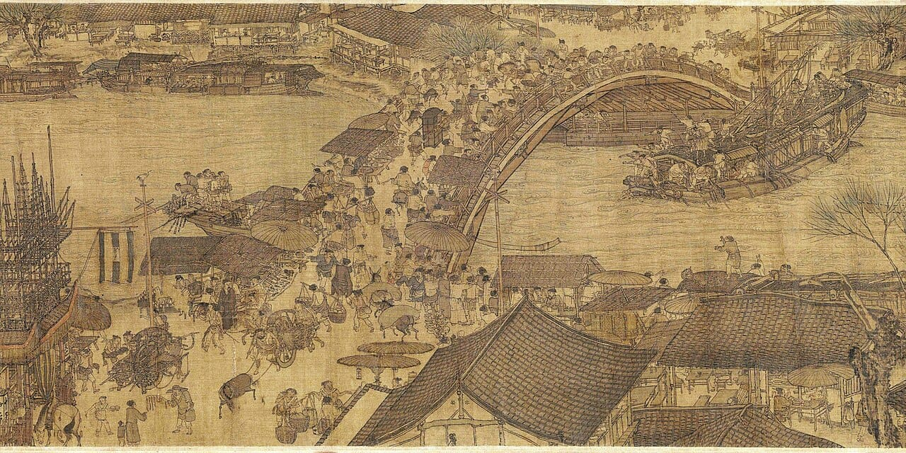

# Dongjing Menghua Lu

Figure: A detail of Zhang Zeduan’s Along the River During the Qingming Festival, showing the Rainbow Bridge and city life in Northern Song Bianjing; this is not a page from Dongjing Menghua Lu. Image: Zhang Zeduan, Public domain, via Wikimedia Commons ([source page](https://commons.wikimedia.org/wiki/File:Along_the_River_During_the_Qingming_Festival_(detail_of_original).jpg)).

## Bibliographic note

Dongjing Menghua Lu is a ten-juan notebook by Meng Yuanlao of the Southern Song. In his preface, dated 1147 (Shaoxing 17), the author recalls the city of Bianjing (modern Kaifeng), capital of the Northern Song, during the reign of Emperor Huizong, roughly 1102–1125. The book describes streets, temples, taverns, food shops, night markets, festivals and customs. The earliest surviving edition is a Yuan imprint; the National Library of China Publishing House has published a facsimile. Among modern editions, Zhonghua Book Company’s Dongjing Menghua Lu Jianzhu, annotated by Yi Yongwen, is widely used and cites a large body of historical sources and old illustrations.

“Dongjing” means the Eastern Capital, Bianjing, not Tokyo, Japan. “Menghua” alludes to the Huaxu dream and carries a sense of recollection, nostalgia and “the capital as a dream.” The title itself signals the method: this is not a contemporary official archive but a southerner’s memory of a lost city. A reader who treats it as a real-time record of Northern Song Bianjing will miss the roles of memory, selection and idealisation.

## Author and text

Meng Yuanlao, whose personal name is given as Meng Yue, has no reliable birth or death dates; “Yuanlao” may be a courtesy name or style, and “Youlan Jushi” is another sobriquet. He says he entered the capital with his father in 1103 and lived there for more than twenty years before fleeing south in 1126. In old age, fearing that later generations would get the capital’s customs “wrong,” he wrote ten juan of remembered streets, festivals, food, music and ritual. The motive is explicit: to leave a transmission of a lost city.

But “personal experience” is not “objectivity.” Meng’s memory is selective: he is more interested in the city’s bustle, festivals, consumption and elite life than in the poor, disease, labour or institutional darkness. He writes “dream of splendour,” not “social survey.” Some figures and place names need collation, and editions differ. Readers should separate the eyewitness memoir from later annotation: the former gives immediacy, the latter gives verification and correction.

## Where wine sits

Wine is one of the book’s most important material clues. It describes taverns, wine shops, licensed breweries, petty wine shops, banners, night markets, vessels, dishes, drinking games and festival customs, laying out a city’s wine network. The most quoted line is that “within the capital there are seventy-two licensed wine houses, and beyond these cannot be counted; the rest are all called petty shops.” Licensed houses had the right to brew and sell; petty shops bought wine from them and retailed it. This “licensed–petty” structure shows that Bianjing’s wine trade was not a scatter of stalls but a layered urban industry with licences and supply chains.

The book also describes tavern space: façades, coloured gate arches, halls, private rooms, night lamps, singers and waiters. A tavern was not only a place to drink; it was a place to do business, entertain, listen to music, watch lanterns and socialise. Wine is tied to the rhythm of the city: licensed and petty shops by day, night markets and “ghost markets” after dark; festival drinking at Qingming, Dragon Boat, Mid-Autumn and Double Ninth; different circles of imperial, official, merchant and common drinkers at different tables. These passages make “the tavern is the city’s living room” a spatial fact, not merely a metaphor.

Wine vessels also matter. The book mentions silver, porcelain, lacquer, ewers and trays; material and shape are tied to occasion and status. A vessel is not a neutral container; it participates in ritual and display. Recent research has compared Dongjing Menghua Lu with Along the River During the Qingming Festival to discuss Song wine-vessel heat retention, tavern furnishing and drinking methods. Such work supplements what the text leaves out, but images and texts each have their own limits.

## Key scenes and the urban wine trade

The taverns in Dongjing Menghua Lu are nodes in a city network, not isolated shops. The book says that every capital wine house hung coloured gate arches at its entrance—what we might call advertising—and that some taverns had a main corridor of more than a hundred paces, with courtyards, side galleries and small rooms; at dusk, lamps and candles shone and reflected from above and below. This description links architecture, lighting, service and nightlife, and the reader can almost see a city that did not sleep.

Festival drinking is another focus. The book describes food and wine at Qingming, Dragon Boat, Qixi, Mid-Autumn, Double Ninth and Winter Solstice; different festivals have different drinks, people and spaces. At Qingming, there is spring outing, river travel and banqueting; at Mid-Autumn, moon viewing and drinking; at Double Ninth, climbing and chrysanthemum wine. Wine is not an “added beverage” but part of the calendar: what to drink when is tied to agriculture, climate, belief and social life.

Night markets and “ghost markets” also deserve attention. The book describes the Zhouqiao night market and the Maxing Street night market, selling food, fruit, wine, tea and sundries; some stalls close at the third watch and reopen at the fifth. Wine in these markets is both commodity and medium of light, warmth and sociability. Reading taverns, night markets and festivals together shows that Bianjing’s wine trade was not a simple “open by day, closed by night” pattern but an all-day, city-wide service network.

## Historical value and limits

As historical evidence, its value is density and spatial sense. It records many place names, shop names, streets, bridges, festivals, foods and vessels, helping researchers reconstruct the urban map and daily life of Northern Song Bianjing. It can be checked against Along the River During the Qingming Festival, Song notebooks, gazetteers, wine-tax documents and excavations. The “seventy-two licensed houses” can be compared with Song wine administration and tax records; the tavern architecture with images and sites; the festival customs with poetry and notebooks.

There are four limits. First, it is a memoir, not a contemporary archive; it was written more than twenty years after the fall of the Northern Song, and memory can err. Second, it has a nostalgic and idealising tendency, easily turning the lost capital into “splendour like a dream” while neglecting social conflict and institutional problems. Third, editions are complex: Yuan, Ming, Qing manuscripts and modern annotated editions differ, so citations need the version. Fourth, its geography and numbers need collation; “seventy-two” should not be treated as an exact statistic. It is more likely a rounded figure indicating that licensed houses were numerous.

## Common misreadings

The most common misreading treats Dongjing Menghua Lu as a novel or storybook; it is a notebook-style historical source. It has literary quality, but its aim is to record urban customs. A second misreading takes “Dongjing” to mean Tokyo, Japan; it refers to Bianjing, the Northern Song capital. A third misreading treats “seventy-two licensed houses” as the total number of wine houses in Bianjing; the text itself says “beyond these cannot be counted, the rest are all petty shops,” so licensed houses were only the large, brewing-qualified ones, and petty shops were more numerous. A fourth misreading treats the bustle as the normal condition of all Northern Song society; the book focuses on the city, festivals and consumption, not the countryside, the poor or institutional darkness. A fifth misreading treats illustrations or Along the River During the Qingming Festival as the book’s “original illustrations”; they are different media that can corroborate each other but are not the same text.

## See also

- [Along the River During the Qingming Festival: Bianjing wine houses and urban rhythm](ref:qingming): the city wine trade and urban space in images.
- [Reading a city through a tavern](ref:pub-and-city): taverns and urban life.
- [Song wine tax: official service, private brewing and fiscal dependence](ref:song-tax): Song wine institutions and finance.
- [Huangjiu](ref:yellow-wine): the basic grain wine of the Song.
- [China](ref:china): placing Bianjing in Chinese geography and history.
