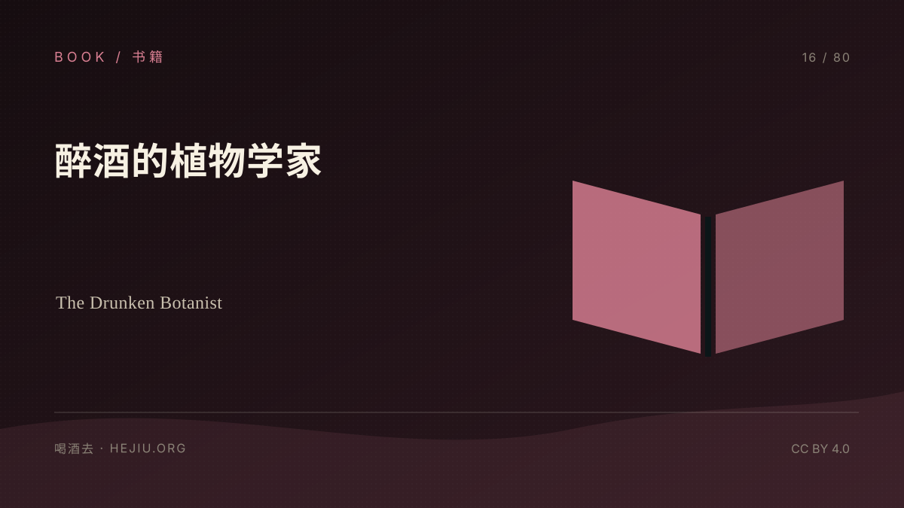

# The Drunken Botanist

The English original is subtitled The Plants That Create the World's Great Drinks. The "botanist" in the title is not a rhetorical flourish: the author really starts with plants and asks where a drink comes from. Wheat, corn, rice, sugarcane, agave, grapes, apples, juniper, spices and bark are planted, harvested and processed, then fermented, distilled or infused before they become the drinks we know. Once that chain is laid out, a drink is no longer only a brand and a flavour; it becomes a history of agriculture, trade and chemistry.

Figure: thematic illustration for The Drunken Botanist. Image: AI-assisted illustration generated with Doubao Seedream 5.0 (project-owned); not a photograph of the subject.

## What this book is

It is neither a simple cocktail recipe book nor a strict botanical textbook. It sits between the two: part of it is a set of plant entries on origins, varieties and uses; part is an explanation of craft, showing how fermentation, distillation and infusion turn plants into alcohol; and part is food culture, showing how a drink enters local life, colonial trade and migrant memory.

It can therefore be read as a "plant index to alcohol": want to know where the juniper in gin comes from, look up juniper; want to know how rum relates to sugarcane, look up sugarcane; want to know why Scotch whisky involves peat and oak, look up barley and the craft entries. It can also be read from the beginning as a popular account of how plants shape drinks.

## Authors and editions

The author is Amy Stewart, an American writer known for books on gardening, plants and natural history. The book was first published by Algonquin Books in 2013, and a tenth-anniversary edition followed; covers, illustrations and revisions may differ between editions. The writing is relaxed and full of anecdotes and characters, but the core botanical and technical information can be checked.

One caveat: the book is aimed at English-speaking readers and home cocktail enthusiasts, not at commercial distillers. Its recipes, proportions and steps are suited to home experiments, not industrial standards; for distillation, alcohol strength and local law, follow the rules and professional guidance where you live.

## Core argument

First, every drink begins with a plant. Whether the label says "grain", "fruit" or "botanical", the raw material can ultimately be traced to a cultivated or wild plant. Second, the plant determines the basic character of the drink. Sugar, starch, aromatics, tannin and bitterness come from different plant parts; craft only releases their potential. Third, the history of alcohol is a global history of plants on the move. Sugarcane, coffee, spices, citrus and grains travelled with trade, colonisation and migration, and the names and methods of drinks changed with them.

Fourth, many "drink stories" are simplified versions of plant stories. A drink's name may come from a plant, a place or a misunderstanding; an "ancient recipe" may have a short history. The author does not always offer a scholarly conclusion, but she reminds the reader: look at the plant first, then at the drink, and many myths become clearer.

## Structure and how to read it

The book is organised roughly by plant category and by stage of craft: sources of starch and sugar first, then fruits, spices, trees and other plant materials, followed by fermentation, distillation, infusion and ageing. Entries can be jumped between, or read by working backwards from a drink to a plant.

Three approaches are useful. The first is "from the glass": choose a drink you often have, look up its raw material and craft, then follow the related plants. The second is "from the plant": choose a familiar plant and see what drinks it can make. The third is "from the craft": read fermentation and distillation first, then return to how different plants are handled. The recipes and gardening notes are optional pleasures, not the main line.

## Verifiable factual boundaries

The book supports the "general relationship between plants and craft": a plant contains starch or sugar, a drink uses a particular plant as its main material, and fermentation differs from distillation in a basic way. It also supports a great deal of background on naming and trade, but that material needs to be separated into "consensus" and "anecdote". Historical stories in the book sometimes come from secondary sources, and the original should be checked.

It does not support exact commercial recipes, distillery output, the modern legal classification of a drink, or claims that "this plant certainly originated in this place", which are easy to outdate. Plant taxonomy and names also change; for serious citation, check floras, alcohol regulations and food-science sources.

## Limits and controversies

First, it is a popular work, not a peer-reviewed academic book. For readability, the author compresses complexity and turns long history into short stories. Second, coverage leans towards the English-speaking world and Western drinks; fermentation traditions in Asia, Africa and Latin America receive less space and depth. Third, the "plant" framework ignores synthetic flavourings, industrial additives and modern flavour technology, which also shape today's drinks. Fourth, the recipes are at home scale, and ingredient substitutions, equipment differences and safety requirements can change the result.

Fifth, it says little about the health risks of alcohol. It can be read as a cultural book about plants and drinks, but its language of "natural" and "plant" should not be read as a health guarantee. The relationship between drinking and health requires separate medical information.

## Who should read it

- Gardeners and plant lovers: an entry into the world of drinks through plants.
- Home cocktail enthusiasts: useful raw-material and craft background, though recipes need adaptation.
- Readers of food and drink history: to see how trade, colonisation and migration changed drinks.
- Travellers: to understand the link between local drinks, local plants and climate.
- Beginners: a lively index rather than a systematic textbook.

## See also

- [Beer](ref:beer): grains, hops and fermentation.
- [Whisky](ref:whisky): grains, distillation and oak.
- [Wine](ref:wine): grapes, fermentation and ageing.
- [Sake](ref:sake): rice, koji and multiple parallel fermentation.
- [Fermentation](ref:fermentation): how sugar becomes alcohol.

Start with the author and edition. From there, consider what the book covers, then what it is cited for here. That is how a practical judgment about The Drunken Botanist is built.

Start with [Beer](ref:beer) for author, then read [Wine](ref:wine) for edition. Seeing both keeps The Drunken Botanist from being confused with a neighbouring idea.

**Key facts.**

| Item | Detail |
| --- | --- |
| In one line | A book that starts with plants and ends with drinks: wheat, corn, rice, sugarcane, agave, grapes, juniper and spices become spirits and wines through fermentation, distillation or infusion. It combines botany, craft and … |
| Author | Amy Stewart |
| Publication | First published in 2013 by Algonquin Books; a tenth-anniversary edition followed |
