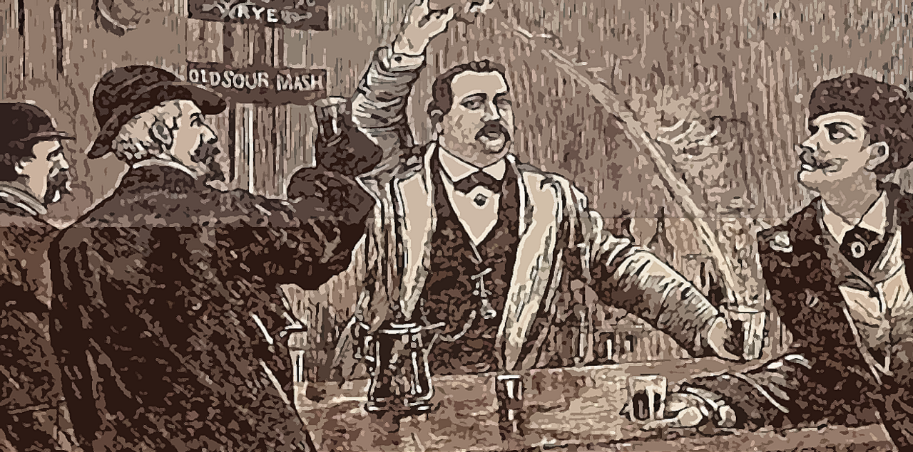

# Imbibe!

Figure: A modern colourised illustration of Jerry Thomas performing the Blue Blazer; it is not a historical photograph and not the cover of Imbibe!. Image: CakeandTail, CC BY-SA 4.0, via Wikimedia Commons ([source page](https://commons.wikimedia.org/wiki/File:JerryThomas-blue-blazer-880x435.png)).

## Bibliographic note

Imbibe! was first published in New York by Perigee Books, part of Penguin Group, in 2007. Its subtitle places “the American cocktail” and “the Blue Blazer” alongside Jerry Thomas, the nineteenth-century bartender who became the book’s central figure. The publisher states that the first edition won a James Beard Award. A revised edition, described as “Updated and Revised,” appeared in 2015 under Perigee/Penguin Random House, with 384 pages, new recipes, new historical detail and a foreword by Dale DeGroff.

The two editions are not simply “old text plus a few pages.” The revised edition reorganised parts of the argument, added material on Thomas’s life and corrected some earlier judgments about gin, whisky and ice. A citation should say “2007 edition” or “2015 revised edition” and should not attribute the new conclusions to the earlier text. Chinese-language book lists sometimes paraphrase the title rather than use a formal translation, so the English title remains the reliable search term.

## Author and context

David Wondrich is an American drinks historian and journalist with a PhD in comparative literature. He was long the drinks correspondent for Esquire and is one of the founders of the modern craft-cocktail movement. He writes from the position of a historian rather than a working bartender: he reads newspapers, bar advertisements, recipe pamphlets, travel guides and private records together, asking when Americans began to treat bartending as a profession.

Jerry Thomas (1830–1885) is the book’s centre. He worked in New York, St. Louis and Chicago, and in 1862 published How to Mix Drinks, or The Bon-Vivant’s Companion, usually described as the first cocktail guide written by a working American bartender. Thomas was famous for showmanship, the Blue Blazer and the title “Professor,” but many details of his life come from later reminiscence and newspaper retellings of uncertain reliability. Wondrich’s achievement is to compare those fragments and turn “the legendary Thomas” back into a bar operator with a professional context, a business strategy and the limits of his time.

## Structure

The book works on three levels. The first is Thomas himself: his apprenticeship, bar businesses, performance style, publishing motives and the daily operation of a nineteenth-century American bar. The second is drink history: punches, cocktails, sours, fizzes, toddies and slings are explained through changes in ingredients, ice, bitters and dilution. The third is recipe reconstruction: using Thomas’s 1862 text as the base, Wondrich gives more than a hundred classic recipes with notes explaining which proportions come from the original and which have been adjusted for modern ingredients.

This three-layer structure lets the book be read as a biography or consulted as a reference. The recipes are not simple transcriptions. The same drink may differ between the 1862 edition, the 1887 edition and a newspaper advertisement; Wondrich points out the differences and explains why they matter. A reader who only follows the recipe section misses the book’s main method: treating a recipe as historical evidence rather than an unchangeable instruction.

## Argument and influence

The central argument is that the “golden age” of the American cocktail was not the 1920s but the middle and late nineteenth century. The rise of the professional bartender, the expansion of the ice trade, and the commercial production of bitters and sugar together moved mixed drinks from the home kitchen into the urban bar. Thomas is not a lone genius who “invented the cocktail”; he is the representative figure of that professionalisation. His recipe book matters not because it contains the first appearance of every name, but because it fixed a working method that later bars could learn, copy and revise.

This argument changed how cocktail history was written. Earlier popular narratives often reduced the subject to “Prohibition, revival, craft cocktail.” Wondrich pushed the timeline back and restored the nineteenth-century bar, the railway, the ice trade and print culture to the picture. He also made recipe verification a standard move in drinks writing: a drink should be cited with a year, an edition and a page, not merely “according to tradition.”

In practice, the book shaped the craft-cocktail movement after the 2000s. Bars returned to nineteenth-century structures and took bitters, syrups, ice and glassware more seriously. Bartenders moved from “inventing a new drink” toward “understanding why an old drink works.” The James Beard Award helped bring drinks writing into the mainstream of food writing.

## Limits as evidence

The book’s strength is that it puts recipes back into context. Its discussions of the ice trade, bitters brands, syrup production, bar rents and adulteration can be read alongside economic, urban and labour history. It also shows that “one dash” or “one pony” was not arbitrary writing but a product of the measures, tools and service style of the period.

The limits are equally important. First, Thomas’s biography has many gaps; Wondrich sometimes has to connect evidence with “may” and “probably,” and those guesses should not harden into facts. Second, the coverage is mainly American, with comparatively little on Europe, Latin America and Asia. Third, recipe reconstruction uses modern ingredients and equipment, so the flavours cannot be identical to those of the nineteenth century; the book offers structural guidance, not a laboratory replication. Fourth, a James Beard Award is an industry award, not academic peer review. Fifth, “Imbibe” means “to drink,” but the book is not a licence for excess; its subject is technique and history, not consumption.

## Common misreadings

The most common misreading turns Jerry Thomas into “the inventor of the cocktail.” Cocktails as a drink category existed before Thomas; his significance is professionalisation and systematisation, not creation from nothing. A second misreading treats the 1862 How to Mix Drinks as “the world’s first cocktail book.” It is usually described as the first American guide written by a working bartender, but earlier British and French publications exist. A third misreading treats the recipes as “authentic reconstructions”; nineteenth-century ice, spirit strength, bitters and sugar were different. A fourth misreading turns “the first cocktail book to win a James Beard Award” into “the only important cocktail book”; it created a model, not the whole field. A fifth misreading treats Thomas’s theatrical performance as an ordinary bar shift; the Blue Blazer and long pours were showmanship, not the daily routine of every bar.

## See also

- [David Wondrich](ref:wondrich): his research method, journalism and place in drinks history.
- [Jerry Thomas](ref:jerry-thomas): the 1862 guide, the Blue Blazer and the biographical disputes.
- [US Prohibition](ref:prohibition): the break between nineteenth-century bar culture and the 1920s.
- [Cocktail basics](ref:cocktail-basics): tools, proportions and balance.
- [Old Fashioned](ref:old-fashioned): one of the classic structures discussed in the book.

Put [David Wondrich](ref:wondrich)'s author next to [US Prohibition: The Experiment and Repeal of 1920 to 1933](ref:prohibition)'s edition; the difference marks the boundary.
