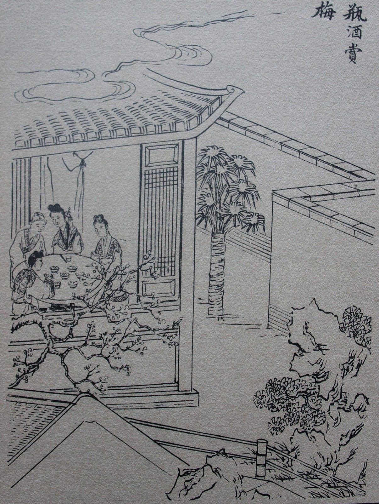

# Jin Ping Mei

Figure: A garden banquet scene from an illustrated edition of Jin Ping Mei; it is not an erotic scene, not a representation of the whole novel, and not a modern book cover. Image: Unknown, 17. century painter from Suzhou (?), China, Public domain, via Wikimedia Commons ([source page](https://commons.wikimedia.org/wiki/File:Jin_Ping_Mei-4.jpg)).

> **Quick verdict**
> **In one line:** This book entry helps you judge whether Jin Ping Mei: Wine Tables, Trade Routes and Ming Life in a Novel of Manners is worth reading, and what question it answers.
>
> - **Best for:** Anyone who wants Jin Ping Mei: Wine Tables, Trade Routes and Ming Life in a Novel of Manners in the history of drink culture and needs to judge whether it is worth reading.
> - **Not for:** If you want want a one-line summary and will not read the book.
> - **Check first:**
>   - As historical evidence, the novel’s value is density and layering.
>   - Jin Ping Mei is a long Ming dynasty novel of manners, attributed to the pen name Lanling Xiaoxiaosheng; the author’s real identity remains unresolved.

## Bibliographic note

Jin Ping Mei is a long Ming dynasty novel of manners, attributed to the pen name Lanling Xiaoxiaosheng; the author’s real identity remains unresolved. It has one hundred chapters and centres on Ximen Qing, Pan Jinlian, Li Ping’er and Pang Chunmei, tracing the rise and fall of a merchant household through marriage, concubinage, business, official connections and urban consumption. The early textual tradition has two main branches: Jin Ping Mei Cihua, which retains more oral storytelling features and dialect, and Xiuxiang Jin Ping Mei, a more literarily polished edition with illustrations. The two differ in chapter titles, wording and detail, so citations should specify the edition.

The novel has long been labelled an “erotic book,” but its content is far broader. Food, clothing, architecture, medicine, law, commerce, transport, opera and banquet etiquette form a dense material world. For alcohol history, it offers detailed evidence of how wine was bought, given, placed on the table and consumed: which wine for which occasion, which vessels, which dishes, and what wine does in a relationship. These details cannot be treated as direct historical records, but they can be checked against gazetteers, notebooks, recipe books and woodblock prints.

## Author and text

“Lanling Xiaoxiaosheng” is a pen name. Scholars have proposed dozens of identities, but none is accepted as definitive. The novel is usually placed in the Ming Wanli period; the earliest surviving Jin Ping Mei Cihua edition has a preface dated 1617, though the writing and circulation may be earlier. The opening borrows the story of Wu Song killing his sister-in-law from Water Margin, then turns into the domestic and commercial world of Ximen Qing. This “borrowed shell” shows how closely the novel was connected to the storytelling, opera and publishing market of its time.

The author’s education and regional background can be inferred from the text. It uses Shandong dialect, prices and official rules from a canal commercial city, medical knowledge and food detail, while also containing literati poetry, opera and classical allusion. Whoever the author was, he knew the life of an urban merchant and the publishing and entertainment market of the Ming. The anonymity is not only a textual puzzle; it shapes how we read the book. It is not a single author’s confession but a multi-voiced record of an era.

## Where wine sits

Wine is almost everywhere in Jin Ping Mei, but it is rarely a “simple drink.” It performs at least four functions. First, sociability: visits, gatherings of wives and concubines, official banquets and festivals all require wine; seating, vessels, dishes and the order of toasts display hierarchy and intimacy. Second, transaction: wine is a gift, a bribe, a debt payment and a form of social credit; a jar of wine can buy information, protection or a business opportunity. Third, desire: wine and sex are often placed together, and drunkenness becomes a catalyst for transgression, testing and violence; but drunkenness is not romantic in the novel, it often brings loss of control, quarrel and consequence. Fourth, narrative: the wine table is where information is exchanged and conflict erupts; many plots advance through banquets, and character is exposed in toasting, urging and refusing.

The novel names many wines. The most prominent is Jinhua wine. Research notes that “Jinhua wine” is one of the most frequent wine names in Jin Ping Mei, used for gifts, hospitality and daily drinking; other names include shaojiu, grape wine, lotus wine and osmanthus-lotus wine. The choice of wine reflects not only taste but status, season and occasion. Shaojiu, a stronger distilled drink, is often associated with cold nights, medicine or particular characters; Jinhua wine is more of a “respectable everyday wine,” recurring in banquets and social exchange.

## Key scenes and characters

The banquets in Ximen Qing’s household are the best window into Ming urban food. A meal is not just a list of dishes: the novel describes how the table is set, which cups are used, who sits where, who raises a cup first and who is left out. Vessels of gold, silver, porcelain and rhinoceros horn are matched to status; dishes range from dried fruit, preserves and fresh fruit to roast duck, pork trotters and shad, mixing northern market food with produce brought south along the canal. What the reader sees is not only a family eating but a commercial chain from producer to table.

The wine scenes of Pan Jinlian, Li Ping’er and Pang Chunmei carry different meanings. Pan Jinlian often uses wine to test, seduce and provoke; Li Ping’er’s wine scenes are more connected to fertility, illness and household position; Pang Chunmei, who later rises from maid to a woman with power, sees her position at the table change as her status changes. Wine is not a label attached to character; it is a thermometer of relationships. Who is allowed the seat of honour, who is urged to drink, who is punished with wine, who leaves under the pretext of drunkenness—all reveal power.

Illustrations are also evidence. Ming or early Qing illustrations of Jin Ping Mei often place banquets, gardens, bedrooms and street markets side by side; tables, chairs, wine pots, cups, screens and plants supplement what the text does not describe. These images are later drawings or woodblock prints, not photographs of the novel’s world. They carry moral instruction and commercial publishing intent and cannot be read as “Ming life photographs.”

## Historical value and limits

As historical evidence, the novel’s value is density and layering. Official histories record institutions; notebooks record anecdotes; a novel can show how institutions were enforced, bent and used in daily life. The banquet etiquette, vessels, prices, scale and dishes help researchers understand Ming consumption, household structure and official-merchant relations. They can be checked against image sources such as Along the River During the Qingming Festival, gazetteers of canal cities, Ming recipe books and alcohol texts.

The limits are equally clear. First, it is fiction, not a transcript; characters and plot involve invention, exaggeration and satire, and not every sentence is historical fact. Second, the author and date are unresolved, and the text has multiple editions; citations must state the version. Third, wine names are regional and period-specific; the same name may cover different techniques in different places and cannot be mapped directly onto a modern product. Fourth, the novel contains explicit sexual content, and excerpts should consider audience and context; reading through alcohol and food history avoids reducing the whole book to eroticism. Fifth, banquet menus serve narrative purposes and may be adjusted for character and plot; they are not necessarily a real menu.

## Common misreadings

The most common misreading reduces Jin Ping Mei to “an erotic novel.” Eroticism is one part, but its historical value lies more in daily life, commercial networks, language and human relations. A second misreading treats the wine names as a “Ming best-wine ranking”; names in the novel also perform narrative and status functions and do not necessarily represent the whole market. A third misreading turns “Jinhua wine” into today’s Jinhua ham or a modern huangjiu; it is a historical wine name whose technique and region need separate research. A fourth misreading treats banquet menus as a “standard Ming cookbook”; the food in the novel is exaggerated, displayed and shaped for character. A fifth misreading treats illustrations as “Ming photographs”; they are part of an edition, with a painting tradition and publishing intent, and cannot be taken as documentary evidence.

## See also

- [A history of Chinese wine: from grain fermentation to national famous wines](ref:chinese-wine): placing the novel’s wine names in the long history.
- [Huangjiu](ref:yellow-wine): the basic type behind Jinhua wine and laojiu.
- [Ming shaojiu: from medicine to northern daily drink](ref:ming-shaoju): the place of distilled liquor in the Ming.
- [Along the River During the Qingming Festival: Bianjing wine houses and urban rhythm](ref:qingming): the city wine trade in images.
- [A history of taverns: from wine houses and inns to bars](ref:taverns): tavern space and food culture.

Read [A concise history of Chinese alcohol: from grain fermentation to national famous wines](ref:chinese-wine) for the author side of Jin Ping Mei, and [Ming Shaojiu: From Medicine to Northern Everyday Drink](ref:ming-shaoju) for the edition side. Together they locate it on a map.
