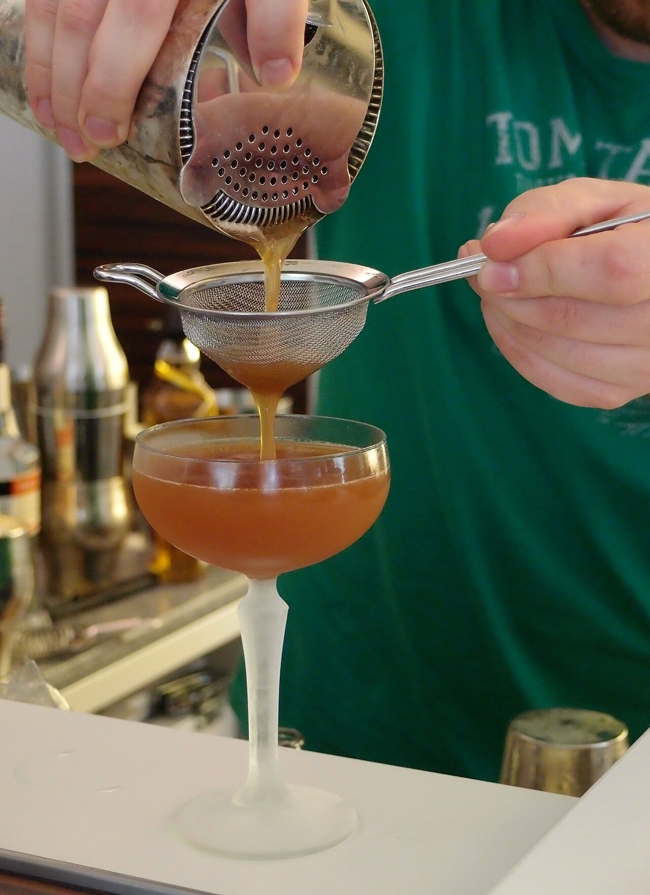

# The Joy of Mixology

Figure: A bartender double-straining a cocktail; The Joy of Mixology is about the structure and ratios behind such operations, not the book cover. Image: SKopp, CC BY 4.0, via Wikimedia Commons ([source page](https://commons.wikimedia.org/wiki/File:Double_straining_a_cocktail.jpg)).

## Bibliographic note

The Joy of Mixology was first published by Clarkson Potter in 2003. A revised and updated edition appeared on 28 August 2018, also from Clarkson Potter, with 352 pages. The publisher describes the 2018 book as a fifteenth-anniversary revision: it keeps the 2003 classification framework, rewrites the recipe section, adds material on the cocktail revival after 2000 and corrects some proportions and names.

The “Joy” in the title is both pleasure and a nod to the author’s nickname, “Gaz.” Chinese-language references sometimes paraphrase the title, but no widely adopted formal Chinese title exists. Citations should use the English title and specify 2003 or 2018, because the two editions differ in recipe count and in some classifications.

## Author and context

Gary Regan (1951–2019) was a British-born American bartender and writer who spent much of his career in New York. He became known as “Gaz Regan” and was active in bartending education, competition judging and cocktail publishing. He founded an annual manual for bartenders and the “101 Best New Cocktails” list, and he wrote several books on drinks and bartending.

The book appeared in 2003, when the craft-cocktail movement was spreading from New York and London to other cities. Bars were rediscovering fresh juice, ice, bitters and classic recipes, but much training still depended on memorising “this drink uses so many millilitres of this and so many of that.” Regan wanted to move bartending from recipe memory to structural understanding: if you know which family a drink belongs to and what each ingredient does, you can adjust when the ingredients change.

## Structure

The book has four broad parts. The first covers tools, ingredients and basic technique: shakers, mixing glasses, strainers, jiggers, ice, syrups, bitters and citrus. The second introduces the “cocktail families”: drinks are grouped into old-fashioned, martini, sour, daisy, fizz, flip, punch and similar families, with an explanation of each family’s base, sweetener, acidity, dilution and garnish. The third is recipes: classic drinks and variations are presented as examples of family principles. The fourth is practice and creation: how to design a new drink, balance it, write a menu and train the palate.

The classification is a working memory tool, not a botanical taxonomy. A “sour” may use whisky, gin, rum or tequila; it may add egg white, fruit purée or herbs; the family shares a skeleton of base, acid, sweetener and dilution, but the proportions and texture vary. Regan’s “family tree” lets a bartender look at a new recipe, decide which branch it belongs to, see what is missing and adjust it.

## Argument and influence

The central argument is that a recipe is an outcome, while structure is the knowledge. Once a bartender understands families and ratios, they can move from “memorising a hundred drinks” to “understanding why a hundred drinks work.” This lowers the barrier to creation and raises the bar for balance: a drink is good not because it matches a formula exactly, but because acid, sugar, bitterness, alcohol, dilution and aroma form a recognisable structure.

The book’s influence is mainly in training and creation. In training, the family classification became a teaching tool in many bars and cocktail courses: beginners learn structure first, recipes second. In creation, it encourages controlled variation within a family—change the base, the sweetener, the bitters or the acidity—rather than mixing ingredients by intuition. The “ratios” are starting points, not fixed formulas; the real work is adjusting for ingredient strength, ice size and guest preference.

In the history of drinks writing, Regan occupies a space between a recipe book and a technique book. He does not attempt deep historical verification, and he does not merely list a menu; he turns the tacit knowledge of the bar into a teachable structure. Later cocktail textbooks borrowed this approach, and “cocktail families” became part of the working vocabulary of modern bartending.

## Limits as evidence

The book’s value as evidence is not in how many historical recipes it records, but in how a working bartender in the 2000s understood recipes. It shows the teaching anxiety of the early craft era: as the number of recipes exploded and ingredients became more complex, the trade needed a reproducible system. Its tool lists, operating sequences, menu language and training advice are also primary material for bar culture.

There are five main limits. First, families are a working model, not a scientific classification; they overlap, and some drinks fit more than one. Second, ratios are starting points, not universal formulas; the same ratio behaves differently with different spirits, syrups and ice. Third, the perspective is mainly American, with limited coverage of Asia, Latin America and other cocktail traditions. Fourth, the 2018 edition rewrote recipes, so an old recipe must be cited by edition. Fifth, Regan’s style is conversational, and some judgments rest on personal experience rather than systematic experiment; readers should not treat every sentence as a settled conclusion.

## Common misreadings

The most common misreading treats “families” as an official taxonomy. They are a teaching tool; different authors and bars divide drinks differently, and understanding structure matters more than memorising labels. A second misreading treats “ratios” as fixed recipes; a ratio only describes the relative amounts, while strength, temperature, ice and glass shape still matter. A third misreading treats the book as a “recipe encyclopedia”; its point is structure, not sheer number of recipes. A fourth misreading treats the 2018 edition as a minor supplement to 2003; the recipe section was substantially rewritten, so citations need the edition. A fifth misreading turns “the joy of mixology” into “anything goes”; Regan’s pleasure is the freedom that comes after repeated practice, accurate measurement and an understanding of balance.

## See also

- [Gary Regan](ref:regan): his bar career, writing and industry education.
- [Cocktail basics](ref:cocktail-basics): tools, proportions and balance.
- [Cocktail shaker](ref:shaker): shaking, dilution and ice.
- [Dry Martini](ref:martini): a representative of the “martini family.”
- [Whiskey Sour](ref:sour): acid, sugar and egg-white structure in the “sour family.”

For The Joy of Mixology, begin with the author and edition. Then look at what the book covers, and finally ask what it is cited for here. The answers point to different choices, not to a single score.

The comparison with [Gary Regan](ref:regan) and [Cocktail shaker](ref:shaker) runs through author and edition. Each answers a different question.

**Key facts.**

| Item | Detail |
| --- | --- |
| In one line | Gary Regan’s The Joy of Mixology, first published in 2003 and revised in 2018, teaches cocktail structure through drink families and proportions rather than rote memorisation. This article covers its editions, author, me… |
| Author | Gary Regan |
| Publication | First published by Clarkson Potter in 2003; revised edition by Clarkson Potter in 2018 |
