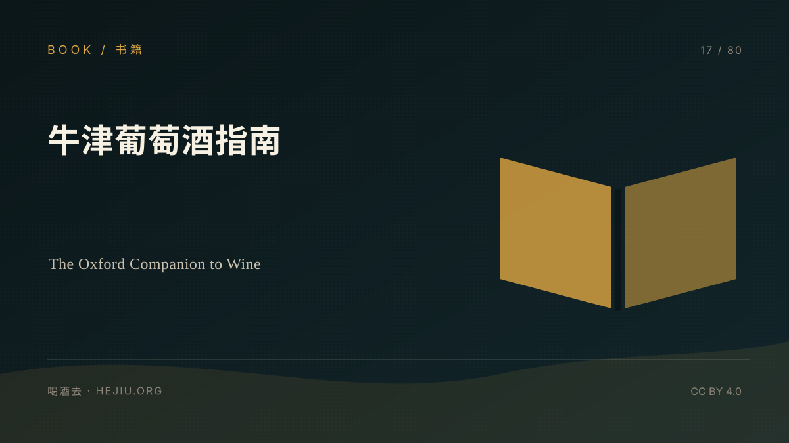

# The Oxford Companion to Wine

The Oxford Companion to Wine, usually shortened to OCW, is not a wine primer to be read from cover to cover. It is an alphabetical reference work that breaks wine into thousands of entries: grape varieties, soils, climates, pests, winemaking, chemistry, law, regions, estates, markets, history and people. For readers outside English, its most important use is not "reading through" but learning to turn a question into a handful of searchable terms and then follow the cross-references.

Figure: thematic illustration for The Oxford Companion to Wine. Image: AI-assisted illustration generated with Doubao Seedream 5.0 (project-owned); not a photograph of the subject.

## What this book is

In form, it belongs to Oxford University Press's "Companion" reference series. A companion here is not a book of essays but an encyclopaedic tool built around a subject. A reader can look up "Chardonnay", "botrytis", "malolactic fermentation", "appellation" or "cork taint", and can also look up a country, a region or a winemaker. Entries usually begin with a definition, then expand into background, debate and related concepts, and end with "see" pointers to other entries.

The coverage is broad: from pruning, rootstocks and irrigation in the vineyard to pressing, clarification and ageing in the cellar; from labelling law and appellation naming to wine trade, auctions and consumption trends. It also includes people and institutions, so it can serve as a small directory of the wine world. It is not, however, a tasting manual. It will not tell you whether a particular bottle is "good", and it does not offer a shopping list.

## Authors and editions

The book has long been edited by Jancis Robinson, a British wine writer and critic who has also worked on reference works such as The World Atlas of Wine. The first edition appeared in 1994 and has been revised repeatedly: the fourth edition was published in 2015, and the fifth in 2023, with an editorial team that includes Julia Harding and Tara Q. Thomas. Editions matter because appellation rules, region boundaries, variety names and market data keep changing.

Entry counts, lengths and illustrations vary between editions. The fifth edition is larger than the early ones, with both new and updated entries. When citing the book, the safest practice is to name the edition and year; "the Oxford Companion says" is not enough, because a statement from 1994 and one from 2023 may differ. Readers working in translation should also keep the English headwords at hand: entries are arranged by English terms, and a Chinese label may not lead to the same place.

## Core argument

As a reference work, it does not have a single thesis. Its method, however, can be summarised in three points. First, wine knowledge is interdisciplinary: a single bottle involves botany, chemistry, microbiology, geography, history and law, and no one discipline explains it alone. Second, terms must be distinguished precisely: "region" and "estate", "variety" and "clone", "ageing" and "maturation" are often used loosely in ordinary speech but have boundaries in professional usage. Third, knowledge changes: laws are amended, scientific conclusions are revised and markets shift, so a reference work has to be revised too.

These points shape the writing: entries, cross-references and definitions that can be checked, rather than a single continuous story. It does not put entertainment first; it can read like a dictionary, but the advantage of a dictionary is that you can jump straight to the problem.

## Structure and how to read it

The main body is an A–Z sequence, usually preceded by a preface, editor's notes and a guide to use, and followed by appendices such as a glossary, units, a regional index or acknowledgements. Entries vary greatly in length: some are a sentence or two, others run for several pages. Long entries often concern disputes—the boundary of a region, the science behind a technique, or the truth of a historical claim.

There are three useful ways to read it. The first is "look it up": when a term is unclear, go to the letter and follow the "see" references. The second is "read a theme": choose a subject such as oak, organic farming or sparkling wine, and read the related entries together to build a small map of knowledge. The third is "compare editions": take the same entry in two or three editions and see which definitions were rewritten and which data updated; this shows how the industry's understanding has changed.

Readers outside English should keep a bilingual word list nearby. Many entries are arranged by English terms, and a Chinese translation may not match directly; finding the English term first is usually faster. Nor should the book be the only source: for current regulations and fresh data, check the official bodies and producers' own material.

## Verifiable factual boundaries

The book supports facts at the level of "concept and background": what a term means, roughly where a region lies, what the basic principle of a technique is. It also supports historical outline and personal connections, but these depend on the sources behind each entry. It does not support "what this bottle costs now", "whether this estate is organic this year" or "how large a region currently is"; such information changes and must be checked against current official sources.

Two further boundaries matter. First, an entry is an editor's or contributor's synthesis, not a primary document; if it mentions a historical event, it is worth tracing the research or source it relies on. Second, the book is an English-language reference work, and its coverage and naming of non-English regions may carry an English perspective; entries on China, Japan or Georgia are best read alongside local material.

## Limits and controversies

First, "comprehensive" is finite. No number of entries can cover every estate and every piece of local knowledge; editorial selection itself creates bias. Second, entries are written by many contributors, and style and judgement are not uniform; some are scientific, some historical, some personal. Third, editions can contradict one another: an older entry may say "this is usually the case" while a newer one has changed its position; without the edition, an old statement can be mistaken for the present.

Fourth, the book is aimed mainly at English-speaking readers, and its terminology and legal discussion are centred on the English-speaking world and European traditions. For a reader coming from Chinese, the main obstacle is not depth but the route in: one must know the English term before entering the network of entries. Fifth, it offers no drinking advice and does not discuss alcohol dependence or public health; it is better used as a dictionary of wine knowledge than as a guide to drinking.

## Who should read it

- Wine students and exam candidates: for terms, background and cross-checking.
- Translators, editors and journalists: for checking English terms against Chinese equivalents and for conceptual boundaries.
- Sommeliers and merchants: for regions, law, varieties and techniques, though not as a substitute for current prices and stock.
- Committed enthusiasts: keep it nearby and consult it as questions arise rather than reading it straight through.
- Researchers: compare editions to observe how the industry's language changes.

## See also

- [Wine](ref:wine): the basic types and styles of wine.
- [Terroir](ref:terroir): how place enters the wine.
- [Vintage](ref:vintage): year variation and climate risk.
- [Appellation](ref:appellation): naming systems and legal boundaries.
- [France](ref:france): regional tradition and regulation.
