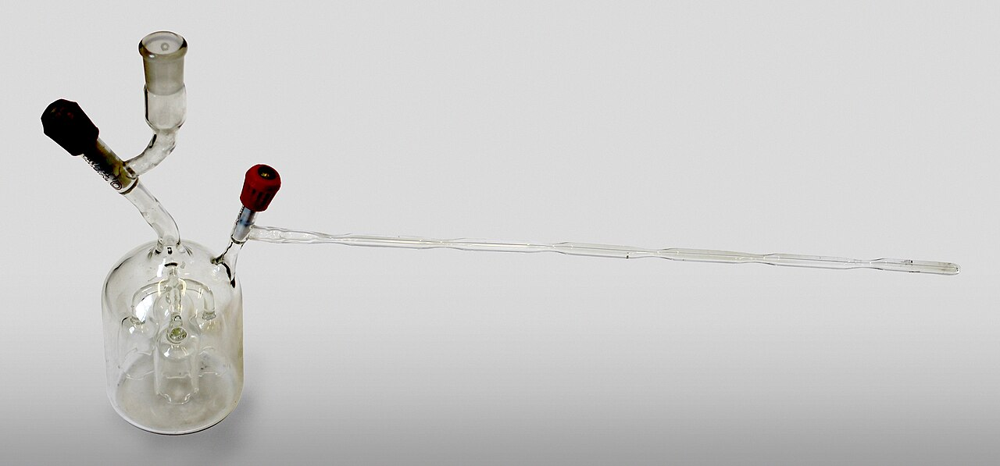

# Proof: The Science of Booze

Figure: A laboratory distillation flask; Proof examines the science of fermentation, distillation and sensory perception, and this is not the book cover. Image: UCL Mathematical and Physical Sciences from London, UK, CC BY 2.0, via Wikimedia Commons ([source page](https://commons.wikimedia.org/wiki/File:Distillation_flask_(21380108976).jpg)).

## Bibliographic note

Proof: The Science of Booze was published in New York by Houghton Mifflin Harcourt in 2014, with 272 pages. Publisher and review sources describe it as a popular-science account of “the making and consuming of alcohol”: from yeast fermentation, distillation and oak maturation to smell, taste, alcohol metabolism and hangovers. It won an IACP award in the wine, spirits and beer category and was shortlisted for the PEN/E. O. Wilson Literary Science Writing Award; a paperback edition later appeared under Houghton Mifflin Harcourt/Harvest.

“Proof” carries a double meaning: the old measure of alcoholic strength and the idea of evidence. The book is closer to a journey through evidence than a textbook. Rogers visits distilleries, laboratories, tasting rooms and neuroscience institutes, putting experiments, industry experience and history side by side. It is not a cocktail recipe book or a “how to distil” manual; it asks why a glass of alcohol behaves the way it does.

## Author and context

Adam Rogers is an American science journalist who has worked at Wired as a senior correspondent and editor. His background is science journalism rather than brewing or chemistry, which shapes the book: it is written as a narrative of experiments, data and interviews, not as a technical manual. He chooses cases that illustrate a principle—why yeast makes alcohol, how distillation separates flavour, how oak changes a spirit, how the nose and brain construct “aroma.”

The book appeared in the 2010s, when artisanal alcohol and science-based food writing were rising together. Craft beer, single malt, artisan gin and boutique wine emphasised craft and place; at the same time, consumers wanted to know why a drink tastes good, what a hangover is and whether additives matter. Rogers tries to bridge the two: explain craft through science without reducing pleasure to numbers.

## Structure

The book follows a “from raw material to body” sequence. It begins with fermentation: how yeast converts sugar into alcohol and carbon dioxide, why different strains produce different flavours, and how temperature, pH, nutrients and oxygen affect the result. Then distillation: pot still versus column still, the separation of heads, hearts and tails, and how flavour compounds change with boiling point. Then maturation: oak species, toast levels, cask reuse, warehouse temperature and humidity, and the “angel’s share.” Then sensory perception: how the nose works, how aroma is interpreted by the brain, and why the same drink tastes different to different people. Finally the body: alcohol metabolism, hangover mechanisms and the contested idea of “moderate drinking.”

The structure makes the book an introduction to the science of alcohol, but it is not a linear textbook. Each chapter includes historical episodes and characters: nineteenth-century stills, industrial alcohol during Prohibition, gas chromatography in modern labs, tasting panels in distilleries. These stories are not decoration; they show how scientific knowledge is produced and used in the industry.

## Argument and influence

The central argument is that alcohol is a composite object of biotechnology, chemistry and sensory psychology. Fermentation is microbial work; distillation is physical separation; maturation is an interaction of wood, air and time; tasting is the brain interpreting signals; intoxication and hangover are physiological processes. Remove any layer and you cannot explain why a drink tastes the way it does, why it pleases, or why it hurts.

A second argument is that science does not destroy mystery; it rewrites it. Rogers does not try to replace tasting with molecular formulas. He asks what actually happens when we say a drink tastes of vanilla. Science becomes a tool for tasting rather than its enemy. The book also reminds readers that perception is subjective, but subjective experience can still be studied, compared and trained.

Its influence is mainly in science communication and industry conversation. It gives general readers a working vocabulary for fermentation, distillation and maturation, and gives distillers, bartenders and journalists a shared language for “flavour.” The IACP award and the PEN shortlist show that food writing and science writing are no longer separate genres.

## Limits as evidence

As popular science, its value is in asking clear questions. It does not avoid controversy: hangover mechanisms have no single answer, the health effects of moderate drinking remain contested in epidemiology, and sensory reliability depends on context. It also reminds readers that industry claims—“older is better,” “more distillations make it purer”—need to be tested against specific conditions.

There are four limits. First, it is popular science, not a research review; later studies may revise its 2014 conclusions, so readers should not treat it as the latest consensus. Second, its coverage is mostly European and American alcohol, with limited space for Asian rice wine, huangjiu, soju and baijiu. Third, it offers no recipes, process parameters or equipment lists; someone who wants to brew or distil will find it insufficient. Fourth, it relies heavily on interviews and scenes, and some conclusions rest on a single study or industry experience; readers should keep some scepticism.

## Common misreadings

The most common misreading treats Proof as a brewing or distilling manual. It explains principles, but it does not teach how to operate a still, control fermentation temperature or design a recipe. A second misreading treats “science explains it” as “science gives the only answer”; sensory experience also involves culture, memory and emotion and cannot be fully reduced to chemistry. A third misreading treats the hangover chapter as a cure guide; understanding a mechanism is not the same as finding a universal remedy, and hydration, rest and time remain basic. A fourth misreading treats “moderate drinking is healthy” as a universal conclusion; the epidemiological evidence is complex and individual risk varies, so a book should not be read as medical advice. A fifth misreading treats “craft” as “science-free”; craft has value, but it still needs sanitation, temperature control and quality testing, not just the word “natural.”

## See also

- [Fermentation](ref:fermentation): yeast, sugar and temperature in the first stage of alcohol.
- [Distillation](ref:distillation): boiling points, cuts and stills.
- [Whisky](ref:whisky): maturation and sensory knowledge applied to a specific drink.
- [First tasting: don’t jump to conclusions](ref:first-tasting): turning sensory science into practice.
- [Aroma](ref:aroma): why “smelled” and “tasted” are not the same thing.

For Proof, begin with the author and edition. Then look at what the book covers, and finally ask what it is cited for here. The answers point to different choices, not to a single score.

[Fermentation](ref:fermentation) and [Whisky](ref:whisky) are the nearest useful comparisons: one clarifies author, the other tests edition.
