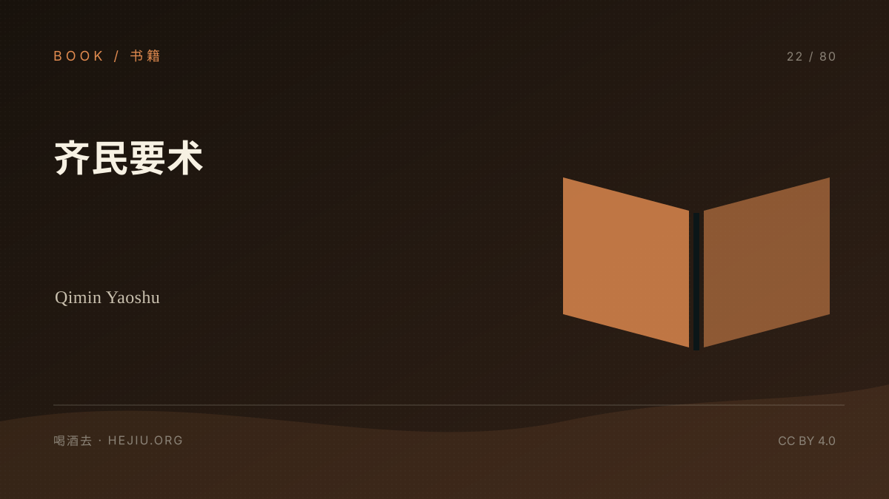

# Qimin Yaoshu

The Qimin Yaoshu is a comprehensive agricultural treatise by Jia Sixie of the Northern Wei, completed between 533 and 544 and transmitted in ten volumes and ninety-two chapters, running to about 110,000 characters. It covers farming, horticulture, livestock and household processing, and wine is only one part of it; yet volume seven records qu-making and brewing in detail, which makes this agricultural book one of the earliest surviving systematic accounts of grain-wine craft.

Figure: thematic illustration for Qimin Yaoshu. Image: AI-assisted illustration generated with Doubao Seedream 5.0 (project-owned); not a photograph of the subject.

## Author and background

Jia Sixie was a Northern Wei figure whose life is poorly documented. The text names him as a former governor of Gaoyang, so he held that office. Gaoyang, in what is now the Zibo area of Shandong, was then a region with developed farming and brewing, which helps explain how he obtained so much production detail.

The title means “the essential techniques by which the common people live”. The book does not discuss metaphysics but how to plant, raise, store and process, and the preface states that it runs “from the ploughman at one end to vinegar and pickles at the other, so that nothing needed for making a living is left unwritten”.

The date is usually placed between 533 and 544, inferred from the administrative divisions, place names and farming practices recorded in the text. The preface also explains the method: “I have gathered from the classics and commentaries, reached down to songs and sayings, asked experienced elders, and tested in practice.”

## Editions and structure

The ten volumes and ninety-two chapters are arranged by branch of production, from cultivation and livestock to brewing, pickling and food processing, with the tenth volume on products outside the Central Plains.

The present text passed through centuries of copying and printing, and editions differ in chapters, wording and commentary. The original carried large amounts of interlinear small-character notes, some by Jia Sixie and some added later, so that text and commentary are easily confused. Among modern editions, Miao Qiyu's Qimin Yaoshu Jiaoshi and the annotated translation by Miao Qiyu and Miao Guilong, published by Shanghai Classics Publishing House in 2009, are the most commonly used.

Citations should give volume and chapter so that commentary is not mistaken for the main text.

## Core content: qu and brewing in volume seven

The wine material is concentrated in volume seven, in this order: coating jars (chapter 63), making spirit qu and wine (64), white-mash qu (65), plain qu and wine (66), and ritual wine (67).

The chapter on coating jars deals with preparation before brewing: jars had to be cleaned, coated and dried to avoid contamination and off-flavours. The chapter on spirit qu gives its making and use; the chapters on white-mash qu and plain qu record the culturing of different qu types and the brewing methods that go with them; the chapter on ritual wine describes a method using more qu, divided additions and careful attention to acidity and temperature.

The book records more than forty methods for making wine, from millet, glutinous millet, japonica rice and foxtail millet. The steps cover soaking, steaming, spreading to cool, mixing with qu, putting into the jar, fermentation, pressing, clarification and storage. Temperature and time are described with words such as “watch”, “observe” and “feel” rather than numbers.

## Wine-cultural value: the chain from qu to wine

First, it turns qu into a workable process. Volume seven records the raw materials, shaping, culturing and storage of spirit qu, white-mash qu and plain qu, letting the reader see how differences in qu correspond to different brewing plans. This is the starting point for understanding the later differentiation of [qu-making](ref:qu-making).

Second, it puts wine back into the farming system. Brewing needs grain, vessels, water and time, and the quality of the wine tests the harvest and the processing. The book first explains how to grow millet and rice, then how to turn surplus grain into wine that can be stored and offered to guests, a chain that shows wine's place in livelihood better than any standalone wine manual.

Third, it preserves social detail. When to brew, how much, with what vessels and how to receive guests are scattered through the chapters. Set beside the drinking rites in the Book of Songs and the Book of Rites, these records reveal the gap between ritual texts and production texts.

Fourth, it can be read against later wine books. Compared with the Song [Classic of Wine](ref:jiujing), it shows how qu names, additions and fermentation management continued and changed over centuries; compared with the qu chapter of Tian Gong Kai Wu, it shows the finer Ming classification and temperature judgement.

## Limits and controversies

First, place and period. The methods serve northern production conditions in the Northern Wei and earlier, with millet, foxtail millet and wheat as main materials, and cannot be transferred directly to any present-day region. Second, textual problems. Long copying produced differences in chapters and wording, some terms are hard to match today, and the boundary between text and commentary is not always clear.

Third, there is no microbiology and no quantitative standard. The old text controls fermentation by observation and experience, while modern production needs strain management, temperature records and hygiene rules; copying the old methods cannot guarantee safety or stability. Fourth, it has no food-safety standard in the modern sense, and home reproduction carries risk.

Fifth, its standard of judgement is practical. It asks whether something can be made, stored and served, not whether it has a particular flavour or regional style.

## How to read it today

Begin with the table of contents to fix the order of chapters 63 to 67, then read the procedures one by one. For technical terms, use the notes in an annotated edition and keep track of what is main text and what is commentary.

For brewers, the book is a historical reference rather than a manual; modern qu-making and fermentation require microbiology and regulatory knowledge.

## See also

- [Qu-making](ref:qu-making): the place of qu in saccharification and fermentation.
- [Yellow wine](ref:yellow-wine): the technical lineage and classification of grain-fermented drinks.
- [Classic of Wine](ref:jiujing): a Song treatise on qu-making and brewing, useful for comparison with volume seven.
- [Time in a cup](ref:time-in-a-cup): from the Book of Songs to Tang poetry, how wine enters the seasons and writing.

For Qimin Yaoshu, begin with the author and edition. Then look at what the book covers, and finally ask what it is cited for here. The answers point to different choices, not to a single score.

**Key facts.**

| Item | Detail |
| --- | --- |
| In one line | Jia Sixie’s Northern Wei agricultural treatise, completed between 533 and 544 in ten volumes and ninety-two chapters, gives volume seven to qu-making and brewing. This article covers the author, the editions, chapters 63… |
| Author | Jia Sixie |
| Publication | Northern Wei; completed between 533 and 544; 10 volumes and 92 chapters |
