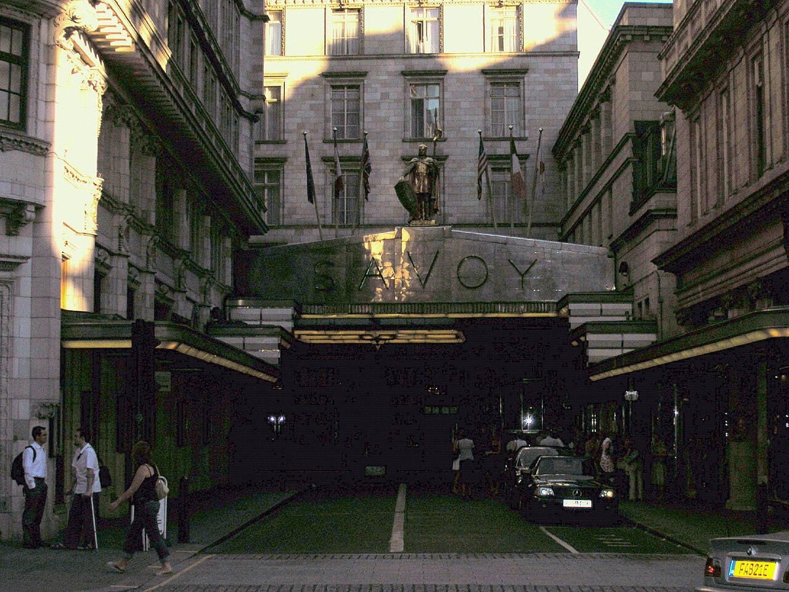

# The Savoy Cocktail Book

Figure: The entrance of the Savoy Hotel in London, where Craddock compiled The Savoy Cocktail Book at the American Bar. This is not the book cover. Image: gailf548 from New York State, USA, CC BY 2.0, via Wikimedia Commons ([source page](https://commons.wikimedia.org/wiki/File:Savoy_Hotel_02.jpg)).

## Bibliographic note

The Savoy Cocktail Book was published in London by Constable in 1930, credited to Harry Craddock, the head bartender of the Savoy Hotel’s American Bar, with illustrations by Gilbert Rumbold. The publisher’s page gives the familiar figure of 750 recipes and describes the book as a record of “the cocktails that set London alight” in the period. In 2014, Constable/Hachette issued a facsimile edition with a new introduction and a handful of contemporary Savoy recipes. The “750” claim belongs to that publishing tradition rather than to a precise bibliographic census of every named drink.

Three objects need to be kept apart: the 1930 first edition, the 2014 facsimile, and the various later selections sold under the “Savoy” name. The first edition is a small, black-covered Art Deco volume arranged by drink type. The facsimile preserves much of the original layout and illustration, but its new introduction is not part of the 1930 text. A citation should say “1930 edition” or “2014 facsimile,” not simply “Savoy,” and should not attribute the new introduction to Craddock.

## Craddock and the American Bar

Craddock was born in 1876 and worked in New York bars before returning to London in the 1920s. He became head bartender at the Savoy’s American Bar, a room that served American-style cocktails to theatre audiences, socialites and visiting Americans at a time when the United States was under Prohibition. New York’s bar culture had gone underground or abroad; London became one of the places where its repertoire was preserved, renamed and sold to a paying public.

The book is less a personal treatise than a bar ledger. It collects drinks that were served, requested, argued over and adapted in a working hotel bar. Craddock’s short preface touches on the purpose of cocktails and the manners of bar service, but it does not build a historical argument. The value of the book lies in the fact that it is a workplace document: it shows what a highly visible London bar thought a cocktail was, which drinks it considered essential and how it wrote them down for staff and guests.

## How the book is organized

The main body is a list of recipes, grouped into Slings, Smashes, Fizzes, Flips, Punches, Cocktails and similar families, then arranged alphabetically within those groups. Each entry usually gives a base spirit, modifiers, garnish and proportions, using bar units such as “dash,” “pony” and “glass” rather than millilitres. There is no modern-style chapter on shaking, stirring, ice or equipment; the book assumes that its reader already knows how a bar works.

That arrangement tells us how the book was used. It was a reference for bartenders, not a course for beginners. It contains well-known drinks, local variations and house specialties. Corpse Reviver #2, the Hanky Panky and the White Lady all sit somewhere in the Savoy tradition, but “appears in the book” does not mean “was invented by Craddock,” and still less “was invented at the Savoy.” The same name can carry different proportions in different editions and different bars, which is one of the defining features of cocktail literature.

Rumbold’s illustrations are not decoration in the trivial sense. They place bars, glassware, figures and exotic imagery into an Art Deco visual language that sits between a menu, a travel brochure and an advertisement. They make the book a visual archive of 1930s London bar culture as well as a recipe collection. They are commercial illustrations, however, not documentary photographs of the bar.

## What it argues, and why it mattered

The book does not argue in chapters. Its argument is embedded in its organisation: a cocktail is a reproducible technical system that can be classified, named, taught and moved from one city to another. Once a bartender understands the relations among base spirit, sweetness, acidity, dilution and garnish, a drink can be recreated under different ingredient conditions. This idea later became foundational to modern cocktail training, but in 1930 it was mostly a working assumption of the trade rather than a written theory.

Its influence has travelled mostly through citation. Later cocktail historians, bar menus, competitions and training programmes returned to the Savoy recipes and treated certain proportions as benchmarks. The equal-parts structure of the Corpse Reviver #2, the bitter finish of the Hanky Panky and the dry gin-lemon combination of the White Lady acquired a “standard” status because they were repeated. The Savoy brand also gave the book a trust signal: it was not an anonymous recipe pamphlet but the record of a real, famous bar.

For cultural history, the book preserves a useful paradox. America banned alcohol, but American cocktail culture was reorganised, commodified and exported back into the English-speaking world from London. The book is not a history of Prohibition, but it is a concrete piece of evidence for the argument that prohibition changes supply without abolishing demand.

## Limits as evidence

As evidence, the book is strongest on how people mixed, named, priced and served drinks. Its base spirits, bitters, glassware and garnishes help researchers reconstruct the material network of a London bar in the 1920s and 1930s. It can be read alongside menus, hotel records and memoirs rather than as a standalone proof of origin.

Its limits are equally clear. First, a recipe is not a laboratory protocol: proportions vary between editions, and ice size, shaking time and glass temperature are not standardised. Second, ingredients have changed: today’s dry gin, vermouth, bitters and spirits differ in strength, sugar and botanical content from their 1930 counterparts, so exact reproduction is impossible. Third, authorship is collective and uncertain: Craddock was the compiler, the bar was a workplace, and many drinks cannot be attributed to one person. Fourth, some techniques in the book are unsafe or excessive by modern standards and should not be treated as operating instructions. Fifth, the geographical coverage is narrow: it represents one London bar, not the whole of European or global cocktail history.

## Common misreadings

The most common misreading is that the Savoy was the birthplace of every classic cocktail. It was a highly visible transmission point; many recipes came from American, French and rival bars, and the book’s role was to collect and preserve rather than to originate everything. A second misreading treats the 750 recipes as 750 distinct drinks; the count includes variations, earlier names and minor proportional adjustments. A third misreading treats the book as a modern bartending manual; it has no systematic teaching of shaking, stirring, ice or balance. A fourth misreading treats the 2014 introduction and added recipes as 1930 text; citations must specify the edition. A fifth misreading treats the illustrations as historical photographs; they are commercial illustrations, useful for visual style but not for documentary evidence of the bar.

## See also

- [Harry Craddock](ref:craddock): his New York years, Savoy tenure and reputation as a cocktail craftsman.
- [The American Bar at the Savoy](ref:savoy-bar): the room and its relationship to the hotel.
- [Cocktail basics](ref:cocktail-basics): tools, proportions and balance.
- [US Prohibition](ref:prohibition): the legal contrast that shaped the book’s moment.
- [Corpse Reviver #2](ref:corpse-reviver): one of the Savoy recipes most often cited today.
