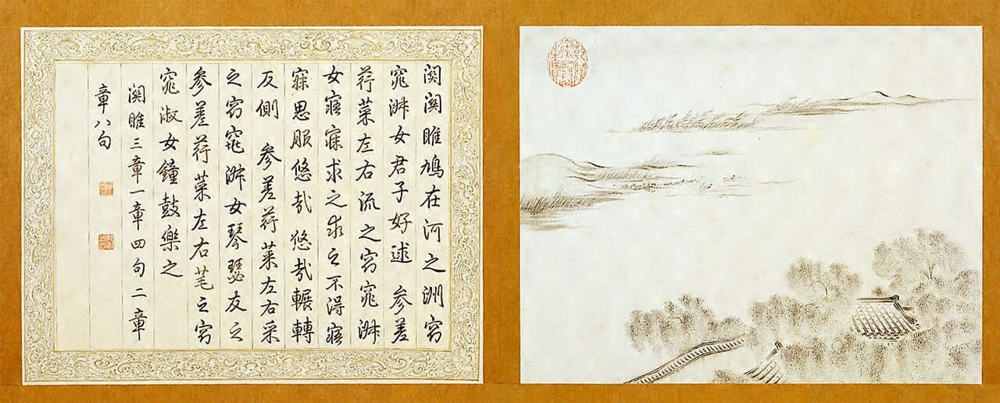

# Classic of Poetry (Shijing)

The Shijing is the oldest surviving anthology of Chinese poetry. The received text contains 305 poems, plus six “sheng” titles that survive without words. It is not the collected work of a single poet but a body of songs gathered and edited over a long period, roughly from the early Western Zhou to the middle of the Spring and Autumn period. Wine is not its central subject, yet it recurs in sacrifices, banquets, farewells and farming. Only when these appearances are put back into ritual and seasonal life do they carry their full weight; picking out a single character for “wine” as proof of heavy drinking narrows the book considerably.

Figure: Classic of Poetry (Shijing). Image: Wikimedia Commons contributor, Public domain, via Wikimedia Commons ([source page](https://commons.wikimedia.org/wiki/File:Shi_Jing.jpg)).

> **Quick verdict**
> **In one line:** This book entry helps you judge whether Classic of Poetry (Shijing) is worth reading, and what question it answers.
>
> - **Best for:** Anyone who wants Classic of Poetry (Shijing) in the history of drink culture and needs to judge whether it is worth reading.
> - **Not for:** If you want want a one-line summary and will not read the book.
> - **Check first:**
>   - What the Shijing gave later culture was not only wine lines but a language for placing wine inside a scene.
>   - Begin with the feng, choosing short poems with clear repetition, and notice where the wine line sits in the whole poem.

## What kind of anthology this is

The received Shijing is divided into feng, ya and song. The feng are mostly songs associated with the states, the ya are divided into minor and major odes, and the song are hymns used in ancestral sacrifice. This three-part structure is not a simple division by subject; it also relates to performance occasions and to the status of those who used the songs. The same poem sung in a ceremony and sung at a feast does not mean the same thing.

Tradition speaks of Confucius “cutting down” the poems to their present number, but modern scholarship generally treats the Shijing as the result of long collection, arrangement and editing. Confucius may have arranged or taught the text, but he was probably not its sole editor. In the Han dynasty, four traditions transmitted the poems: Qi, Lu, Han and Mao. The first three were later lost, and the received text belongs to the Mao tradition, hence the common name “Mao Shi”. Understanding this keeps us from imagining the 305 poems as a definitive edition completed in a single moment.

The lines are short and often repetitive. Many poems advance their feeling through repeated stanzas, changing only a few words each time. Wine lines are usually embedded in this repetition: the same scene returns, the wording shifts slightly, and the emotion moves forward one step. Readers should notice this structure rather than isolate the one line that mentions wine.

## Where wine appears in the Shijing

Wine in the Shijing belongs first to sacrifice. In “Xin Nan Shan” of the minor odes we read, “We sacrifice with clear wine, and follow with red bulls”. Clear wine stands beside the sacrificial animal, showing that wine is part of the rite, not an ornament of the feast. Ancestral sacrifice, sacrifice to heaven and prayers for a good harvest all require wine; here wine connects the living with ancestors and with the land.

Second, wine belongs to banquets. “Lu Ming” of the minor odes says, “I have fine wine, to gladden the hearts of my guests”. Wine is used to receive guests and to strengthen ties. Such banquet poems usually appear together with music, gifts and seating order; wine is one part of a whole code of hospitality. It expresses closeness within an order, not simply “drinking happily”.

Third, wine belongs to occasions such as the village drinking rite. The ritual books place drinking within a sequence of seniority, host and guest, and mutual deference. The Shijing is not itself a ritual book, but its banquet poems share a world with that ritual order. Strip the ritual away entirely and one easily misreads ceremonial drinking as everyday excess.

## The Seventh Month and “spring wine”

“Seventh Month” in the odes of Bin is one of the most agricultural poems in the anthology. It lays out ploughing, gathering, weaving and sacrifice month by month. The line “In the tenth month we harvest the rice; for this we make spring wine, to help us reach a ripe old age” links harvest, brewing and a birthday wish: rice is gathered in the tenth month, made into spring wine, and offered to pray for the elders' long life.

Old commentaries explain “spring wine” as wine brewed in winter and drunk in spring; the Mao commentary calls it “frozen fermented wine”. That explanation does not necessarily match the method of every rice wine today, but it points to a basic fact: ancient grain wine was tied closely to the farming calendar. Wine was not a commodity freely available at any time of year. Only after the harvest was there surplus grain, and only with surplus grain could brewing begin. Wine therefore carried the weight of the harvest.

The phrase “to help us reach a ripe old age” also deserves attention. Wine here is not a tool for drowning sorrow but a medium of blessing. Offering wine to an elder treats it as a shareable gift that brings health. This layer does not conflict with the later poetic use of wine to relieve sadness, but the two should be kept apart.

## Vessels, rites and banquets

The Shijing names many drinking vessels, including the jin lei, the si gong, the jue, the zun and the hu. Vessels are not merely containers; they mark occasion and status. The si gong is often associated with larger drinking scenes, while the jin lei appears in “Juan Er” of the Zhou south: “I will pour from that golden lei”. These names received different explanations in later commentaries and cannot be mapped one-to-one onto modern glassware.

The core of the wine rite is order. Who raises the cup first, who offers to whom, and how one responds all follow rules. The ritual books describe a sequence of xian, chou and zuo: the host offers wine, the guest returns the toast, and the host answers again. Shijing banquet poems do not record every gesture, but they often turn this back-and-forth into rhythm. Notice verbs such as zhuo, chou and yan; they say more about wine's place in a relationship than the simple verb “drink”.

Vessels and rites are also a reminder that most pre-Qin wine was a grain ferment, usually lower in alcohol than later distilled spirits. Imagining the contents of a jin lei or si gong through the experience of today's strong baijiu would misplace the vessel, the capacity and the manner of drinking all at once.

## Wine, farming and the seasons

Wine in the Shijing often appears with food, harvest and season. This is no accident, since grain wine depends on grain, and grain depends on the farming calendar. Sowing in spring, harvesting in autumn, brewing in winter and drinking in spring: this chain determined wine's place in the year.

The season also colours the feeling of wine. Wine at a sacrifice is solemn, wine at a banquet is intimate, wine at a farewell is reluctant. The same substance serves different functions on different occasions, and this is precisely how the Shijing handles it: it rarely praises the taste of wine in isolation, but puts wine back into concrete human affairs.

For readers today this layer is especially useful. It reminds us that drinking culture is not a list of famous brands and vessels but a set of relations between people, time, land, kin and guests. With that relation in view, later wine poetry and customs no longer reduce to the single gesture of “cheers”.

## Four cautions when reading wine lines

First, distinguish the words. “Wine”, “sweet wine”, “fine wine” and “clear wine” are not fully equivalent; some terms stress quality, others use. Reading them all as today's “wine” loses the qualification.

Second, read the occasion. Sacrifice, banquet, farewell and farm work give wine different functions. Discussing wine apart from the poem's purpose turns ritual language into casual speech.

Third, mind the edition and commentary. The received text belongs to the Mao tradition, with layer upon layer of commentary from Mao, Zheng and Kong. Editions may differ on a single line. When quoting, say which commentary you follow rather than blending every explanation into “the ancients said”.

Fourth, do not read the past through the present. Pre-Qin grain wine, vessel capacity and drinking customs differ greatly from today. Expressions such as “a dou of wine” are often rhetoric, not precise measurement. Converting literary exaggeration into modern bottle counts is neither accurate nor necessary.

## Influence on later drinking culture

What the Shijing gave later culture was not only wine lines but a language for placing wine inside a scene. “Spring wine” became a common image in later poetry, not necessarily a fixed drink but often a combination of season, family gathering and birthday wish. The article [Time in a Cup](ref:time-in-a-cup) follows that image from the Shijing into Tang poetry.

In craft terms, pre-Qin grain wine shares a lineage with later [yellow wine](ref:yellow-wine), but the two cannot simply be equated. Raw materials, starter cultures, fermentation and sterilisation all changed; calling “spring wine” a particular yellow wine of today is an oversimplification.

In literary tradition, the banquets and farewells of the Shijing supplied later poets with scenes they could borrow again and again. [Li Bai](ref:li-bai) wrote farewells, solitary drinking and banquets in a very different language and length, yet he was still handling the same matter: wine connecting people to an occasion. Reading the Shijing beside Tang poetry shows how wine moves from ritual scene toward personal lyric.

## How to keep reading the Shijing

Begin with the feng, choosing short poems with clear repetition, and notice where the wine line sits in the whole poem. Then read the banquet poems of the ya, paying attention to host and guest. Finally read the song, and see how wine is placed beside sacrificial animals, music and dance.

Keep two or three commentary editions at hand. When you meet terms such as “spring wine”, “fine wine” or “clear wine”, read the commentary before deciding. If you use a translation, compare it with the original and notice how the translator handles vessels and rites, since differences are often clearest there.

It also helps to make a small table: poem title, occasion, word for the drink, vessel, and the other things that appear with wine. Once the table is complete, the distribution of wine in the Shijing becomes clear, and it is easier to separate ritual from literary invention.

## Further reading

- [Time in a Cup](ref:time-in-a-cup): from the spring wine of the Shijing to the golden goblet of Tang poetry, and how wine enters season and writing.
- [Yellow Wine](ref:yellow-wine): the craft lineage of grain ferments, and their distance from ancient grain wine.
- [Li Bai](ref:li-bai): how wine in Tang poetry moves from ritual scene toward personal lyric.
