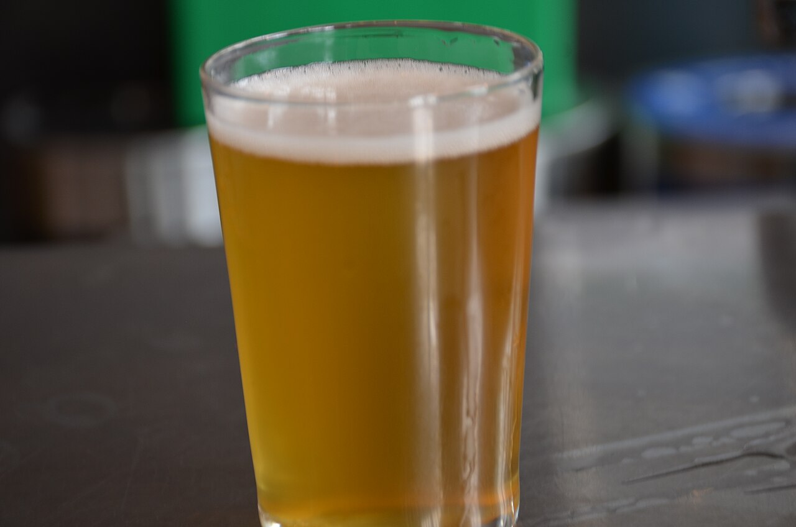

# Tasting Beer

Figure: A glass of cloudy, unfiltered beer; Tasting Beer teaches readers to describe beer with sensory language, and this is not the book cover. Image: shankar s. from Dubai, united arab emirates, CC BY 2.0, via Wikimedia Commons ([source page](https://commons.wikimedia.org/wiki/File:A_glass_of_cloudy_unfiltered_beer-_fascinating!_(27798855532).jpg)).

## Bibliographic note

Tasting Beer: An Insider’s Guide to the World’s Greatest Drink was written by the American beer writer, designer and consultant Randy Mosher. It was first published by Storey Publishing in 2009 and revised in a second edition in 2017, with 376 pages. The author’s website says the book has been translated into nine languages; the publisher describes the second edition as “completely updated,” with new material on beer styles, sensory evaluation, craft-beer trends, food pairing, draft systems and beer cocktails.

The second edition is not a minor addendum. It rewrote some style chapters in line with updated Beer Judge Certification Program (BJCP) guidelines, expanded the discussion of taste science, aroma training and tasting environment, and added beer cocktails to the practical section. Anyone citing a specific style parameter should say “2017 second edition,” because some classifications and figures in the 2009 text are out of date.

## Author and context

Randy Mosher is a Chicago-based beer writer, lecturer and creative consultant. He has been active in the American Homebrewers Association, the Chicago Beer Society and beer-judging circles. He is not a brewer by training; he came to beer through design, writing and sensory education. He cares how people perceive a beer and how a brewery builds a flavour. He is the author of Radical Brewing, Mastering Homebrew and Beer for All Seasons, and has taught at the Siebel Institute.

The book appeared in 2009, when American craft beer was moving from “niche hobby” to “mainstream market.” The number of styles and brands was growing fast, and consumers often had only “bitter or not” and “dark or not” to describe a beer. Mosher wanted a tasting-training manual: not “is this beer good?” but “how do I look, smell, taste, judge body and finish, and then put the experience into words?”

## Structure

The book has five broad parts. The first is sensory foundation: how sight, smell, taste and touch (mouthfeel) work, and how environment, glass, temperature and time affect judgment. The second is ingredients and process: malt, hops, yeast, water, mashing, boiling, fermentation, maturation, filtration and carbonation. The third is style: British ales, German lagers, Belgian sours, American IPA, abbey beers, wheat beers and flavoured beers, each with history, aroma, palate and representative examples. The fourth is practice: organising a tasting, writing notes, diagnosing faults, pairing food and serving draft beer. The fifth is the industry: competitions, scoring systems, brewery trends and beer culture.

A distinctive feature is that tasting is treated as a trainable skill, not a talent. Mosher gives exercises: compare two beers of the same style, taste the same beer from different glasses, smell at different temperatures, describe faults with standard vocabulary. A reader who does the exercises builds a sensory memory bank. This is more useful than memorising style parameters and closer to the work of beer judges.

## Argument and influence

The central argument is that beer tasting is not a binary of “like” and “dislike.” It is “what do I perceive, where does it come from, and how do I describe it?” Colour, foam, aroma, bitterness, body, carbonation and finish can be observed separately; separating them makes comparisons possible and helps explain a brewer’s choices.

A second argument is that style is history, not law. Mosher repeatedly stresses that beer styles come from local materials, taxation, religion, migration and market demand, not from a pre-existing recipe. British ale’s low bitterness and high aroma are connected to British water, malt and pub cellaring; American IPA’s high bitterness and citrus aroma to American hops and the craft market. Understanding the history of a style is more useful than memorising its numbers.

The book’s influence is mainly in beer education and beer writing. Many beer courses, bar trainings, competitions and consumer guides borrow its sensory framework; it also helped move “beer pairing” from improvisation to a more reasoned practice. It has won food-writing awards and been translated into several languages, a sign that beer tasting had become an independent field of writing.

## Limits as evidence

As a reference, its value is in structuring sensory experience. The tasting tables, fault descriptions, style comparisons and pairing advice help readers build repeatable observation. It can be checked against BJCP guidelines, brewery technical data and judging records rather than treated as the sole standard.

There are four limits. First, style guidelines change, and the book’s parameters and categories can go out of date; readers should check the latest BJCP guidelines and brewery information. Second, the perspective is mainly the American market, with limited coverage of Asia, Africa and South America. Third, tasting is subjective; Mosher’s preferences are not everyone’s preferences, and the same beer changes across people and environments. Fourth, beer recommendations and brewery information age quickly and should not be used as a long-term shopping list.

## Common misreadings

The most common misreading treats tasting as scoring. The core of tasting is observation and description, not ranking; a score is only a convenient comparison tool. A second misreading treats IBU as the whole of bitterness; IBU is a calculated measure of iso-alpha acids, while perceived bitterness also depends on malt sweetness, body, carbonation and temperature. A third misreading treats style as law; a style is a historical typicality, not a legal requirement for brewers. A fourth misreading treats a “fault” as “character”; some sourness, ester aroma and bitterness are features in one style and faults in another, so judgment must stay within the style context. A fifth misreading treats tasting ability as innate sensitivity; smell and taste can be improved through comparison, recording and training, and are not a gift for a few.

## See also

- [Beer](ref:beer): raw materials, fermentation and styles.
- [Beer tasting introduction](ref:beer-tasting): applying the sensory framework to a first tasting.
- [Beer mug](ref:beer-mug): glass shape, foam and aroma.
- [IBU](ref:ibu): what a bitterness number can and cannot tell you.
- [Barbecue and beer](ref:pairing): tasting and pairing at a real table.

**At a glance:** Randy Mosher’s Tasting Beer, first published in 2009 and revised in 2017, teaches sensory evaluation, styles, ingredients, pairing and draft service, turning beer tasting from preference into describable and comparable skill. This article covers its editions, structure, arguments, limits and common misreadings.

**Key facts.**

| Item | Detail |
| --- | --- |
| In one line | Randy Mosher’s Tasting Beer, first published in 2009 and revised in 2017, teaches sensory evaluation, styles, ingredients, pairing and draft service, turning beer tasting from preference into describable and comparable s… |
| Author | Randy Mosher |
| Publication | First published by Storey in 2009; second edition by Storey in 2017 |
